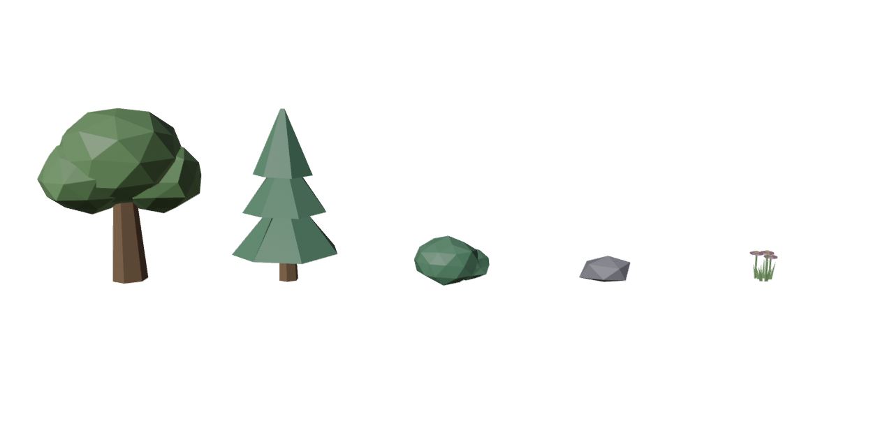

# Lobby decor kit (map polish, 2026-10-20)

Five small faceted props for the sky islands, built by `tools/blender/map_decor_kit.py` (own Blender scene, open file
untouched) and placed by `tools/studio/place_lobby_decor.luau`.

| Prop | Meshes (coloured in Studio) | Tris | Size (studs) | Open Cloud model |
|---|---|---|---|---|
| `Decor_TreeRound` | Trunk, Canopy | 260 | ~8 wide, ~10 tall | 112923572292891 |
| `Decor_TreePine` | Trunk, Leaves | 92 | ~6 wide, ~10 tall | 119942453672575 |
| `Decor_Bush` | Leaves | 160 | ~4 wide, ~2.6 tall | 121358676796724 |
| `Decor_Rock` | Stone | 20 | ~3 wide, ~1.4 tall | 108813216400441 |
| `Decor_FlowerTuft` | Grass, Petals, Centers | 180 | ~1.4 wide, ~1.7 tall | 127599498711858 |

- Origins at the ground centre, 1 unit = 1 stud, flat shading. Colours and SmoothPlastic are set in Studio (see
  `MESH_LOOK` in the placement script); the Blender colours are preview only.
- The models import in centimetres (100x); the placement script scales them by 0.01 with `Model:ScaleTo`.
- `decor_kit.blend` holds the review row; `decor_kit_preview.png` is a flat render of it. Upload records are in
  `roblox_assets.json` (`upload_list.json` re-uploads changed files only).

