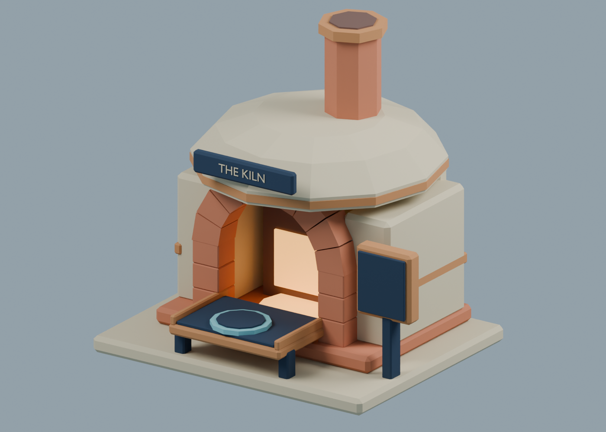
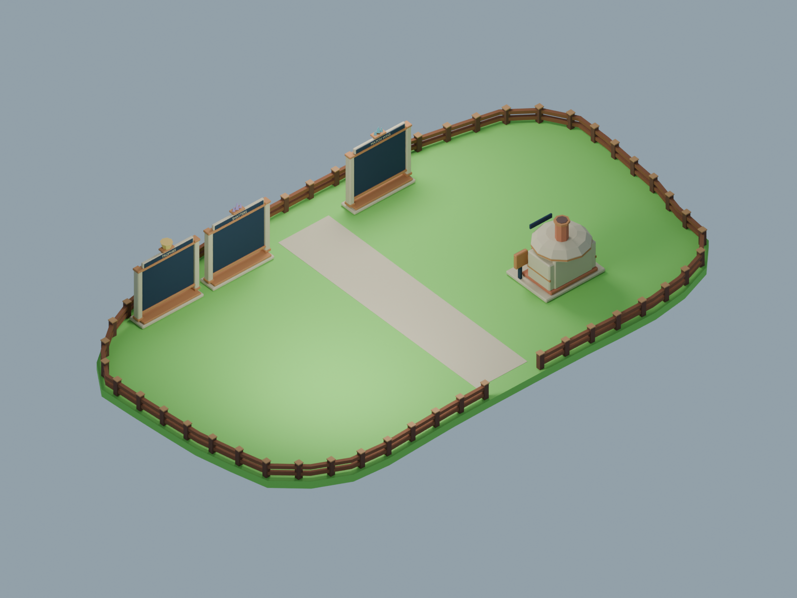
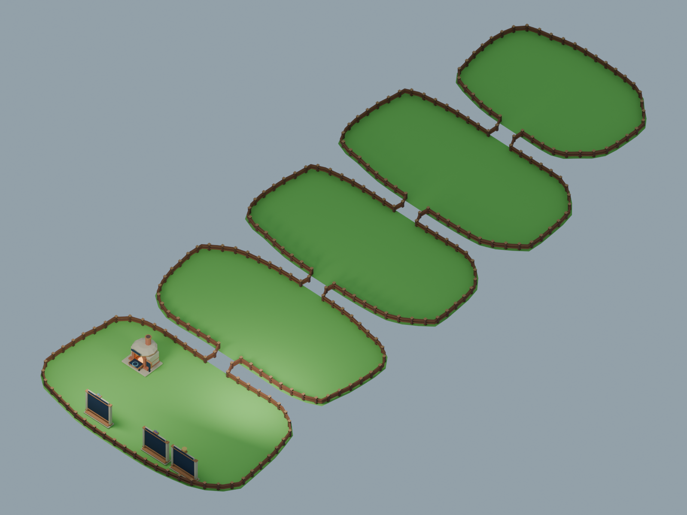
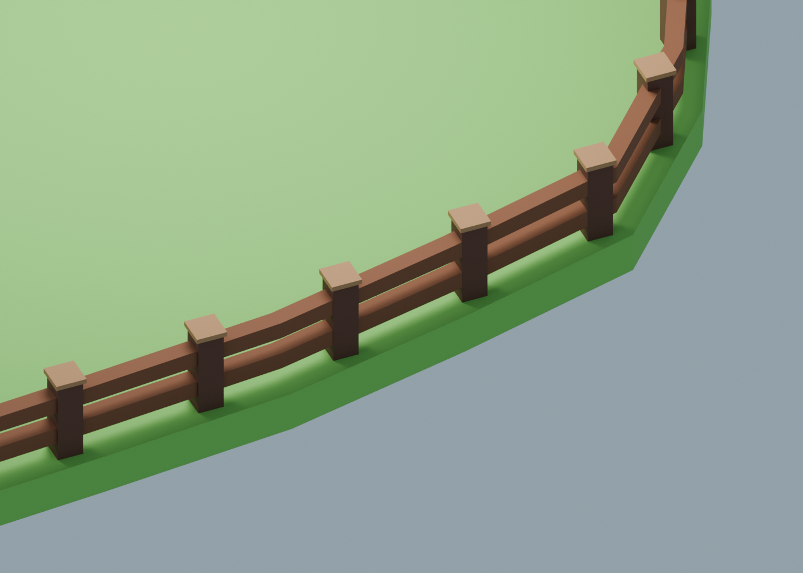

# Lobby v2 — installed art, approved fence alignment

Created 2026-10-14 through Blender MCP, then imported by the creator and placed through Studio MCP. **The creator approved the corrected fence alignment.** Studio remains in Edit mode; gameplay testing and publication are left to the creator. Native IDs/transforms are in `studio_assets.json`; the measured live grass rims are in `live_island_rims.json`. See [integration report](../../../../docs/testing/LOBBY_V2_INTEGRATION.md).

The original Blender-only build preserved the open scene and used the handoff's geometry snapshot. Subsequent native inspection found the old island imports had a baked 180° yaw relative to that source. The initial fence placement was therefore wrong despite matching bounding boxes. The corrected Studio fence set follows the live mesh geometry without moving islands, stands or paths.

## Ready to review

- `Kiln_Furnace.blend` / `.fbx`: original 1,528-triangle furnace with an actual recessed open chamber, nine arch bricks, faceted dome, short chimney, cooling tray, reveal seat and separate information display. 42 color-separated meshes.
- `Board_MatchWins`, `Board_Shatters`, `Board_Trophies`: three original stone/copper frames, distinct matte crests and unobstructed 10.2 × 7.8-stud display surfaces. 652 / 652 / 672 triangles. Titles and text in previews are **preview-only**, leaving production text editable in SurfaceGuis.
- `Fence_Isle_*`: five assemblies fitted to all 40 original grass-outline corners per island. Continuous mitered two-rail strips, 3-stud capped posts and bridge gates. Each assembly contains just three color-separated meshes. Posts follow arclength at spacing ≤5 studs; corners remain exact independently of post spacing.
- `Fence_Bridge1`–`4`: sloping rail assemblies meeting all island gate endpoints; endpoint posts belong to the island, avoiding duplicated surfaces.
- `lobby_v2_review.blend`: all isolated asset scenes plus plaza, full-row and fence-detail review scenes. `open_scene_before.blend` preserves the previously active Sky_Islands_Preview; its active scene was restored after work.
- `manifest.json`: mesh names, colors, materials, bounds, triangle counts and exact placements. `fence_geometry.json`: the continuous paths and post coordinates. `validation.json`: saved-source and export checks.






The plaza/row views show the new assets with exact flat grass footprints. Existing stands, kiosks, Champion spot, manual decor, rock undersides and clouds are omitted for clarity, not removed or proposed for deletion. The pale central route is a preview marker only. Generated UI concepts have more illustrative background detail than these actual models.

## Validation completed

13 FBXs, 13 isolated asset sources, 119 meshes, **12,688 triangles** total. Every saved mesh is closed/manifold with positive signed volume, no degenerate triangles and zero location/rotation plus unit scale. FBX round trips preserve mesh/vertex counts, zero origins and vertex positions within **0.000016 studs** (reported comparison rounds coordinates to five decimal places). The largest individual asset is the lobby perimeter at 1,872 triangles.

All island fence vertices are inside the actual source rim; the smallest horizontal clearance is approximately **0.18 studs**. Rail centerlines are inset 0.9 studs. Gates have 11-stud center spacing, 10.14 studs between post faces and 9.98 studs between decorative cap edges. Rail centers are 0.9 and 2.1 studs above the ground, with 0.6-stud rail thickness. All **16 bridge rail endpoints** match the island gates with zero coordinate error. The source outline file's SHA256 is recorded and checked.

These original Blender checks cover topology, export geometry and source-outline fitting. Native import size/orientation and fence fitting have since been corrected and inspected in Edit mode. Actual gameplay, queue approaches and phone rendering remain creator checks. The complete previous lobby and both earlier fence sets are preserved in ServerStorage backups.

## Reproduction and original import reference

**Already installed; do not rerun builders over the current place.** On a fresh matching place/import set, run `tools/studio/install_lobby_v2.luau` followed by `tools/studio/correct_lobby_v2_fences.luau`. Both refuse to repeat over their existing backups. The correction is essential: it aligns imported perimeter meshes to the live baked island orientation, uses native geometry cuts/closures at Lobby and Featured gates, and fits native bridge handrails and safety walls to the actual entrances. These Studio adjustments are not represented by the original FBX gate layout. The following import measurements remain useful when reconstructing the package.

1. Wait until Claude has handed over Studio. Save a local place backup. Inspect the current island meshes and existing props; the saved snapshot below must still match. Do not rerun old builders over manual work.
2. Import these 13 `.fbx` files into a staging folder named `LobbyV2Imports`. Preserve separate meshes and imported pivots; use **Studs / scale 1**, no model simplification or mesh merging. Anchor all meshes. No texture uploads are needed. Import one Kiln first and compare dimensions before the other bundles.
3. **Check measured bounds, not only the importer unit label.** The earlier Studio importer applied unexpected scale. Expected Roblox sizes before yaw: Kiln **12.35 × 12.17 × 10.92**; MatchWins frame **12.4 × 12.95 × 3.2**; lobby fence **95.0131 × 3 × 55.1966**. Other sizes come from `manifest.Bounds.Size` reordered `(X,Z,Y)`. If they differ, correct the importer/model scale uniformly as a group; never resize individual meshes independently.
4. Orient the art to the documented coordinate mapping: Blender `(x,y,z)` → Roblox `(x,z,-y)`. The Kiln's mouth is Blender −Y / Roblox +Z; its information display sits to the viewer's right (local +X). Boards have the same local front and receive 180° world yaw to face the lobby. Fence rims are intentionally asymmetric; do not rotate or mirror them to look more rectangular.
5. Each asset's common source origin is zero, although its bounding-box center is usually offset. **Do not use Center Pivot to place it.** If Studio has auto-translated the import, align its measured bounding-box center to the manifest's local center first. With `PrimaryPart` unset, set the model's `WorldPivot` to identity without moving geometry, then `PivotTo(CFrame.new(PivotRoblox) * CFrame.Angles(0, yaw, 0))`. This preserves the top-center/ground origins. Confirm one asset before bulk placement.
6. Apply each mesh's `Color` and `Material` from `manifest.json`; preview FBX materials are not the production color system. Use SmoothPlastic, Transparency 0, Reflectance 0. Only the two furnace meshes marked `Glow` use subdued Neon. All decorative meshes: Anchored=true, CanCollide=false, CanTouch=false. Use simple native collision for the Kiln footprint and board feet only if needed; no precise mesh decomposition.

| Asset | Roblox origin X / Y / Z | Yaw |
|---|---|---|
| Kiln_Furnace | −22 / 0.05 / −11 | 0° |
| Board_MatchWins | −14 / 0.05 / 21 | 180° |
| Board_Shatters | 14 / 0.05 / 21 | 180° |
| Board_Trophies | 28 / 0.05 / 21 | 180° |
| Fence_Isle_Lobby | 0 / 0 / 0 | 0° |
| Fence_Isle_Arena1 | 0 / 2 / −55 | 0° |
| Fence_Isle_Arena2 | 0 / 4 / −105 | 0° |
| Fence_Isle_Arena3 | 0 / 6 / −155 | 0° |
| Fence_Isle_Featured | 0 / 9 / −206 | 0° |
| Fence_Bridge1 | 0 / 1 / −29.9291363 | 0° |
| Fence_Bridge2 | 0 / 3 / −79.9992523 | 0° |
| Fence_Bridge3 | 0 / 5 / −129.8006287 | 0° |
| Fence_Bridge4 | 0 / 7.5 / −179.8924255 | 0° |

The manifest retains full precision, including insignificant floating-point X drift on Bridge4. Grass sizes are 96/1.4/56, 92/1.4/46 for the three arenas, and 72/1.4/48 for Featured. Grass rotations were identity. If live transforms or shapes differ, refit from updated geometry; do not stretch finished fence assemblies individually.

## Preserve gameplay bindings while replacing visuals

**Kiln:** keep `Workspace.Lobby.GlassClashProps.Kiln` and its descendant `OpenKiln` ProximityPrompt; `KilnService` locates them by name when starting. Archive a complete clone under a new `ServerStorage.Unsorted.LobbyV2Backup` folder before touching the old art. Add imported meshes as a `VisualsV2` child. Keep the prompt parent as an invisible anchored native interaction carrier, or move it to an equivalent native carrier inside the same Kiln model **before starting a new play session**. Place the carrier by the cooling tray, approximately (−22, 2.5, −6.8), out of the furnace opening. Preserve prompt attributes, distance/rate validation and the existing title anchor. The separate display is for the existing odds-first interaction; it does not change prices or eligible content. The reveal seat is local Blender (0,−4.02,2.24), approximately Roblox (−22,2.29,−6.98) after placement. Animation binding to this seat is future integration, not implemented by this asset export.

**Boards:** keep root names `Leaderboard_MatchWins`, `Leaderboard_Shatters`, `Leaderboard_Trophies` and each descendant `Entries` TextLabel. `LeaderboardService:Draw` finds those descendants and updates their text. Preserve live GUI objects; do not replace them with baked mesh lettering. Add the imported frame beneath the corresponding existing root, archive a complete clone first, and hide/archive only old visual geometry after transferring its GUI carrier.

A safe display setup uses an invisible native `Board` Part as SurfaceGui carrier, sized about 10 × 7.7 × 0.08, facing Roblox −Z. For the saved placement, center it around **(boardX, 6.20, 20.58)** so its front face lies slightly ahead of the imported screen; recheck for z-fighting. Preserve `Entries`. Move the existing `Title` label to a separate header carrier at approximately **(boardX, 11.0, 20.40)**, size 9.4 × 0.68 × 0.05, or keep the existing title in the main GUI until its layout is reviewed. Keep Montserrat and editable text. Display row layout and board readability still need an actual play test. The source crests are matte metric symbols; no paid-spending leaderboard is introduced.

**Fences:** retain every native `SafetyCollider` under `Workspace.Lobby.Fences` in place. Clone the complete existing fitted fence set to `ServerStorage.Unsorted.LobbyV2Backup` before changes. Add the new visuals separately under `Workspace.Lobby.FenceVisualsV2`, then hide only old visible posts/rails; leave colliders enabled. Keep the older `OriginalPerimeterFences` archive intact. New continuous rails may require a narrow safety-collider addition at an original outline corner where the old sampled rail path cut across it; assess after import rather than replacing collision automatically. Bridge deck/collision and all queue pads/stand hooks stay in place.

After integration, walk all 14 queue pads and all four bridges, test the island edges and fall rescue, inspect arena swings for fence occlusion, verify Kiln prompt/odds/reveal and all three leaderboard updates, then check phone presets. Record installed mesh IDs and revised transforms separately. Save/publish remains a creator action.

## Reproduce

Run in a fresh Blender scene or a separate background Blender process to avoid global naming collisions on repeated builds. The script creates new scenes and restores the previously active one; it never clears pre-existing scenes. The built-in glassclash helper is loaded by the builder.

```python
import os
os.environ['GLASSCLASH_REPO'] = r'C:\Users\charl\Documents\CrystalCoveBlenderWork'
p = os.path.join(os.environ['GLASSCLASH_REPO'], 'tools/blender/build_lobby_v2.py')
ns = {}
exec(compile(open(p).read(), p, 'exec'), ns)
ns['build_lobby_v2']()
ns['render_lobby_v2']()
q = os.path.join(os.environ['GLASSCLASH_REPO'], 'tools/blender/validate_lobby_v2.py')
qa = {'__file__': q, '__name__': 'lobby_v2_qa'}
exec(compile(open(q).read(), q, 'exec'), qa)
qa['validate_lobby_v2']()
```

Generated interface images and exact prompts: [UI concepts](../../../../docs/ui/concepts/lobby_v2/README.md). They are visual references; no image is uploaded or bound to a ScreenGui.
