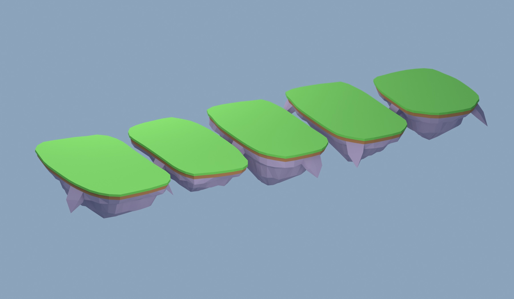

# Crystal Isles — island platforms (Part A)

Five islands, each with exactly three separate meshes: `_Grass`, `_Dirt`, `_Rock`.
Only platform geometry is included. Studio placement and collision are Part B.

## Import into Studio

1. **Back up the current place first:** File > Publish to Roblox (version history keeps it), and/or File > Save to File As… `places/pre_sky_backup.rbxl`.
2. File > Import, select the five `Isle_*.fbx` files in this folder. Use the glassy import settings: **Upload to Roblox**, **Add to Workspace**, **Import Only As Model**, **Scale Unit: Studs**, **Merge Meshes off**, **Use Imported Pivot**, **Anchored on**.
3. Leave the five models in Workspace where they land and tell Codex **“islands imported, backup done”**.

The exports are individually centred at zero, so imports may initially overlap. Their
layout is intentionally deferred to Part B. Keep their separate mesh names and imported
pivots. Check the Lobby grass footprint is **96 × 56 studs**, thickness **1.4 studs**;
the model pivot belongs at the top centre, not the centre of the rock volume.

## Contents and placement contract

| File / island | Grass size (Blender X × Y) | Total depth | Hanging chunks | Part B top-centre position (Roblox X, Y, Z) |
|---|---|---|---|---|
| `Isle_Lobby.fbx` | 96 × 56 | 33 | 3 | (0, 0, 0) |
| `Isle_Arena1.fbx` | 92 × 46 | 30 | 2 | (0, 2, −56) |
| `Isle_Arena2.fbx` | 92 × 46 | 34 | 4 | (0, 4, −107) |
| `Isle_Arena3.fbx` | 92 × 46 | 31 | 3 | (0, 6, −158) |
| `Isle_Featured.fbx` | 72 × 48 | 32 | 3 | (0, 9, −210) |

- `sky_islands.blend`: five asset scenes plus `Sky_Islands_Preview`, which instances
  the island collections at the layout positions. Choose an `_Asset` scene to edit
  its three meshes at zero. Cameras, lights and preview instances are not exported.
- `manifest.json`: measured per-mesh triangle counts, local bounds in studs, origins,
  and intended positions in both coordinate systems.
- `preview.jpg`: rendered row, Lobby at the near left and Featured at the far right.
- `validation.json`: saved source and FBX round-trip check results.

**Coordinates:** Blender `(x, y, z)` → Roblox `(x, z, −y)`. One Blender unit equals
one stud. Every source mesh has identity transforms and its origin at `(0, 0, 0)`,
the grass surface centre. All upward grass faces are exactly at local Z = 0.
The grass slab is 1.4 studs thick; the dirt band is 2.5 studs thick and inset about
0.5 studs at the cardinal edges. The rock begins at Z = −3.9.

Grass, dirt and rock are separately closed, outward-facing triangular meshes meeting
at layer boundaries. Each rock's hanging chunks branch directly from its surface;
there are no intersecting primitive solids or buried faces within the rock mesh.
All geometry is flat-shaded. Three different seeds, ledge profiles, depths and chunk
counts distinguish the arena variants. Featured uses a rounder exponent of 3;
the other four use exponent 4 with a gently irregular rim.

## Colour and collision in Part B

Blender uses untextured matte preview materials. Set final colours and materials in
Studio per DECISIONS 14: Grass `#7CCB5B`, Dirt `#9A6B43`, Rock `#9787A0` (or darker
`#6E6180` if desired). The preview's `#5DA845` grass sides are a face material on the
same grass mesh; they are not an additional independently colourable MeshPart.
The three mesh-level Studio colours remain independent. No colour textures are needed.

Part B will disable visual-mesh collision and add simple invisible platform colliders,
then place the islands. This package does not include collision helpers or props.

## Rebuild

Run `tools/blender/build_sky_islands.py` in a fresh Blender session, with
`GLASSCLASH_REPO` pointing to this checkout if necessary. It loads
`tools/blender/glassclash_blender.py` and calls its unchanged `export_fbx` settings
(`-Z` forward, `Y` up, unit scale applied, baked axis transform, face normals,
triangulation). It preserves pre-existing scenes and refuses to overwrite named
island objects in the live session. Render `Sky_Islands_Preview` to refresh the JPEG.

Run `tools/blender/validate_sky_islands.py` with Blender `--background --factory-startup`
to check the saved source and all FBX round trips. Final checks: **4,210 triangles
total, 536 maximum per mesh**, flat grass tops, closed manifold meshes, consistent
outward normals, no nonadjacent face intersections, and maximum FBX vertex error
below **0.000005 studs**. Repository tests: **51 passed, 0 failed**. Studio import
and collision checks are deferred to Part B.
