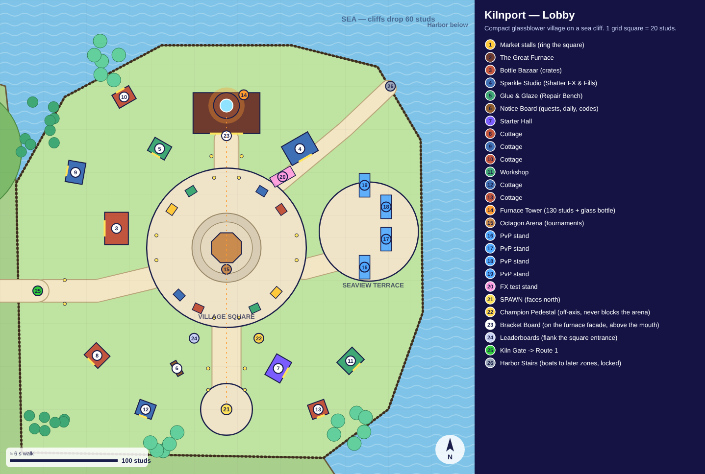
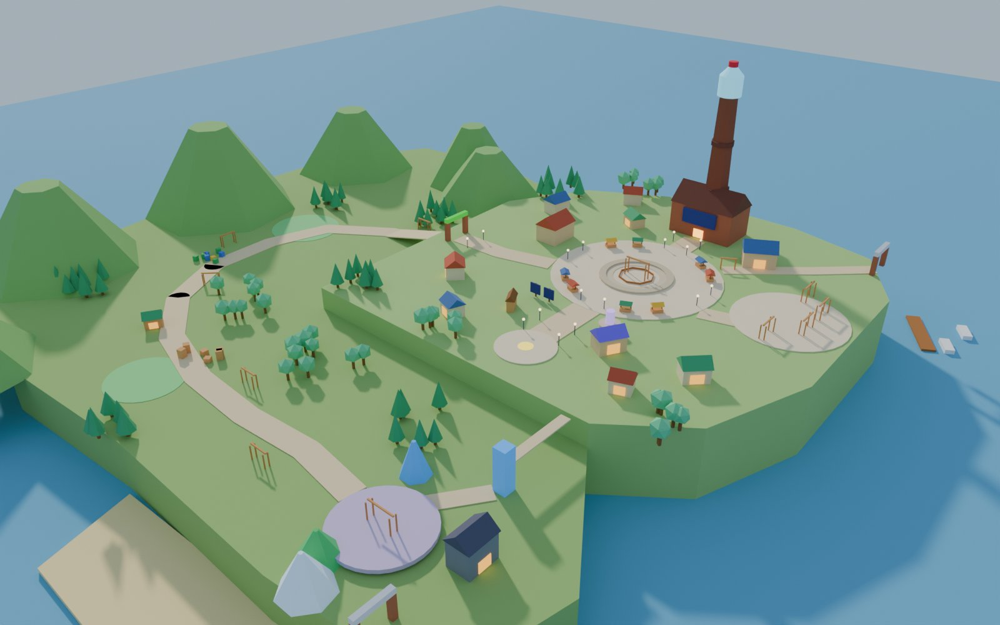
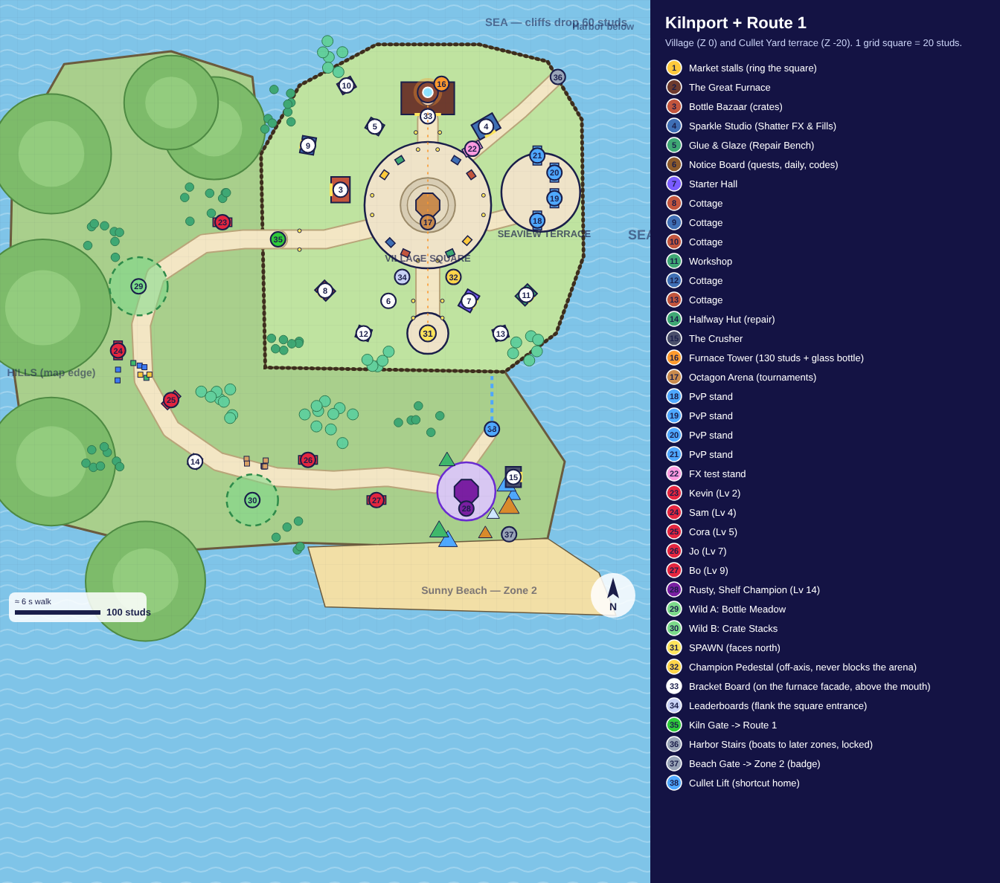
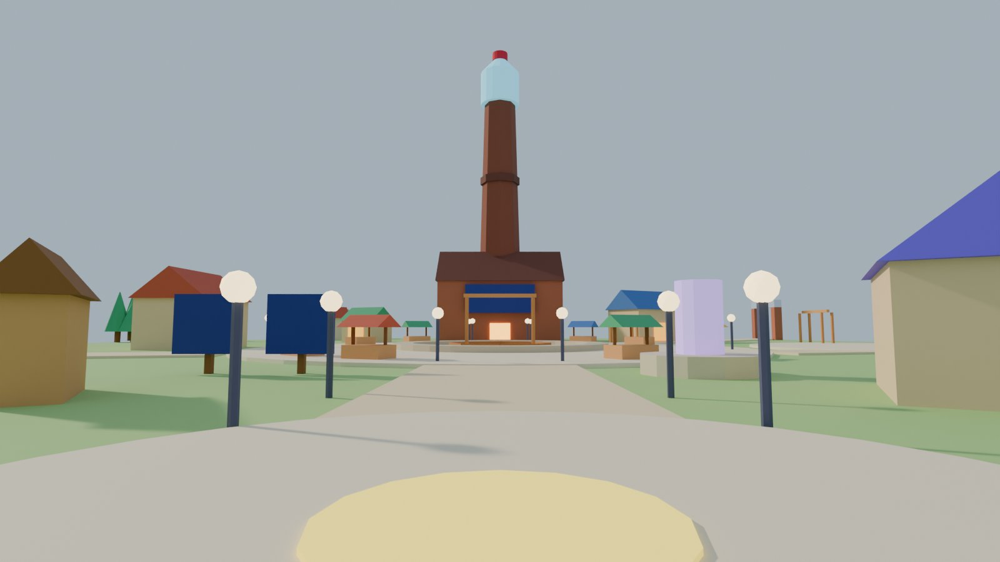

# Map Blueprint: Kilnport + Route 1 (Cullet Yard)

**Replaces the first-pass layout** in `assets/blender/map/first_pass` (flat slab, no landmark, sparse). Chosen with the user on Oct 12:

| Question | Choice |
|---|---|
| Theme | **Glassblower village** ("Kilnport", name is a placeholder) |
| Setting | **Seaside cliff**: sea and cliffs on the north and east, hills on the west |
| Landmark | **Giant glass furnace tower** with a glass bottle on top, visible from everywhere |
| Arena | **Center of the village square** |
| Lighting | **Warm golden afternoon** |
| Layout | **Compact hub + walkable Route 1**; later zones through portals (harbor boats) |
| Scope | Lobby + Zone 1 |

| Blueprint | 3D blockout |
|---|---|
|  |  |
|  |  |

- **Data:** `tools/map/village_layout.py` (single source of truth, studs)
- **Redraw blueprints:** `python tools/map/make_blueprints.py`
- **Build the blockout in Blender:** open `tools/blender/blockout_village.py` in the Scripting tab and click Run (see section 6)

## 1. Why this layout works

1. **First 5 seconds:** you spawn on the Arrival Steps facing north and see, front to back: Main Street with lamps, the Village Square with the Octagon Arena, the glowing furnace mouth with the bracket board above it, and the 130-stud tower with its glass bottle. The Champion Pedestal and leaderboards sit just off the center line, so they're seen but never block the arena.
2. **Natural edges:** cliffs and sea on two sides, hills and trees on the others. No invisible walls, no "slab in the void".
3. **Everything within ~10 s:** spawn → arena 135 studs (8 s), spawn → Kiln Gate ~190 studs (12 s), at walk speed 16.
4. **The story is in the map:** the Cullet Yard collects broken glass (*cullet*), a conveyor carries it up toward the furnace, and the furnace makes new glassies. The route even loops back home via the Cullet Lift.
5. **Height:** village at Z 0, yard terrace at Z −20, sea at Z −60. Walking down into Route 1 feels like going somewhere.

## 2. Lobby: Kilnport (about 360 × 380 studs)

| # | Place | Position (X, Y) | Size | Notes |
|---|---|---|---|---|
| Spawn | Arrival Steps | (0, −150) | r 24 plaza | Spawn faces **north** |
| — | Main Street | (0, −150) → (0, −72) | 26 wide | Lamps both sides |
| — | Village Square | (0, 0) | r 74 | Cobblestone, 8 market stalls on the rim, lamps |
| Arena | Octagon Arena | (0, 0) | pen r 15, seats r 20–32 | Tournament finals; two low seat rings |
| Landmark | The Great Furnace + Tower | (0, 125), tower (0, 132) | hall 62 × 38 × 30, tower 130 + 30 bottle | Glowing mouth faces the square. **Bracket board** on the facade above the mouth. Kiln (evolution) inside later |
| Shop | Bottle Bazaar (crates) | (−102, 18) | 30 × 22 | Odds board by the door |
| Shop | Sparkle Studio (Shatter FX, Fills) | (68, 92) | 28 × 20 | FX test stand outside at (52, 66) |
| Service | Glue & Glaze (Repair Bench) | (−62, 92) | 18 × 14 | Reverse-shatter repair |
| Service | Notice Board (quests, daily, codes) | (−46, −112) | small kiosk | On the way from spawn |
| Service | Starter Hall | (48, −112) | 22 × 16 | New players pick Pop / Jam / Prism (M2) |
| Social | Champion Pedestal | (30, −84) | r 9 | Off-axis on purpose |
| Social | Leaderboards | (−30, −84) | 2 boards | Mirror the pedestal |
| PvP | Seaview Terrace | (132, 15) | r 46, 4 stands | Facing the sea: the best clip backdrop |
| Exit | Kiln Gate → Route 1 | (−175, −40) | arch over a 22-wide ramp | Ramp drops 20 studs to the yard |
| Locked | Harbor Stairs | (152, 150) | stairs down the cliff | Boats = portals to later zones |
| Decor | 6 cottages + workshop | see layout | 16–20 wide | Fill the gaps; glowing windows |

## 3. Route 1: Cullet Yard (about 650 studs, ~40 s of walking)

Kiln Gate → down the ramp → **Kevin** (Lv 2) → **Wild A: Bottle Meadow** → **Sorting Lane** with colour-sorted bins: **Sam** (Lv 4), **Cora** (Lv 5) → **Halfway Hut** (repair) → **Wild B: Crate Stacks** → **Crusher Hill**: **Jo** (Lv 7), **Bo** (Lv 9) → **The Cullet Pit**: **Rusty** (Lv 14) on a raised platform ringed by **mountains of crushed coloured glass** (green, amber, clear, blue) next to **The Crusher** machine.

After Rusty:
- **Cullet Lift** (75, −262) carries you back up to the village (shortcut home).
- **Beach Gate** (95, −385) leads down to Sunny Beach (Zone 2) once you have the badge.

Each trainer has their own Clash Stand just off the path, facing it. Wild areas are open grassy pockets between trees and props.

## 4. Look and lighting

- **Village palette:** warm cream walls, terracotta / blue / green roofs, honey wood, brick-red furnace, glowing orange windows. Matte everything; **only glassies, lamps, the tower bottle and cullet piles are glossy or glowing.**
- **Yard palette:** the same grass and wood plus recycling-bin blue, green and yellow, and sparkly cullet colours.
- **Roblox lighting (golden afternoon):** `ClockTime` ≈ 16.6, `GeographicLatitude` ≈ 35 (sun from the west-south-west), `Atmosphere` density ~0.3 with warm haze, `ColorCorrection` slight warm tint (+0.1 saturation), `Bloom` low (intensity ~0.4, threshold ~1.5), `SunRays` subtle. Lamps and furnace use `PointLight`s.
- **Colours are set in Studio** (DECISIONS #14). Blender preview colours just guide you.

## 5. Kit to model in Blender (low-poly, flat-shaded)

| Group | Pieces |
|---|---|
| Village | 3 cottage sizes (swap roof colours in Studio), workshop, shop front, market stall, lamp post with glass globe, bench, flower box, cobble path tiles, low stone wall, cliff railing, Kiln Gate arch |
| Landmark | furnace hall, chimney segments (stackable bands), giant glass bottle top, glowing mouth, bracket-board frame |
| Nature | pine, round tree, bush, rock (3 sizes), cliff faces (stackable), hill |
| Yard | recycling bins (3 colours), bottle crate, pallet, conveyor belt segment, cullet pile (3 sizes), Crusher machine, Halfway Hut, lift tower |
| Coast | dock, small boat, beach rocks |

Keep each piece under its triangle budget (ART_BIBLE 1). Reuse pieces as linked duplicates.

## 6. How to build it yourself (step by step)

1. **Blockout:** in Blender, Scripting tab → Open `tools/blender/blockout_village.py` → Run Script (leave `REPO` empty; it finds the folder itself). You get every building, path, stand and landmark as a grey box at true stud scale, in the `Blockout` collection.
2. **Walk it in Studio first:** export the blockout (or the parts you're unsure about) as FBX, import it, and walk it with a character. Check the spawn view and the timings in section 1 before modelling anything detailed.
3. **Model the kit** (section 5) in a separate `kit_village.blend`, one piece at a time.
4. **Replace the boxes:** place kit pieces on top of the blockout, then hide the `Blockout` collection.
5. **Export in chunks** (village center, village edges, yard 1–3, Cullet Pit), import into `Workspace.Map`, and set colours and materials in Studio.
6. **Gameplay markers:** ask Codex to tag spawn, trainer stands, wild areas, repair benches and gates using the positions in `village_layout.py`.

## 7. Open questions

- Village name: **Kilnport**? Alternatives: Glimmerhaven, Glassport.
- Should the Harbor (boats to later zones) be visible at launch with a "coming soon" sign? (Recommended: yes, it teases updates.)
