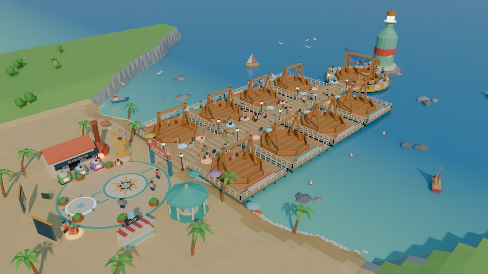
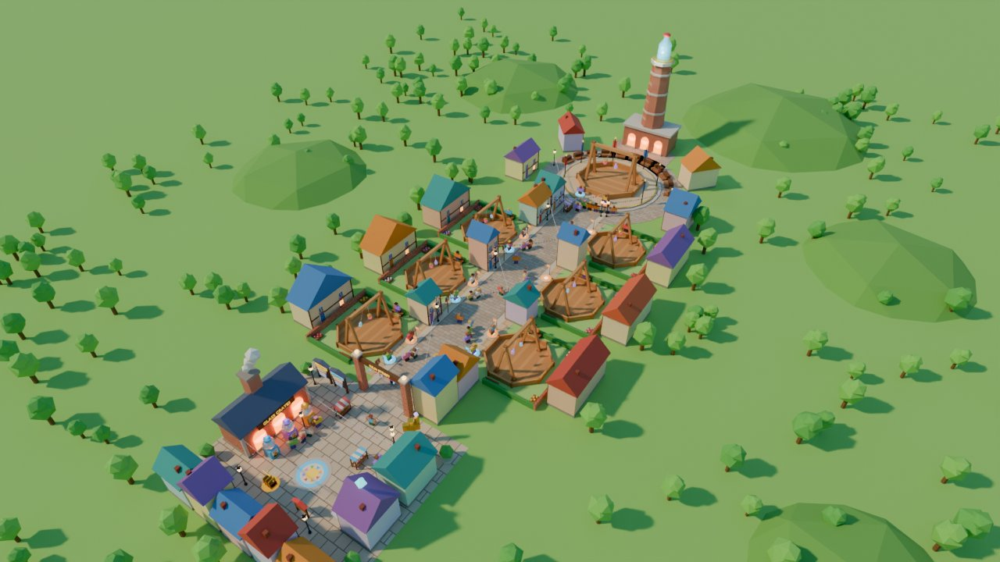

# Map Plan: the lobby (v0.3)

One compact, **linear** lobby: spawn → a walkway lined with **8 arenas** (4 each side) → a **featured arena** at the far end. Everything within ~13 s of walking (16 studs/s). The arenas face the walkway so walking past means watching fights. Built **mostly in Studio from parts**, with a short list of Blender hero pieces.

Four concepts were built and rendered in Blender with the real Clash Stand and glassies, then judged on game flow, looks, thumbnail power, Studio buildability, mobile performance and theme fit. Each folder has the renders, a full `CONCEPT.md` (layout in studs, palette, lighting, Studio vs Blender list, risks) and the `build.py` that made it (`tools/map/concepts/<slug>/`).

| | Concept | Score /60 | One line |
|---|---|---|---|
| **1** | **[Toy-Sized Kitchen](concepts/giant_kitchen/CONCEPT.md)** (recommended) | **49** | Toy-sized on a sunny kitchen counter; arenas on pastel cutting boards along a tea-towel runner |
| 2 | [Glassblower's Boardwalk](concepts/boardwalk/CONCEPT.md) | 44 | Beach plaza and a "Clash Pier" out to sea with a sea-glass bottle lighthouse |
| 3 | [Crystal Isles](concepts/crystal_isles/CONCEPT.md) | 43 | Floating islands over clouds joined by bridges, crystals underneath |
| 4 | [Kiln Street](concepts/kiln_street/CONCEPT.md) | 36 | Glassblower village street with arenas in courtyards and a furnace chimney |

| Kitchen | Boardwalk |
|---|---|
|  |  |
| **Crystal Isles** | **Kiln Street** |
|  |  |

## Recommendation: Toy-Sized Kitchen

- **It tells the game's story.** Glassies are everyday bottles and jars, so of course they battle on a kitchen counter. Every lobby function is a prop kids already know: the **Kiln is the oven** (glowing door, glassblowing reveal), the toaster is the shop, the cookie jar is the daily reward, the spice rack is the Index, recipe cards are leaderboards.
- **Clearest layout** of the four: one straight runner, color-coded boards with numbered toothpick flags, bottle-cap queue pads (blue = side A, orange = side B).
- **Easiest to build in Studio**: big slabs, cylinders and balls; ~550 parts plus stands. The room walls enclose the play space: no horizon, water or falling-off-islands problems (just one open counter edge).
- **Glassies stay the only shiny thing**: matte pastel world, wooden pens stand out on colored boards.

**Fix while building** (from the review):
1. **More contrast:** the spawn view is washed out. Deeper board colors, a bold red-and-white runner, saturated cabinets, ColorCorrection contrast up a little.
2. **Clear the spawn sightline:** move the leaderboards and the champion beside or behind spawn; shrink the placemat and move spawn ~20 studs closer to arena 1.
3. **Keep giant props back** from the runner and matte (no glass), so they don't dwarf the glassies.
4. Invisible wall along the open counter edge + a fall teleport back to spawn.

**Grafts from the others:** a big "CLASH COUNTER" arch over the start of the runner and guide stripes from spawn (boardwalk); a full bleacher ring around the featured tray (boardwalk); a glass landmark at the far end, e.g. a giant juice pitcher by the clock (boardwalk's lighthouse idea); floating free/busy markers above each pad and a more saturated Roblox palette (crystal isles); one soft spotlight per stand and a post-match "back to lobby" button (kiln street). **Don't** take the cottage density, neon crystal clutter, or wood-on-wood decks.

**If you'd rather have outdoors:** the boardwalk has the best spawn view and the strongest landmark; it needs pier color contrast and a swimming/respawn decision. Crystal isles makes the best thumbnail but the theme is generic and it needs the most Blender work.

## Game-wide finding: glassies are too small at true scale

All four concepts showed it: glassies are ~2.5 studs, hanging ~10 studs up under a 17-stud stand, so they read as specks from the walkway. Fix (DECISIONS 30, Proposed): show glassies **1.75× bigger** in arenas on 7-stud strings, hooks moved from ±1.5 to ±3 on the crossbar (`Balance.Motion`). Codex tunes the exact scale by eye in F1. Floating name + hearts labels above running fights also help spectators.

## Kitchen: build list

Full layout (studs), palette and lighting are in [concepts/giant_kitchen/CONCEPT.md](concepts/giant_kitchen/CONCEPT.md).

| In Studio (parts) | In Blender (small lathe kit, ~1 h each) |
|---|---|
| Counter slab, cabinets, backsplash and walls (tiles as one `Texture`, never one part per tile), window + Neon garden backdrop | Kitchenware kit: mug, canister, kettle, utensil crock, fruit bowl, cookie jar |
| Tea-towel runner, woven placemat, cork spawn coaster | Oven/Kiln front (if parts look too boxy) |
| Cutting boards (8), bottle-cap pads, toothpick flags, recipe-card leaderboards, sticky-note codes board | Featured serving tray (raised rim) |
| Toaster shop, spice-rack Index, plate-stack bleachers, wall clock, fridge, rolling pins, lemons | Cake stand for the champion |
| **Clash Stands**: existing model (hooks moved, DECISIONS 30) | (optional) bottle-cap pad as one MeshPart |

**Order:** blockout the counter, runner, boards and pads first (F2) and play a match on it; then the room shell; then props; Blender kit last.

**Performance:** ~25 parts per arena, 5 materials (SmoothPlastic, Wood, Fabric, Glass for glassies only, Neon for pad rings/window), `StreamingEnabled`, decorative pieces `CanCollide/CanQuery/CanTouch = false`, Box collision on meshes.

## Next step

You pick the concept (or a mix). Then, in F2, Codex builds the blockout in Studio from the chosen `CONCEPT.md` layout table.
