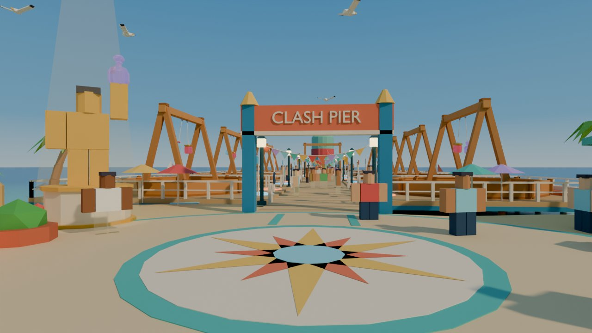
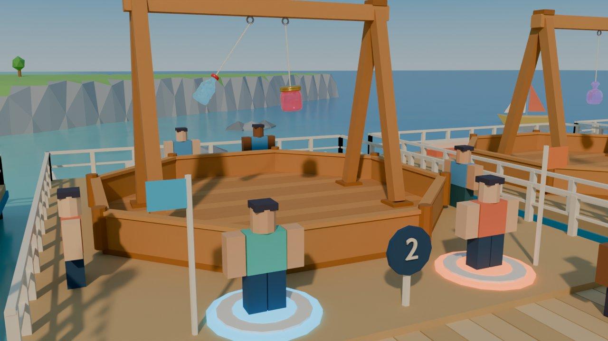

# Map concept: Glassblower's Boardwalk


| Spawn view | Arena close-up |
|---|---|
|  |  |

Renders come from `tools/map/concepts/boardwalk/build.py` (headless Blender, Cycles). The Clash Stand and the pop / jam / prism glassies in the renders are the real repo assets. Everything else is placeholder block-out at the correct stud scale.

## Pitch

A sunny beach town where a glassblower's workshop sits on a sand plaza and a long wooden pier runs out over a sparkling sea. Eight Clash Stands sit on platforms along both sides of the pier, four per side. The pier ends at a round Featured stage under a lighthouse shaped like a giant sea-glass bottle. You spawn, grab a crate at the kiln and walk down the pier. Each arena you pass has two glowing pads, and you step on one to fight.

## Why it fits the game

- **One straight line.** The core loop is "walk to an arena and step on a pad", and a pier makes that obvious with no menus. From spawn you see the arch, the row of stands and the lighthouse at the end.
- **Glass belongs here.** Beach glass, bottles on a pier, a glassblower's kiln and a bottle lighthouse all fit the bottle-to-fantasy-glass theme. The setting needs no extra explanation.
- **Easy to watch.** Every pen faces the walkway, so people walking past see the hanging glassies at head height and up (about 8 to 11 studs above the deck). Each platform has railings at the sides and a small two-step bleacher at the back.
- **Matte world, glossy heroes.** Wood, sand and painted trim are all flat and matte. The water and the glassies are the only shiny things. The lighthouse is deliberately frosted (high roughness) so it does not compete with the glassies.
- **Mostly parts.** Planks, pads, rails, lamps, booths and boards are all boxes and cylinders. Only about six props really need Blender.

## Layout (studs; +X = out to sea, +Y = north)

```
                         N (+Y)
   dunes / trees          ^
  ----------------------- |  ------------------------------------------------------------
   WORKSHOP+KILN (-36,40) |                                                     . rocks
   [G][B][P] crate machines (-45..-27, 26.5)
      CODES  (-58,16)   * CHAMPION (-12,24)      +-36-+    +----+    +----+    +----+
                                                 | 1  |    | 2  |    | 3  |    | 4  |  y +8..+51
LEADER  (     SPAWN  (  *sunburst )   ARCH  ====|o  o|====|o  o|====|o  o|====|o  o|====( FEATURED )  (BOTTLE
BOARDS  (    (-48,0) (  (-24,0)   )   x=-2  ====|o  o|====|o  o|====|o  o|====|o  o|====(  r=27    )  LIGHT-
(-68,+-14)    plaza disc r=27 @(-30,0)           | 5  |    | 6  |    | 7  |    | 8  |  y -8..-51  ( x=202    )  HOUSE
      CHEST  (-58,-16)                           +----+    +----+    +----+    +----+               x=246)
   SHOP  (-40,-38)      GALLERY (-12,-38)        x=28      x=68      x=108     x=148
  ---------- beach / shoreline x~4..18 ---------------- sea ----------------------------------
                                                    o = queue pad (blue = Hook A side, orange = Hook B side)
```

| Element | Size / position |
|---|---|
| Clash Stand (measured) | 28.7 × 28.7 footprint (octagon pen floor 27.7 across), 17.4 tall. Crossbar 22 long. Hooks at local x = ±1.5, z ≈ 15.0–15.7. Legs at x = ±10. Pen walls 2.4 high. Strings 5 long (`Balance.Feel.StringLength`), so glassies hang about 8–11 studs above the pen floor. |
| Walkway | 16 wide, x = −6 … 178 (184 long), deck top at z = 3.1 (sand is 2.9) |
| Arena platforms | 36 × 43 each, raised 0.4 above the walkway, 40-stud pitch (4-stud water gaps between them). Pen centres at x = 28 / 68 / 108 / 148 and y = ±30. The front of each pen is 7.7 studs from the walkway edge. |
| Queue pads | Radius 2.9, at (arena x ± 7, ±11.9), one in front of each hook. Blue = Hook A, orange = Hook B. A team-colour flag on a 7.5-stud post marks each pad, and a numbered roundel (1–8) stands between them. |
| Featured stage | Round deck r = 27 at x = 202, with a 3-tier bleacher ring (r 19.6–26.2) around the back 256°. The stand is scaled ×1.25 (≈ 36 across, 22 tall) and faces the walkway. Gold-trimmed pads at (180, ±9). |
| Bottle lighthouse | ≈ 57 tall, body radius ≈ 9.4, on a rock island at x = 246. Lamp room at the neck. |
| Plaza | Paved disc r = 27 at (−30, 0) with a teal ring, a sunburst mosaic r = 11.5 and teal guide stripes from spawn to the arch |
| Spawn | Pad r = 7 at (−48, 0), facing straight down the pier |

**Walking distances at 16 studs/s:** spawn → daily chest 19 studs (1.2 s), crates 29 (1.8 s), shop 35 (2.2 s), champion statue 43 (2.7 s), gallery 46 (2.9 s), Arena 1 pads 70 (4.4 s), Arena 4/8 pads 203 (12.7 s), Featured pads 228 (**14.3 s**, a little over the 220 target; see Risks).

## Player flow

1. **Spawn** (−48, 0) on the glowing pad, facing the CLASH PIER arch. The daily chest (left) and codes easel (right) are a few steps behind and to the sides. The leaderboards stand behind spawn, angled toward the plaza.
2. **Crates.** Turn left (north) to the Glassblower's Workshop. The three crate machines are mini-kilns in green / blue / purple tiers under a "GLASS CRATES" sign, with the real kiln glowing next to them. The Shop kiosk (striped awning, gem on top) and the Glass Gallery pavilion (collection index; your glassies on a tiered stand) are to the south.
3. **Arena.** Follow the teal stripes across the sunburst, past the champion statue in its spotlight, and through the arch. Arenas 1/5 are 4 s away. Step on any free blue or orange pad. When both pads are filled, the match starts in that pen. After about 15 s alone, a bot takes the other pad.
4. **Watch.** Everyone else on the walkway sees the fight at head height. Fans can stand on the platform sides or the back bleacher. The Featured stage at the end has a real bleacher ring for event and top-player matches.
5. **Back.** Walk back down the pier. The arch, the statue's beam and the kiln chimney mark the lobby. Later, a "Back to plaza" button could teleport players to spawn.

## Pieces: Studio parts vs Blender

| Piece | Build in Studio (parts) | Model in Blender |
|---|---|---|
| Clash Stand ×9 | | **Existing** `clash_stand.blend` (merge into 3–4 MeshParts per stand) |
| Walkway planks, stringers, pilings | ✔ (planks as 3 alternating-colour parts per 6 studs; pilings are cylinders) | |
| Arena platforms + blue trim band | ✔ | |
| Railings (posts + 2 rails) | ✔ (or one small Blender rail segment, repeated) | optional |
| Queue pads (3 stacked cylinders, Neon ring), flags, number roundels | ✔ (+ SurfaceGui number) | |
| Lamp posts (Neon lantern) | ✔ | |
| Bunting across the walkway | ✔ (Beam with a flag texture, or wedge parts) | optional single mesh |
| Back bleachers (2 steps) | ✔ | |
| Featured round deck + 3-tier bleacher ring | deck ✔ (cylinder) | **bleacher ring** (curved; 22 wedges in Studio also works) |
| Bottle lighthouse | | **✔** (lathe profile, label band, cork roof; ~600 tris) |
| Plaza disc, teal ring, guide stripes, spawn pad | ✔ (cylinders, thin parts) | |
| Sunburst mosaic | ✔ (Decal on a thin disc) | |
| Workshop building (gable roof) | ✔ (blocks + WedgeParts) | |
| Kiln dome + chimney | chimney ✔ | **kiln dome** (faceted dome with arched mouth) |
| Crate machines ×3 | body ✔ | **dome cap** (or Studio Ball part) |
| Shop kiosk with striped awning, gem | ✔ (gem = Blender or rotated block) | gem optional |
| Glass Gallery pavilion (8 columns, cone roof) | columns/floor ✔ | **octagonal cone roof** |
| Leaderboards ×2, codes easel | ✔ (+ SurfaceGui) | |
| Daily chest | ✔ (box + half-cylinder) | optional |
| Champion statue | ✔ (R15 rig of the #1 player, gold material, `HumanoidDescription`) | |
| Palms, round trees | | **✔** (2 palm + 2 tree variants, 100–300 tris each) |
| Boats, gulls, buoys | buoys ✔ | **✔ boats, gulls** (animated by a client script) |
| Rocks | | **✔** (3 low-poly rock variants) or Terrain rock |
| Beach, dunes, headlands, sea | ✔ **Roblox Terrain** (Sand, Grass, Rock, Water) | |

## Colour palette

| Use | Hex |
|---|---|
| Sand / wet sand | `#F2D59B` / `#E2BE7E` |
| Grass / dark grass | `#8BCB6B` / `#5FAE55` |
| Rock / dark rock | `#A3ABB5` / `#7D8794` |
| Deck planks (3-tone driftwood) | `#DDBE8E`, `#CFAE7C`, `#E6CB9F` |
| Beams / pilings | `#8C6142` / `#6E4C35` |
| Platform trim / arch | `#2F8FC0` |
| Featured gold trim | `#F2B83B` |
| Railings, strings | `#FBF5E8` |
| Plaza paving / tile ring | `#EFD9B0` / `#4FC3C0` |
| Lamp posts / lantern (Neon) | `#2C5D6B` / `#FFE6A3` |
| Pad A / Pad B (Neon) | `#3EC6FF` / `#FF8A4C` |
| Accents (bunting, awnings, roofs) | `#EF5B5B`, `#F27B5B`, `#FFD166`, `#4ECDC4`, `#C9A8FF` |
| Workshop walls / roof / brick / kiln glow | `#FFF4E2` / `#F27B5B` / `#C8664A` / `#FF8A3D` |
| Crate tiers | `#6CCB7E`, `#5AA9E6`, `#B084F5` |
| Signs / boards | `#26476B` |
| Lighthouse sea glass (frosted) / cork | `#86D9BE` / `#C9935B` |
| Water shallow → deep | `#7FE6D8` → `#2E93D1` |
| Glassy tints (glossy) | pop `#8FE3FF`, jam `#FF6B8B`, prism `#C9A8FF` |

## Roblox lighting (golden afternoon)

- `Lighting.Technology = Future` (per ART_BIBLE; low-end phones fall back automatically), `ClockTime = 16.3`, `GeographicLatitude = 25`. Point the sun from the south-west so shadows fall away from the spawn view.
- `Brightness = 2.8`, `Ambient = #7E8796`, `OutdoorAmbient = #A9C3D6`, `ColorShift_Top = #FFE2B8`, `ColorShift_Bottom = #2A3A4A`, `EnvironmentDiffuseScale = 0.5`, `EnvironmentSpecularScale = 0.9` (glass picks up sky reflections), `ExposureCompensation = 0.1`, `ShadowSoftness = 0.25`.
- `Atmosphere`: Density 0.28, Offset 0.15, Color `#C8E6F5`, Decay `#FFD6A0`, Glare 0.25, Haze 1.0.
- `ColorCorrection`: Saturation 0.12, Contrast 0.05, TintColor `#FFF6EA`. `Bloom`: Intensity 0.35, Size 24, Threshold 1.5. `SunRays`: Intensity 0.05.
- Terrain water: WaterColor `#2E93D1`, WaterTransparency 0.55, WaterReflectance 0.45, WaterWaveSize 0.12, WaterWaveSpeed 8. Paint a band of shallow Sand under the first 30 studs of water so it reads turquoise near the beach.
- Each Clash Stand gets one soft `SpotLight` (Shadows off, Range 24) aimed at the hooks, per ART_BIBLE section 4. The Featured stand and the champion statue get a stronger one.

## Performance notes

- **Stands dominate.** 9 stands × 55 parts is about 500 parts. Merge each stand into 3–4 MeshParts by material (wood, dark wood, light wood, metal) and keep the hooks as separate Attachments. Then the stands cost about 36 draw calls in total.
- **Planks.** Build the decking as 6-stud panels: one part plus a texture or 3 coloured strips, not 120 single planks. Pilings are decorative: `CanCollide = false`, `CastShadow = false` underwater.
- **Lights.** Neon lanterns instead of PointLights on the 12 lamp posts, or PointLights with `Shadows = false` on every other lamp. No more than about 10 shadow-casting lights in total (stand spots plus the featured stage).
- **Water.** Roblox Terrain water gives the sparkle for free and is cheaper than a reflective mesh. Keep the playable sea inside about 300 × 600 studs and fill the horizon with a flat, non-colliding water-coloured plane.
- **Streaming.** The whole map is about 300 × 120 studs of playable space, so StreamingEnabled with a 256-stud target radius keeps all arenas loaded from spawn. Use `ModelStreamingMode = Atomic` for stands so a stand never appears half-loaded.
- **Ambient life.** Gulls and boats are client-only and move by CFrame tweens. Pause them when out of view.
- **Materials.** Only about 6 materials are needed: SmoothPlastic, Neon, Wood (optional), Glass for glassies, plus Terrain Sand/Grass/Rock/Water.

## Risks and weaknesses

1. **Long and thin.** The Featured pads are about 228 studs (14.3 s) from spawn, slightly over the 14 s target. Arenas 4 and 8 are 12.7 s away and will see less traffic than 1 and 5. Possible fixes: move spawn to x = −42 (saves 6 studs), tighten the pitch to 36 (saves 12), or add an "Auto-queue" button that sends players to the nearest free pad.
2. **Accidental queueing.** The pads sit only about 1 stud inside the walkway edge, so someone walking past could brush one. Mitigations: require standing on the pad for 1 s with a ring-fill animation, a short prompt, or move the pads 2 studs deeper (there is room before the pen wall).
3. **Water.** Kids will jump off the pier. Decide early: either railings plus invisible walls everywhere, or allow shallow swimming with ladders and a "splash" that respawns players on the beach. Terrain water swimming can distract from queueing.
4. **Similar wood tones.** The stand's red-brown wood sits on driftwood decking. The blue trim and pale planks separate them, but in Studio check that pens still read clearly from far away (or tint the platform tops differently).
5. **Spectating is front-only.** The best views are from the walkway. The side margins are narrow (about 3.7 studs), and the back bleacher looks at the backs of the glassies. A "Spectate" camera button for any running match would help small screens.
6. **Glassies are small.** At 2–2.5 studs, the hanging glassies are hard to see from more than about 2 arenas away. That is fine for players fighting (they get the battle camera) but weak for passers-by. Consider scaling glassies ×1.5 on stands or adding a floating name and heart billboard above each running pen.
7. **One-sided lobby.** All services are on the shore, so returning players have to walk back. A teleport button or a small kiosk halfway along the pier (between Arenas 2 and 3) would reduce that.

## Re-rendering

```
<bpyenv>/bin/python tools/map/concepts/boardwalk/build.py
# quick preview: BW_SAMPLES=8 BW_SCALE=50 BW_VIEWS=aerial ...
# save the scene: BW_SAVE=/path/boardwalk.blend ...
```
