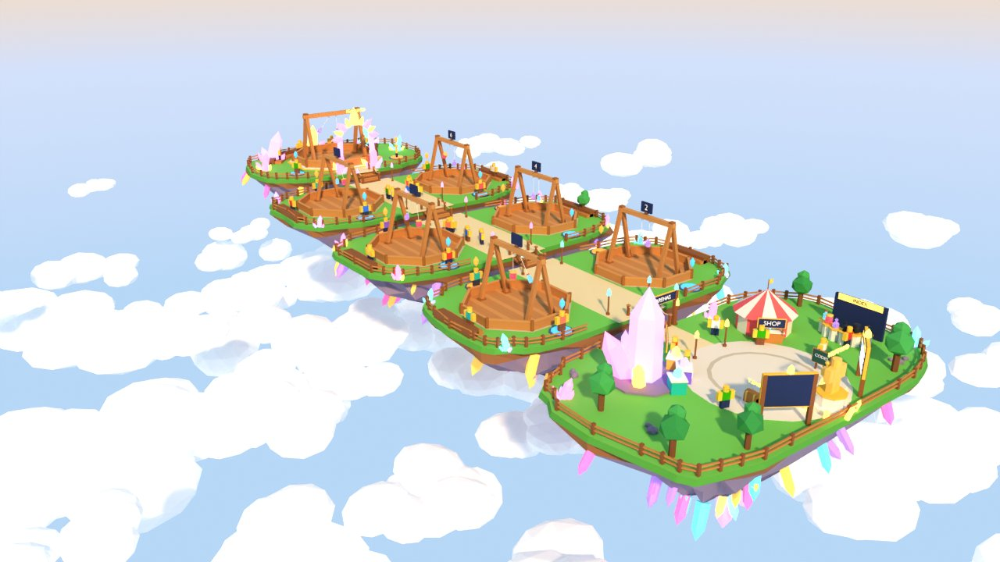
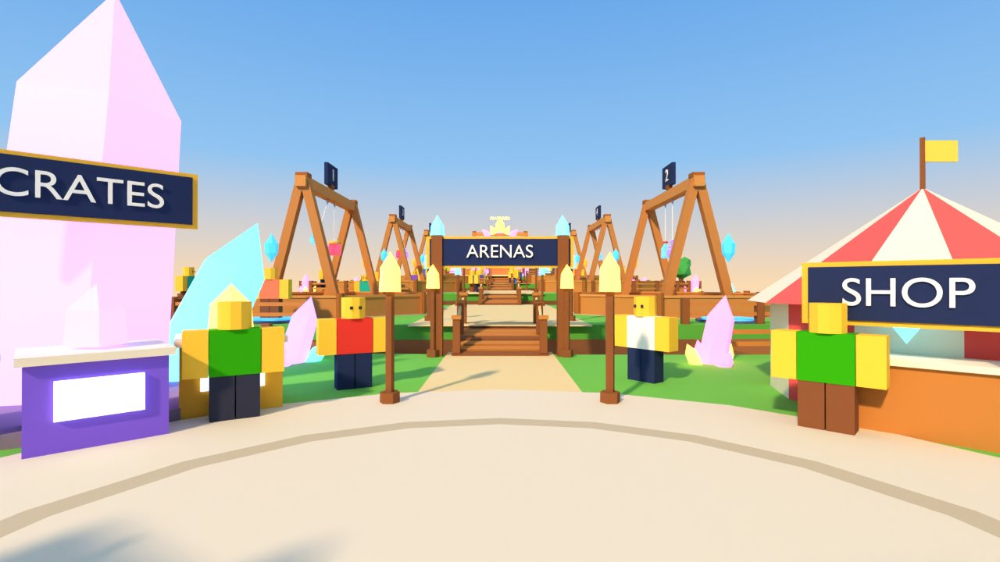
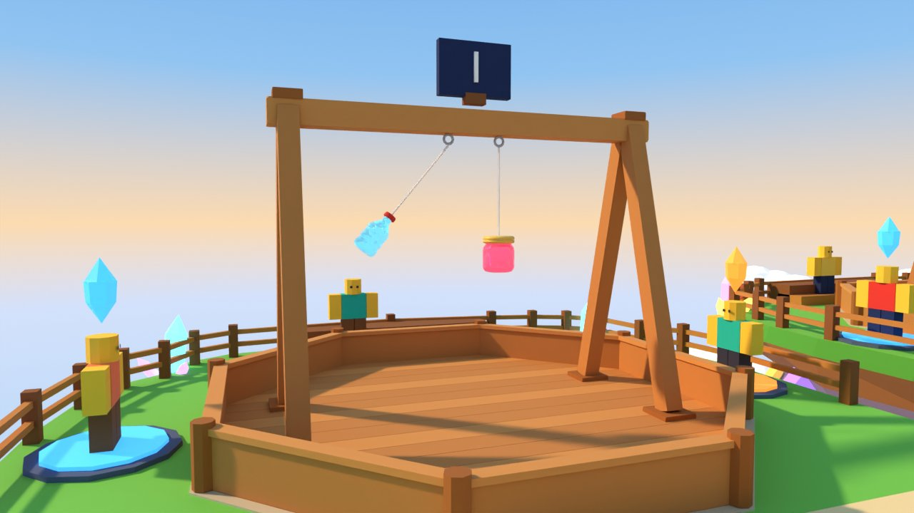

# Map concept: Crystal Isles



| Spawn view (eye height 6) | Arena close-up |
|---|---|
|  |  |

Rebuild the renders with `tools/map/concepts/crystal_isles/build.py` (headless bpy, Cycles, about 1 minute).

## Pitch

Glass Clash happens on a chain of small floating grassy islands high above a sea of clouds. The islands are joined by short wooden bridges, and glowing glass crystals grow out of the rocks. You spawn on the lobby island. A giant crystal holds the crate machines. You walk through the ARENAS gate and climb island by island past six numbered arenas, and at the top a crystal arch frames the bigger Featured arena.

## Why it fits the game

- **One straight line.** One walkway runs from spawn to the Featured arch, with the arenas numbered 1–6 on the left and right of it. Kids can't get lost, and the next free arena is always next to the path.
- **Glass world, glass toys.** The crystals echo the glassies without copying them. Crystals are matte or neon, and the glassies are the only glossy, see-through things.
- **Built-in spectating.** Each arena island has a 19-stud viewing walkway between its two pens. The stands are turned so the glassies swing *along* the row, so people on the walkway see every hit from the side (the best angle). Outer two-step bleachers add a second row.
- **Room to grow.** A new island makes a natural "update" or event venue, such as a seasonal crystal colour or a limited-time arena.
- **Mostly simple parts.** Island tops are flat slabs, and the props are boxes and cylinders. Blender is only needed for about 8 reusable meshes.

## Layout (studs)

The row runs along +Y (north). Every island top is flat. The islands step up 2–3 studs each, so from spawn you look up a gentle climb toward the Featured arch.

Measured **Clash Stand** (real asset): **28.7 × 28.7** octagon pen, frame **17.4** tall above the floor (17.8 including the 0.4 floor slab). The crossbar is 22 long, and the hooks are at x = ±1.5, z = 15.0. Glassies hang 5 studs below the hooks.

```
 y=234 +----------------- FEATURED ISLE  72x48  (z=9) ------------------+
       |      bleachers (2 tiers)      backdrop crystals                |
       |              +----------------------------+                    |
 y=210 |              |  FEATURED STAND  x1.15     |  33x33, 20 tall,   |
       |              |  gold-trim stage 0.6 high  |  swings along X    |
       |   [A]pad     +----------------------------+     pad[B]         |  pads (±22, 198)
 y=190 +------------------- \ CRYSTAL ARCH (24 tall) / -----------------+
                                  ||  bridge 8w, gap 5, +3 rise
 y=181 +------------------ ISLE 3  92x46  (z=6) -------------------------+
       |   [B]pad                    walkway               [B]pad        |  y=176.5
       |  ( ARENA 5 )   lamp      19 wide view     lamp   ( ARENA 6 )    |  y=158, x=±24
       |   [A]pad                                          [A]pad        |  y=139.5
 y=135 +---------------------------------||-------------------------------+
                                  ||  bridge +2
 y=130 +------------------ ISLE 2  92x46  (z=4) ---------  ARENAS 3 & 4 --+  centre y=107
 y=84  +---------------------------------||-------------------------------+
                                  ||  bridge +2
 y=79  +------------------ ISLE 1  92x46  (z=2) ---------  ARENAS 1 & 2 --+  centre y=56
 y=33  +---------------------------------||-------------------------------+
                                  ||  bridge +2
 y=28  +----------------- LOBBY ISLE  96x56  (z=0) -----------------------+
       |  champion*  CRATE CRYSTAL      [ARENAS gate y=26.5]  SHOP TENT   |
       |   (rocks)   (-22,11) 3 machines      path          (22,11)      |
       |                       ( plaza r=19 )                 INDEX arc   |  (38,-5)
       |   DAILY (-12.5,-12)    (SPAWN 0,-12)      CODES (12.5,-12)       |
       |    TOP WINS (-14,-21)  CHAMPION (0,-22.6)  TOP STREAK (14,-21)    |
 y=-28 +-------------------------------------------------------------------+
            x=-48                       x=0                        x=+48
```

| Measure | Value |
|---|---|
| Whole map footprint | 96 × 262 studs (x −48…48, y −28…234), plus clouds |
| Lobby island | 96 × 56, top z = 0, spawn at (0, −12), plaza radius 19 |
| Arena islands (×3) | 92 × 46, centres y = 56 / 107 / 158, tops z = 2 / 4 / 6 |
| Arena stands | x = ±24, rotated 90° (swing axis along the row), 0.1 above the grass |
| Queue pads | radius 3.3 (glowing disc radius 2.7), 18.5 from the stand centre along the swing axis; A (blue) faces the lobby, B (orange) faces away. A floating diamond marker sits 8 above each pad |
| Viewing walkway | 19 wide between the pens (17.5-wide sandy path) |
| Bridges | 8 wide, 5-stud gaps (9 long including overlap), rise 2 / 2 / 2 / 3 studs (≤ 19° slope) |
| Featured island | 72 × 48, centre y = 210, top z = 9; stand ×1.15 on a 0.6 gold-trim stage; pads at (±22.4, 198) |
| Walk: spawn → farthest normal pad | ≈ 195 studs ≈ **12.2 s** at 16 studs/s |
| Walk: spawn → Featured pad | ≈ 223 studs ≈ **14.0 s** |
| Island undersides | inverted rock cones 30–35 deep with glowing crystals; cloud sea at z −48…−75 |

## Player flow

1. **Spawn** on the round crystal-ringed pad in the plaza, facing the ARENAS gate. The CRATES crystal is on the left and the SHOP tent is on the right, about 25–30 studs away and both in view.
2. **Collect and spend.** DAILY chest and CODES board stand right next to spawn. The crate machines (3 tiers: cyan, violet, gold) sit at the foot of the giant crystal. The INDEX arc on the right shows owned glassies in glass and locked ones as dark silhouettes. Behind spawn is the "hall of fame": champion statue and two leaderboards.
3. **Pick an arena.** Walk through the gate and over the first bridge. The nearest pads (arenas 1 and 2) are about 55 studs from spawn (3–4 s). Step on a blue or orange pad. When both pads are filled the match starts; after about 15 s alone, a bot joins. The floating pad markers show which arenas are free from far away (for example, dim when busy).
4. **Watch.** Anyone on the walkway or the outer bleachers sees the swing side-on. The Featured arena has a crescent of bleachers and the arch view.
5. **Back.** After a match, show a "Back to lobby" button (teleport to spawn), or walk back down the slope. It takes 3–12 s.

## Pieces

| Piece | Build in Studio (parts) | Model in Blender |
|---|---|---|
| Island tops (grass slab, 1.4 thick) | **Yes**: big blocks plus cylinders for rounded corners, or one wedge-trimmed slab. Simple collision | Optional: superellipse slab mesh if parts look too boxy |
| Island undersides (rock cone + dirt band) | No | **Yes**: 2–3 variants, reused and scaled. CanCollide off |
| Hanging and rim crystals | No | **Yes**: crystal kit of 3 meshes (single, small cluster, big cluster), recoloured per use |
| Giant crate crystal (15–20 tall) | No | **Yes**: one hero mesh |
| Crystal arch (Featured) | No | **Yes**: one hero mesh (pillars, arc, top gem) |
| Clash Stand ×7 | No | **Existing asset**: `assets/blender/map/clash_stand.blend` (Featured scaled ×1.15) |
| Glassies (pop, jam, prism, …) | No | **Existing assets** |
| Queue pads + markers | **Yes**: 2 cylinders, Neon disc, marker = 2 wedge pyramids or a kit crystal | Marker can reuse the crystal kit |
| Bridges (planks, posts, ropes) | **Yes**: plank parts; ropes = thin parts or Beams | No |
| Rim fences | Prototype with parts | **Recommended**: one fence-segment mesh (cuts about 100 parts per island) |
| Walkway paths, plaza rings, stone aprons | **Yes**: blocks and cylinders | No |
| Lamp posts | **Yes**: cylinder plus kit crystal (PointLight optional) | Uses crystal kit |
| Shop tent (striped) | Possible with cylinders, but stripes are hard | **Yes**: 12-sided striped tent and cone |
| Crate machines ×3 | **Yes**: block body, Neon screen, kit crystal on top, ProximityPrompt | No |
| Leaderboards, CODES board, INDEX backboard, all signs | **Yes**: blocks + SurfaceGui text | No |
| Daily chest | **Yes**: blocks + half cylinder | Optional nicer mesh later |
| Champion statue | **Yes**: R15 dummy with gold material + glassy mesh, on cylinder pedestals | No |
| Index pedestals | **Yes**: cylinders, with glassy meshes or silhouettes on top | No |
| Bleachers | **Yes**: blocks | No |
| Trees, rocks | **Yes**: cylinder trunk + ball canopies; rocks = balls | Optional low-poly tree/rock pack |
| Cloud sea | No | **Yes**: 3 lumpy cloud meshes, reused about 60 times. CanCollide/CastShadow off |

## Colour palette

| Use | Hex |
|---|---|
| Grass top / grass side | `#7CCB5B` / `#5DA845` |
| Dirt band | `#9A6B43` |
| Rock / rock dark (lavender-grey) | `#9787A0` / `#6E6180` |
| Path sand / plaza stone / plaza ring | `#F1DDAA` / `#EDE5D3` / `#CFC3AA` |
| Planks / dark planks / rope | `#C98A4B` / `#94603A` / `#E8D2A0` |
| Crystals: cyan / pink / violet / gold | `#6FE7FF` / `#FF7EC8` / `#B58CFF` / `#FFD166` |
| Queue pad A (blue) / B (orange) / pad rim | `#4FB8FF` / `#FF9F43` / `#5B6A8C` |
| Signs: navy / gold trim | `#2B3A67` / `#FFC94D` |
| Shop tent stripes | `#FF6B6B` / `#FFF4E0` |
| Leaves / trunk | `#4FAF5A`, `#3E9B4E` / `#8A5A3B` |
| Sky zenith / horizon / below-horizon haze | `#4C9BEA` / `#FFE0B8` / `#BFDDFB` |
| Clouds | `#FFFFFF` |
| Glassy preview tints: pop / jam / prism | `#8FE3FF` / `#FF6B8B` / `#C9A8FF` |

## Roblox lighting (golden afternoon above the clouds)

- `Lighting.Technology = ShadowMap` (Future only for PC if needed). `ClockTime = 16.4` and `GeographicLatitude ≈ 35`, so the sun sits about 35° up. Turn the map, or nudge the time, so the sun is **behind spawn**: faces seen from spawn are then lit and shadows point down the row.
- `Brightness = 2.6`, `Ambient = #6E7390`, `OutdoorAmbient = #A9B8D6`, `ColorShift_Top = #FFD9A8`, `ColorShift_Bottom = #2B2F55`, `EnvironmentDiffuseScale = 0.5`, `EnvironmentSpecularScale = 0.7` (gives the glassies their reflections), `ExposureCompensation = 0.1`.
- `Atmosphere`: Density 0.28, Offset 0.15, Color `#CFE3FF`, Decay `#FFD9B0`, Glare 0.25, Haze 1.3. This gives a warm horizon and blue haze over the cloud sea.
- `Sky`: soft gradient skybox (blue zenith, peach horizon) with the default sun. Turn the built-in `Clouds` off (the clouds are below the islands).
- `BloomEffect`: Intensity 0.5, Size 24, Threshold 1.7. Just enough for the Neon crystals and pads to glow without blooming the glassies.
- `ColorCorrectionEffect`: Saturation 0.1, Contrast 0.05, TintColor `#FFF6EC`. `SunRaysEffect`: Intensity 0.04.
- Materials: crystals near the path use **Neon** (in a few places only). The many underside crystals use **SmoothPlastic** in the same colours, with no glow. Glassies use **Glass** with Reflectance about 0.2. Nothing else is glossy.

## Performance notes (mobile first)

- **Instance budget:** 7 stands × about 55 parts = 385. Lobby and arena props are about 600. Use one fence mesh per island side instead of about 540 fence parts. Crystals are about 250 MeshParts from 4 source meshes, and clouds are about 60 MeshParts from 3 meshes. Target is **under 2,000 instances and under 150k triangles**.
- Set **CanCollide, CanQuery, CanTouch and CastShadow off** on all crystals, clouds, island undersides, ropes and decorative fences. Only the island tops, bridges, pens, pads and fences you can walk into collide (fences at least `CollisionFidelity = Box`).
- **StreamingEnabled** with a ~256-stud target radius. Each island is its own `Model` with `ModelStreamingMode = Atomic`, so the far islands stream in as whole units.
- Reuse one material set (Grass, Wood planks, SmoothPlastic, Neon, Glass). No unique textures except SurfaceGui text and decals.
- Neon and bloom are cheap, but keep under about 40 Neon parts in view at once. Fewer, bigger crystals read better on phones anyway.
- Clouds below the islands can be fewer and bigger on low graphics quality (tag them and hide 50% when `UserGameSettings.SavedQualityLevel` is low).

## Risks and weaknesses

1. **Falling off.** Floating islands invite kids to jump off. The fences and bridge ropes help but are climbable. Add invisible walls (1.5 studs above the fences) and a catch volume under each island at z −40. It should **teleport the player back** to the island they fell from (no death or reset), with a soft "whoosh" effect. Set `Workspace.FallenPartsDestroyHeight = -150`.
2. **At the 14 s limit and hard to extend.** The Featured pad is about 223 studs (14.0 s) from spawn. Arenas 7–8 cannot go on a fourth arena island without breaking the budget. To grow, make islands hold 3 arenas (wider), add a second row branching from the lobby, or add a "crystal glide" jump pad at spawn.
3. **Crystals compete with glassies.** Glowing coloured crystals sit near the arenas, and the real glassies are small (about 2.5 studs under a 17-stud frame, see the arena render). Keep crystals out of the pens, keep them matte or neon (never Glass), keep bloom low, and consider scaling glassies ×1.5–2 or using a battle camera that frames them.
4. **Two matches side by side.** The two pens on an arena island are 19 studs apart. Hit effects, shards and sounds from neighbouring matches will overlap. Keep shard VFX client-side and local to the arena, and use a match camera for the fighters.
5. **Pads near the island edge.** The pads sit 2–3 studs from the rim fence at the island ends. Crowds of waiting players will bunch against the fence and the bridge heads. Keep a clear 4-stud lane next to each bridge.
6. **Sky theme needs a good skybox.** Without the warm gradient sky and cloud sea it looks empty. The cloud meshes and underside crystals are pure decoration and cost instances.
7. **Studio build effort.** The rounded island tops and the striped tent look much better as meshes, so a pure-parts build will look a little blockier than these renders.
