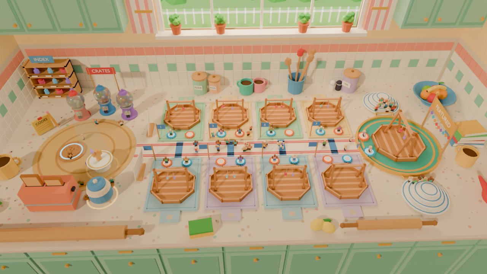
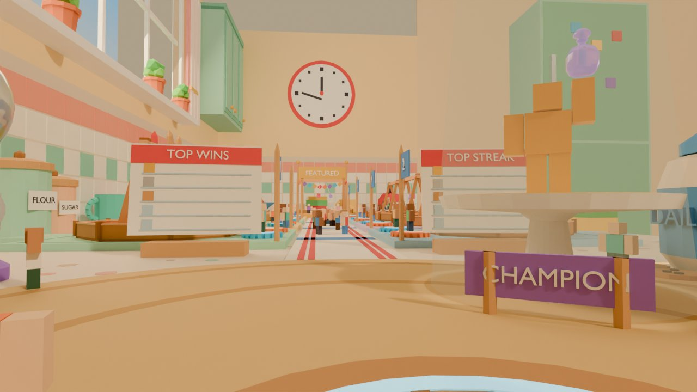
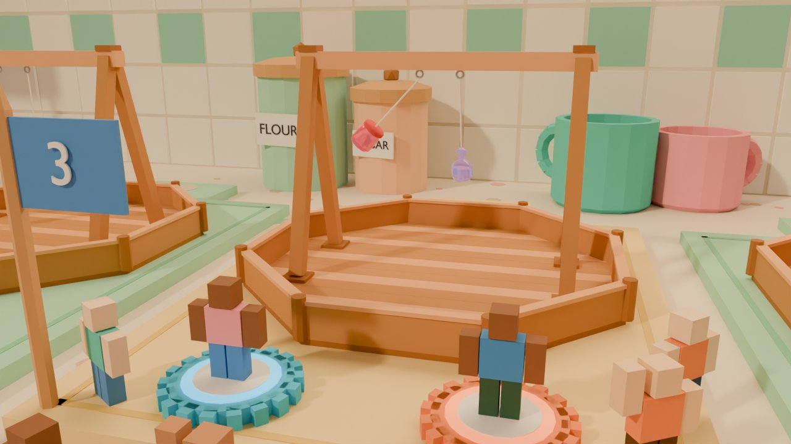

# Map concept: Toy-Sized Kitchen (`giant_kitchen`)



| Spawn view (eye height) | Arena close-up |
|---|---|
|  |  |

Renders come from `tools/map/concepts/giant_kitchen/build.py` (headless Blender, Cycles). The Clash Stands and glassies in the renders are the real assets from `assets/blender/`.

## Pitch

You're toy-sized on a giant, sunny kitchen counter. Eight Clash Stands sit on pastel plastic cutting boards along a striped tea-towel runner. The featured arena sits on a round serving tray at the far end. Gumball machines hand out crates, the toaster is the shop, the cookie jar gives the daily reward, and a big window full of afternoon sun fills the wall behind the arenas.

## Why it fits the game

- **The theme is the game's own story.** Glassies start as everyday bottles and jars, so the kitchen they come from makes sense to kids straight away. Every landmark is something a kid already knows by name ("meet me at the toaster").
- **The layout is the brief, with nothing extra.** A small lobby, one straight walkway and a row of arenas on both sides, with the featured arena at the end. Nothing to explore, no wrong turns.
- **The props do the signposting.** Each lobby function gets its own giant, recognisable object, so players can find them without reading. Arenas are colour-coded by board colour, numbered on toothpick flags, and the queue pads are giant bottle caps (blue = side A, orange = side B).
- **It's cheap to build.** Nearly everything is a box, cylinder or ball. The counter, walls and tiles are big flat parts with textures, so the user can build most of it in Studio.
- **Glassies stay the only shiny things.** Everything else is matte, chunky and pastel, so the glossy glassies stand out (ART_BIBLE).

## Layout (studs; +X = lobby → featured, +Y = back wall / window, counter top Z = 0)

Measured Clash Stand: **28.68 × 28.68 footprint, 17.8 tall** (pen floor top at origin, floor 0.4 thick, pen walls 2.4, crossbar top 16.95, post caps 17.4, HookA/HookB at X = ∓1.5, hook bottom Z = 15.02). Glassies hang on 5-stud strings (`Balance.Feel.StringLength`), so they hang at about Z 10 above the pen floor.

```
 Y=+78  ================== backsplash (tiles to Z 44) ====== window X 6..158, Z 54..122 ======== clock on end wall
        [INDEX spice rack]          FLOUR SUGAR   mugs      crock    S&P TEA                fruit bowl
        [CRATES: 3 gumball machines]   ┌─1─┐  ┌─3─┐  ┌─5─┐  ┌─7─┐        plate-stack bleacher
        [CODES note]   .-------.       │mint│ │butr│ │mint│ │butr│   .-----------.
        (       woven placemat  )      └A─B┘  └A─B┘  └A─B┘  └A─B┘  /  round tray   \   cookbooks
 Y=0    (  SPAWN(cork)      CHAMP )[LB]=====tea-towel runner (16 wide)=====A{ FEATURED  } banner
        (       r=36            )  [LB]  ┌B─A┐  ┌B─A┐  ┌B─A┐  ┌B─A┐  \   r = 29    /
        [TOASTER SHOP] [COOKIE JAR]      │sky │ │lila│ │sky │ │lila│   '-----------'
        rolling pin                      └─2─┘  └─4─┘  └─6─┘  └─8─┘        plate-stack bleacher
 Y=-75  ---------------------------------- open counter edge (invisible wall) -------------- kettle
        X=-112      -60  -34   -6       18     56     94     132      151  180  209      246
```

| Item | Position / size (studs) |
|---|---|
| Counter top | X −112 … 246 (358), Y −75 … 78 (153), top Z 0 |
| Backsplash / walls | tiles Z 0 … 44 (8-stud tiles), wall to Z 140, upper cabinets Z 62 … 128 |
| Window opening | X 6 … 158, Z 54 … 122 (behind arenas 1 to 8), sill with herb pots |
| Lobby (woven placemat) | centre (−50, 0), r = 36 |
| Spawn (cork coaster) | centre (−60, 0), r = 10, top Z 1.3 |
| Tea-towel runner | X −14 … 152, Y −8 … 8 (16 wide), blue cross-band at every arena pair |
| Arenas 1 to 8 | X = 18, 56, 94, 132 (38 pitch); odd numbers back row (+Y), even numbers front row (−Y) |
| Cutting board | 34 × 44 × 1.2, Y 9 … 53 from the aisle; handle tab 12 × 8 pointing away from the aisle |
| Stand on board | centre Y ±34; pen front edge 19.7 from the aisle centre |
| Queue pads (bottle caps) | r = 3.3, at arena X ± 7, Y ±14 (between pen and aisle); A = HookA side |
| Featured tray | centre (180, 0), r = 29, top Z 1.0; stand ×1.25, turned 90° so it faces the runner |
| Featured pads | (156.5, ±8), r = 4 (gold rims) |
| Plate-stack bleachers | (182, ±47), four steps of 2.2 (r 15 / 12 / 9 / 6) |
| Champion (cake stand) | (−34, −15), plate top Z 8, statue ×1.7 |

**Walking distance.** Spawn (−60, 0) to the featured pads (156.5, ±8) is about **217 studs, 13.5 s** at 16 studs/s. To the farthest normal arena (8) it's about 200 studs, 12.5 s. Arena 1 is 80 studs (5 s) from spawn.

## Player flow

1. **Spawn** on the cork coaster, facing +X straight down the runner. The two recipe-card leaderboards frame the start of the runner, the kitchen clock on the end wall marks the far end, and the gold champion on the cake stand stands front-right.
2. **Crates:** the three gumball machines (Common red / Rare blue / Epic purple) are 40 studs to the left, under the INDEX spice rack. Crate odds show on each machine's prompt. The **daily** cookie jar and the **toaster shop** are on the right, the **codes** sticky note is by spawn.
3. **Pick an arena:** walk the runner. The board colour and toothpick-flag number tell you which arena is which, and lit bottle caps show free slots. Step onto a cap. When the other cap fills (or a bot joins after 15 s), the match starts.
4. **Watch:** spectators stand on the runner and on the front strip of each board (about 10 studs between the pads and the pen). For the featured arena they climb the plate-stack bleachers.
5. **Back:** after a match, players get dropped back onto the runner by their pad. The lobby is never more than 13 s away. A "back to lobby" button can teleport them to the coaster.

## Pieces: Studio parts vs Blender

| Piece | Build in Studio (parts) | Model in Blender |
|---|---|---|
| Counter slab, front edge band, lower cabinet doors/drawers | ✔ blocks + cylinders (speckle = one tiling `Texture`) | |
| Backsplash + walls, window frame, mullions, sill, curtains (stacked slabs), upper cabinets | ✔ blocks; tiles = `Texture` on one wall part (don't use one part per tile) | |
| Outside garden through the window | ✔ Neon/emissive-looking backdrop part + a few ball trees, or a single `Decal` | |
| Tea-towel runner, woven placemat, cork coaster | ✔ thin parts + cylinders (stripes as thin parts or a texture) | |
| Cutting boards (pastel plastic) + juice groove + handle tab | ✔ blocks; the handle hole is a cylinder decal | |
| Clash Stand | | ✔ existing `clash_stand.fbx` (already done) |
| Queue pads (bottle caps) | ✔ cylinder + 18 small blocks around the rim, then union | (optional MeshPart for fewer parts) |
| Toothpick number flags, skewer signs, recipe-card leaderboards, sticky-note codes board | ✔ cylinders + blocks + SurfaceGui text | |
| Gumball machines (×3) | pedestal/knob as cylinders, gumballs as balls, globe as a `Glass` ball | ✔ recommended: one lathe mesh for the pedestal and cap |
| Toaster shop | ✔ blocks (slots, toast, lever) + SurfaceGui "SHOP" | (optional rounded-corner MeshPart) |
| Cookie jar (daily) | | ✔ lathe mesh (jar + lid), cookies = cylinders |
| Spice-rack index | ✔ blocks; glassy displays = existing glassy meshes | |
| Champion cake stand + statue | stand = 3 cylinders; statue = R15 rig posed with a gold material | ✔ cake stand as one lathe mesh (nicer silhouette) |
| Mugs, canisters, kettle, utensil crock, fruit bowl, salt & pepper | | ✔ one small "giant kitchenware" kit, all lathe shapes, flat-shaded |
| Rolling pins, lemons, sponge, cookbooks | ✔ cylinders, balls, blocks | |
| Featured tray + gold rim + handles | rim as cylinders; handles as blocks | ✔ tray as one lathe mesh (raised rim) |
| Plate-stack bleachers | ✔ stacked cylinders | (optional lathe for the plate lip) |
| Wall clock, fridge with magnets | ✔ cylinders + blocks | |

**Blender list, in priority order:** kitchenware kit (mug, canister, kettle, crock + spoons, fruit bowl, cookie jar), gumball-machine pedestal and cap, featured tray, cake stand. Each one is a single lathe mesh, about 1 hour of work.

## Colour palette

| Use | Hex |
|---|---|
| Counter / speckles | `#F6EBDC` / `#D8C3AA`, `#9FD3C7`, `#F3B0A6` |
| Tiles / grout / mint row / coral border | `#FFFDF6` / `#E3D8C6` / `#8ED8C6` / `#F59C8C` |
| Wall / room | `#FFE2A6` / `#F6DDB0` |
| Cabinets / cabinet shade / brass knobs | `#97D3C2` / `#78BFAC` / `#E7B04B` |
| Curtains | `#F7A3A8`, `#FFF4F0` |
| Boards: mint, butter (back row) | `#A6E3C8`, `#FFE39A` (grooves `#7FCDAA`, `#EFC965`) |
| Boards: sky, lilac (front row) | `#A9D8F5`, `#D8C8F6` (grooves `#7FBFE8`, `#B9A3EC`) |
| Tea towel / stripes / arena band | `#FFF8EE` / `#E8505B` / `#4C8FE0` |
| Placemat / cork | `#E8C27A`, `#CE9F57` / `#C9935B` |
| Queue pad A / B / spawn ring | `#3EC6FF` / `#FF8A4C` / `#8FE3FF` (Neon ring) |
| Featured tray / gold | `#3FB8AF` / `#F2C14E` |
| Gumball machines (Common / Rare / Epic) | `#E8434B` / `#3E8EDE` / `#9B6BE0` |
| Toaster / toast / crust | `#FF8F6B` / `#F2C37A` / `#B87333` |
| Cookie jar / band | `#FFF1DC` / `#5BA4E6` |
| Glassies (only glossy things) | pop `#8FE3FF`, jam `#FF6B8B`, prism `#C9A8FF` |

## Roblox lighting (golden afternoon)

- `Lighting.Technology = Future` on PC, but the map has to look good with `ShadowMap` too (most lights are the sun).
- `ClockTime = 15.6`, `GeographicLatitude = 30`. Turn the map so the sun comes from the **open front-left of the counter** and shadows fall toward the backsplash. The back wall then never shades the arenas.
- `Brightness = 2.6`, `EnvironmentDiffuseScale = 0.5`, `EnvironmentSpecularScale = 0.6` (glassies get their shine from this).
- `Ambient = #8C7A66`, `OutdoorAmbient = #B8A68C`, `ColorShift_Top = #FFE0B0`.
- `Atmosphere`: Density 0.25, Offset 0, Color `#FFE6C4`, Decay `#F2C9A0`, Glare 0, Haze 0.6. This gives a soft warm room haze and hides the far wall on low-end devices.
- `ColorCorrection`: Saturation 0.12, Contrast 0.05, TintColor `#FFF6EA`. `Bloom`: Intensity 0.35, Size 24, Threshold 1.6 (so the Neon pads and window glow a little).
- Window: Neon backdrop part for the sky (`#FFE9B8` → `#7CC8F2` gradient as a texture) and a `SurfaceLight` (Brightness 2, Range 60, `#FFD9A0`) on the sill that points into the room.
- No ceiling (or a ceiling with `CastShadow = false`). The kitchen shell beyond the counter edge is decoration only.

## Performance notes

- **Parts:** about 25 parts per arena (board, groove, tab, 2 bottle caps as unions, flag) plus the stand mesh. That's about 250 for all arenas, about 150 for the lobby and about 150 for props. The room shell is under 60 big parts. Never build the tiles one part each: use one `Texture` (StudsPerTile 8) on the backsplash parts.
- **Materials:** SmoothPlastic for almost everything, Wood for the stand, Fabric for the runner and placemat, Glass for the glassies and the 3 gumball globes, Neon only for pad rings, the spawn ring and the window. That's 5 materials, few textures (speckle, tiles, weave, cork).
- **MeshParts:** reuse 1 asset ID per kitchenware piece. All lathe meshes are under 500 tris. Set `RenderFidelity = Automatic` and `CollisionFidelity = Box` on decorative pieces, and turn collision off on things players can't reach (curtains, garden, clock, fridge).
- **Streaming:** turn on `StreamingEnabled`. The whole play area is 358 × 153 studs, so everything stays loaded. The shell (floor, fridge, far walls) is decoration and can be one model with `ModelStreamingMode = Persistent` and `CanQuery/CanTouch = false`.
- **Spectating:** glassies, strings and shards are client-animated (GAME_DESIGN 3.8). Eight matches at once is a small cost because each arena has only 2 glassies.

## Risks and weaknesses

- **Glassies look small against the stand.** The real glassies are only 2–2.5 studs tall and hang from 15-stud-high hooks. Seen from the runner (the arena render), they're small next to the 17-stud stand and the giant props. Recommended: scale glassies ×1.5–2 in the arena (or lower the crossbar) and give them a soft rim highlight or a gentle glow when it's their turn.
- **Scale can be confusing.** A "giant" world needs constant size cues. If the props get too big, the arenas look like toys in a toy (the aerial already reads a bit like a diorama). Keep big props (mugs, canisters) behind the board handles and away from the walkway.
- **The open counter edge.** The front is a drop to the floor about 85 studs down. It needs an invisible wall along Y = −75 (the rolling pins, sponge and lemons are only decoration), plus a kill-floor teleport back to spawn for anyone who glitches off.
- **Everything is pastel.** The pastel boards, mint cabinets and cream counter are calm, but the screen can get washed out (see the spawn render). The tea-towel stripes, arena bands and Neon pad rings carry the contrast, so keep them strong. Don't add more pastels.
- **Gumball globes are glass too.** They compete a little with glassies for "shiny". Keep them frosted (Transparency 0.4, Reflectance 0) and full of colourful gumballs.
- **Same arenas everywhere.** All 8 normal arenas are identical apart from board colour. For more character later, a "cereal bowl arena" or a "pizza board arena" could be added as events, without changing the layout.
- **Content check.** All props are plain kitchenware, with no brands on any boxes or jars. The canister labels (FLOUR, SUGAR, TEA) are generic. No alcohol bottles anywhere, and the glassies are pop, jam and perfume shapes.

## Re-rendering

```bash
<bpyenv>/bin/python tools/map/concepts/giant_kitchen/build.py          # all three views, ~2.5 min on 4 CPU cores
# quick preview: GK_SAMPLES=8 GK_SCALE=50 GK_VIEWS=aerial ...
# save the scene for Studio reference: GK_SAVE=/path/giant_kitchen.blend ...
```
