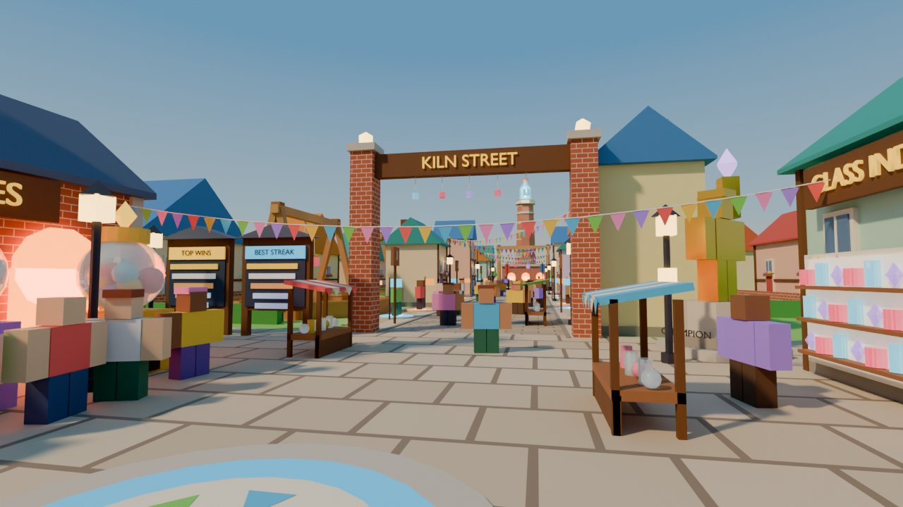
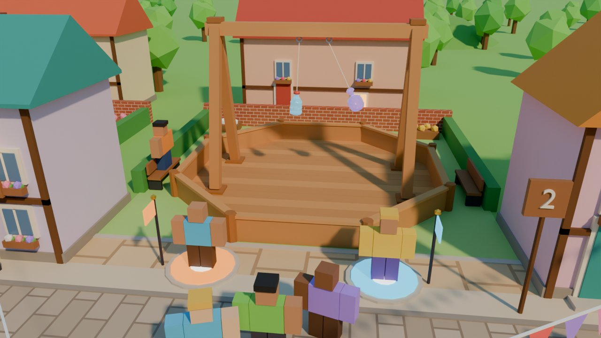

# Map concept: Kiln Street


| Spawn view (eye height) | Arena close-up |
|---|---|
|  |  |

Rebuild the renders with `tools/map/concepts/kiln_street/build.py` (headless bpy, Cycles CPU, about 2 minutes; `--quick` gives half-size previews in about 20 s).

## Pitch

Kiln Street is a cozy cobblestone glassblower village laid out along one street. You spawn in a small square next to a brick kiln shop whose three arches glow orange behind the crate machines. You walk under the "KILN STREET" gate past cottages, market stalls and bunting, and each arena sits in its own courtyard, alternating left and right. The street ends at a tall brick furnace chimney with a giant glass bottle on top. Behind its plinth is the bigger Champion Arena.

## Why it fits the game

- **One readable path.** Spawn, then crates, then the gate, then the arenas, then the featured arena. A kid can't get lost, and the chimney and bottle are always visible down the street to pull players forward (they show through the gate arch from spawn).
- **The arenas are what you see on the street.** Every Clash Stand faces the street with its crossbar running parallel to it, so passers-by see the swing side-on, the best angle to read a clash. Queue pads sit on the paved apron right next to the street, so you can join by walking straight on.
- **Glass is the hero.** The world is matte low-poly in warm pastels. The only glossy things are the glassies, the crate domes, shop-window glass and the giant bottle. Workshops behind the arenas get warm walls (cream, peach, butter) so cyan, pink and violet glass stands out.
- **Theme = lore.** A glassblower village explains why glass collectibles exist, why the crates live in a kiln, and why the champion fights under a furnace.

## Layout (studs; X = across the street, Y = down the street; Roblox Z = -Y)

```
 Y
278 .           [ FURNACE 30x16 ]  chimney stack to 56, giant bottle top ~72
262 .             ( ( ( glowing mouths ) ) )
240 .    seats )                          ( seats
214 .   shop  (   CHAMPION ARENA  x1.3     )   shop       plinth r=28, plaza r=42
192 .          [A pad]  (0,214)  [B pad]
186 .-----------+----------------------+------------  street ends, plaza begins
164 .  cottages | . . . . . . . . . . .|[ 6 ]======]   arena 6  (+31.5, 157)
134 .  [====[ 5 ]. . . . . . . . . . . | cottage          arena 5  (-31.5, 134)
111 .  cottage  | . . . street . . . . |[ 4 ]======]   arena 4  (+31.5, 111)
 88 .  [====[ 3 ]. . . 20 wide . . . . | cottage          arena 3  (-31.5,  88)
 65 .  cottage  | . . +3 sidewalks . . |[ 2 ]======]   arena 2  (+31.5,  65)
 42 .  [====[ 1 ]. . . . . . . . . . . | cottages         arena 1  (-31.5,  42)
 17 .   boards  [##  KILN STREET  ##]  champion statue          gate arch, beam z 17-19.6
  0 .   KILN    stall          stall   GLASS INDEX
-15 .   SHOP  [3 crate machines]       (gallery)                square 80 x 62
-22 .   arches       ( SPAWN )         GEM SHOP
-34 .        DAILY chest      CODES board
-45 .  [ back row of cottages ..................... ]
       -40         -10    0    10          40
```

| Item | Value |
|---|---|
| Clash Stand (measured from `clash_stand.blend`) | **28.68 × 28.68 footprint, 17.4 tall**; hooks at ±1.5 on the crossbar, hook bottom z = 15.02; glassies hang 5 below (`StringLength`) |
| Street | 20 wide cobbles + 3-stud sidewalks each side (26 between facades); runs y = 16 → 186 |
| Arena courtyard | 36 along the street × ~41 deep: 7.2-stud paved apron (pads), then lawn with the pen, side benches, hedges, a brick back wall and a glassblower workshop behind |
| Arena spacing | 6 arenas alternating sides every 23 studs (same side every 46, with a 10-stud cottage between courtyards). Centres at x = ±31.5, y = 42, 65, 88, 111, 134, 157 |
| Queue pads | r = 2.5 (stone rim r = 2.9), on the apron at x = ±13.6, y = arena ± 7. Pad A (cyan) sits on the HookA side, pad B (orange) on the HookB side. Each has a 6-stud pennant pole |
| Featured arena | Clash Stand scaled ×1.3 (37.3 footprint, 22.6 tall) on a round plinth r = 28, h = 1.2, at (0, 214). Crossbar faces the street; pads at (±8, 192); 2 rows of curved seats behind |
| Spawn square | x −40…40, y −44…18; spawn ring at (0, −22) |
| Overall footprint | ~130 × 335 studs (workshops to x = ±65; back row y = −55 to furnace y = 278) |
| Walk times at 16 studs/s | spawn → crates 20 studs (1.3 s); → arena 1 pads 60 (3.8 s); → farthest normal pad (arena 6) ~186 (11.7 s); → **featured pads 214 (13.4 s)** |

## Player flow

1. **Spawn** on the round mosaic facing down the street. The kiln glow and crate machines are 20 studs to the left; the Glass Index window and Gem Shop are to the right.
2. **Crates** (left): three gacha machines (Basic, Rare, Epic) in front of three glowing kiln arches. **Daily** chest and **Codes** board are right behind spawn, so returning players pass them first.
3. **Gate**: two leaderboards (Top Wins, Best Streak) on the left and the spotlit **Champion statue** on the right frame the "KILN STREET" arch.
4. **Arena**: walk the street, pick the nearest courtyard with a free pad, and step on it. Arena numbers are on signs at each courtyard's front corner. When both pads are filled (or a bot joins after 15 s) the match camera takes over. Players stay on the pads, and the pen stays empty so it never gets crowded.
5. **Watch**: spectators stand on the street and apron (closest view, side-on swing) or sit on the courtyard benches. Bigger crowds gather around the featured plinth's curved seats.
6. **Back**: one straight street back to the gate. A "back to crates" button or a pad that teleports players to spawn after the match is recommended so they don't have to walk 200 studs to spend coins.

## Pieces

| Piece | Build in Studio (parts) | Model in Blender |
|---|---|---|
| Clash Stand + pen | – | **Existing** `clash_stand.blend` (reuse; one Packaged model ×7, featured scaled 1.3) |
| Glassies (pop/jam/prism) | – | **Existing** bodies; giant chimney bottle = pop `Body` + `Cap` scaled ×6 |
| Ground: street, sidewalks, square, plaza, courtyards | Parts with Cobblestone / Slate / Grass materials (or Terrain for the grass) | – |
| Cottages (≈20) and workshops (6) | Block walls, WedgeParts for gable roofs, inset window/door parts, timber trims; make 3 widths as Packages | Optional: a 3-piece cottage kit (wall shell, roof, chimney) cuts part count a lot |
| Kiln Shop (crates) | Brick block walls, 3 Neon arches (block + cylinder top), sign SurfaceGui | – |
| Crate / gacha machines ×3 | Block base, Glass ball dome, cylinder cap, Neon gem | Optional nicer rounded machine (one mesh, recoloured per tier) |
| Glass Index gallery + Gem Shop | Cottage package + display shelves; shelf glassies can be small Glass parts | – |
| Leaderboards ×2, Codes board, arena number signs | Parts + SurfaceGui | – |
| Daily chest | Block + half-cylinder lid, gold bands | Optional chest mesh with an opening lid |
| Champion statue | Anchored R15 rig wearing the current champion's HumanoidDescription, Foil/gold material, 2 SpotLights | – |
| Gate arch | Brick pillars, beam, SurfaceGui text, 5 hanging mini bottles | – |
| Lamp posts + bunting masts | Cylinder pole, Neon lantern, wedge hat | – |
| Bunting (zigzag across street, square) | Possible with WedgeParts, but costs ~20 parts per span | **Recommended**: one mesh per span (rope + flags, vertex-coloured or 6 colour sub-meshes) |
| Flower boxes, flower beds | Box + small balls (adds many parts) | **Recommended**: 2–3 flower-box meshes |
| Market stalls ×4 | Table, posts, striped roof slats | – |
| Queue pads | Cylinder rim + Neon cylinder + white dot, pennant pole; BillboardGui "1/2 waiting" | – |
| Featured plinth, seats, banner poles | Cylinders (or a 24-sided union), block seats, banner parts | – |
| Furnace + chimney | Furnace block with Neon mouths can be parts | **Recommended**: tapered 8-sided brick stack with stone bands (one mesh) |
| Trees, hills | – | **Recommended**: 2–3 low-poly tree variants, hill meshes (or Terrain hills) |

## Colour palette

| Use | Hex |
|---|---|
| Grass / courtyard lawn / hedge | `#8CCB5E` / `#A6DB78` / `#4E9A47` |
| Cobbles / sidewalk / square paving | `#C9B8A3` + `#B3A08A` (mortar `#8E7C6A`) / `#E3D3B8` / `#DCCBB2` |
| Courtyard apron pavers | `#E8C99A` |
| Brick / dark brick / stone | `#C0623F` / `#8E4430` / `#CFC6B8` |
| Wood / dark wood / iron | `#A0673C` / `#6E4425` / `#3B3A45` |
| Cottage walls | `#FFE6B8` `#FFC9A8` `#BDE8D2` `#BFDDF5` `#FFF1A8` `#F7C6D9` `#E4D3F5` |
| Roofs | `#D9603B` `#2F9C95` `#8E5BA8` `#3F7FBF` `#C7493A` `#E08A2C`, slate `#56607A` |
| Kiln glow / lanterns / gold | `#FF8A2A` (Neon) / `#FFD27A` / `#F5C542` |
| Queue pads A / B | `#3FD0FF` / `#FF9A3C` |
| Bunting and flowers | `#FF5E5E` `#FFD23F` `#4FC3F7` `#7ED957` `#FF8FD1` `#B388FF` |
| Glassies (Glass material only) | pop `#8FE3FF`, jam `#FF6B8B`, prism `#C9A8FF` |

## Roblox lighting (golden afternoon)

| Setting | Value |
|---|---|
| `Lighting.Technology` | Future (ShadowMap works on low-end; kiln arches still read through Neon) |
| `ClockTime` / `GeographicLatitude` | 16.4 / 35 (sun from the south-west, low enough for long shadows across the street) |
| `Brightness` | 2.6 |
| `Ambient` / `OutdoorAmbient` | `#6E6457` / `#9C8C7A` |
| `ColorShift_Top` / `ColorShift_Bottom` | `#FFE2B5` / `#3A3040` |
| `EnvironmentDiffuseScale` / `EnvironmentSpecularScale` | 0.5 / 1 (glass glints) |
| `Atmosphere` | Density 0.28, Offset 0.15, Color `#FFE3B8`, Decay `#9CC3E6`, Glare 0.2, Haze 1.3 |
| `Bloom` | Intensity 0.45, Size 24, Threshold 1.5 (Neon arches and lanterns glow, the world doesn't) |
| `ColorCorrection` | Saturation 0.12, Contrast 0.06, TintColor `#FFF7EE` |
| `SunRays` | Intensity 0.04, Spread 0.6 |
| Arena accent | One SpotLight per stand (Brightness 1.2, Angle 40, warm `#FFEFD0`, Shadows off on the 6 normal arenas) aimed at the glassies |

## Performance notes

- The concept scene has ~2,300 map objects (not counting avatars and outer trees), mostly flowers and bunting flags. Replacing bunting spans and flower boxes with a handful of Blender meshes brings it to roughly **900–1,200 parts/meshes**, fine for mobile.
- Build one cottage of each width as a **Package**, and use Packages for the arena courtyard (stand, pads, benches, hedges, sign). Seven arena courtyards then share one source of truth.
- **StreamingEnabled** with each courtyard as an Atomic model; streaming radius ~256 is enough because the whole street is 335 studs long.
- Materials kept to ~8: Cobblestone, Brick, Slate, WoodPlanks, SmoothPlastic, Grass, Neon (small), Glass (glassies, crate domes, gallery only).
- Lights: real lights only on the 7 arena spots, the 2 champion spots and 1 SurfaceLight per kiln arch. Street lanterns are Neon with no light object.
- Decorative props `CanCollide = false`, `CanTouch = false`, `CastShadow = false` on small items (flowers, bunting, flags).

## Risks and weaknesses

- **Linear = long walk back.** The farthest pads are 214 studs from spawn, about 13 s each way. A post-match teleport or a "back to square" button is needed, or crates could also be added near the featured plaza.
- **Hot spot at the front.** Arena 1 (and 2) will always fill first because they're closest to spawn, while arenas 5–6 sit empty. Show "free arena" signs on the gate, or route new queue joins to the next free arena.
- **Glassies are small at true scale.** The glassies are 2–2.5 studs tall hanging 10 studs up a 17-stud frame, so they are easy to miss from the street. The match camera solves it for the players, but spectators need help: glassy scale ×1.5 in matches, a stronger arena spotlight, or a BillboardGui health/name tag.
- **Bunting and tall props vs. the camera.** Bunting is kept at 13–14.4 studs and lamps are off the arena aprons, but cottages close to the street can still block the third-person camera in tight spots. Facades are 13 studs from the street axis, so test with zoomed-out cameras.
- **Spectator space is thin.** Each courtyard is only 36 wide, with ~1.6 studs between pen and hedge. Most watching happens on the street apron. Heavy crowds around one hot arena could block the street.
- **Part count creep.** The cozy-village look relies on many small details. Without Packages and a few Blender meshes, it can exceed mobile budgets.
- **Cottage sameness.** About 20 cottages from one template can feel repetitive. Vary roof type (gable vs. ridge), roof colour, signs and stall placement, which the build script already does.
