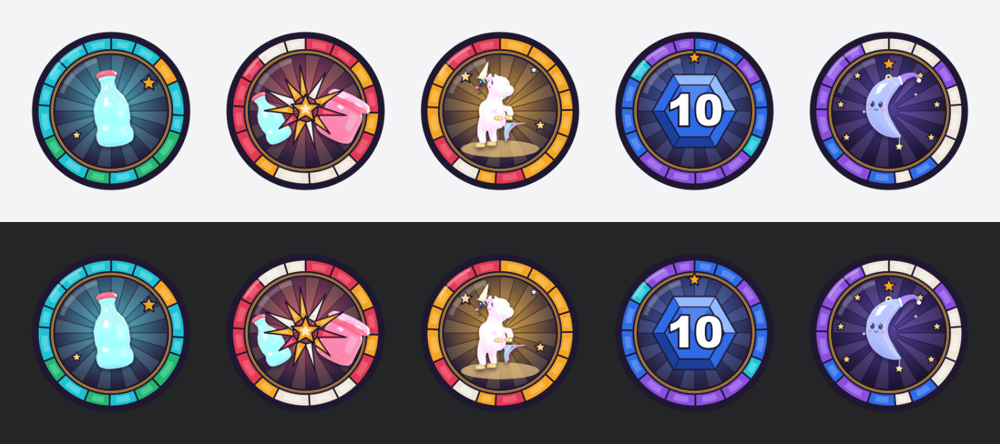

# Badges (decision 118, Proposed)

Five free launch badges with stained-glass icons, awarded from the server. Code: `Config/Badges` (names, ids, rules'
numbers), `Server/Data/BadgeRules` (pure, `tests/BadgeTests`), `Server/Services/BadgeService` (Roblox calls).
Icons: `tools/ui/badge_art.py` → `assets/badges/png` (+ `preview.png`). Creation: `tools/opencloud/badges.py`.



## 1. Research

**Roblox rules** (Creator Docs, [Badges](https://create.roblox.com/docs/production/publishing/badges)):
- Up to **5 badges free per experience per 24 h (GMT)**; each extra one **costs 100 Robux**. The live numbers agree:
  `badges.roblox.com/v1/badges/metadata` returned `badgeCreationPrice: 100`, `maxBadgeNameLength: 50`,
  `maxBadgeDescriptionLength: 1000`. On Oct 21 the experience had no badges and `free-badges-quota` was 5.
- Icons use a **512×512 template**. The upload "trims and crops the badge image into a circular icon", so nothing
  important may sit outside the circle (the docs show cropped text as the bad example). Icons are moderated like any
  image upload.
- A disabled badge can't be earned and doesn't show on the experience page.

**Scripting** (Engine API, [BadgeService](https://create.roblox.com/docs/reference/engine/classes/BadgeService)):
- `AwardBadgeAsync` only works from the **server**, for a player who is **in the experience**, who **doesn't already
  own** the badge, and for a badge that is **enabled**. Check `GetBadgeInfoAsync().IsEnabled` first. Wrap every call
  in `pcall` (the guide's example does both).
- Rate limits: `AwardBadgeAsync` and `UserHasBadgeAsync` allow **50 + 35 × players per minute** each.
  `GetBadgeInfoAsync` "caches for a short duration".
- A player can delete a badge from their profile and be awarded it again. So a saved "awarded" flag is what stops
  repeat awards from our side. DevForum advice for rate-limit trouble is to cache ownership per player and badge
  ([thread](https://devforum.roblox.com/t/help-with-userhasbadgeasync/1650318),
  [BadgeUtil](https://devforum.roblox.com/t/badgeutil-efficient-and-optimized-badge-operations/4140491)).
- **Studio:** "a badge can only be tested if it is **disabled**". An enabled badge in Studio only warns.

**Open Cloud** ([Badges API](https://create.roblox.com/docs/cloud/reference/features/badges)):
- `POST /legacy-badges/v1/universes/{universeId}/badges` creates a badge from multipart fields: `name`,
  `description`, `paymentSourceType` (1 user, 2 group), `files` (the icon) and `expectedCost`.
- It needs the scope **`legacy-universe.badge:manage-and-spend-robux`**. Error 18 means the "expected badge cost is
  different from the actual badge cost", so sending `expectedCost=0` can never spend Robux.
- `PATCH /legacy-badges/v1/badges/{id}` changes the name, description and enabled state. It needs
  `legacy-universe.badge:write`.
- Probe on Oct 21 (empty-name create, nothing made): the group key **has** `legacy-universe.badge:write` and
  `legacy-badge:manage` but **not** the create scope (403 "Scope not authorized").

**What top games award.** Public badge lists (`badges.roblox.com/v1/universes/{id}/badges`, sorted by rank), Oct 21:

| Game | Badge | Awarded |
|---|---|---|
| Doors | Welcome ("Enjoy your stay!") | 530 M |
| Doors | Welcome Back (join back the next day) | 296 M |
| Doors | Buddy System (play with a friend) | 215 M |
| Pet Simulator 99 | Welcome! | 111 M |
| Murder Mystery 2 | Level 10 (its top badge; levels 20 … 100 follow) | 303 M |
| Arsenal | Commander: Reach Level 10 | 51 M |
| Arsenal | Golden Touch: Win a game / Stepping Stone: first kill | 36 M / 195 M |
| Tower of Hell | Newbie: beat your first tower | 66 M |
| Grow a Garden | SHINY!: first gold fruit | 236 M |

Every big kids' game has a welcome badge, a first-success badge, level milestones, a rare-find moment and a
come-back badge. Ladders such as Bee Swarm's 99 rank badges come later.

## 2. The five

| Key | Name | How | Symbol |
|---|---|---|---|
| Welcome | Welcome to Glass Clash! | First join (any profile) | Pop, the first bottle |
| FirstWin | First Win! | Win a **round** against **another player**; bots don't count (creator) | Pop and Jam clash, shatter burst |
| LegendaryFind | Legendary Find | A Legendary or Mythic out of any Kiln (Coin, Marble, free tickets, the group gift) | The Unicorn on a golden glow |
| Level10 | Level 10 | Level 10 (decision 104; ~42 matches in EconomySim) | The profile's sapphire level hex with "10" |
| DailyWeek | Midnight's Week | Daily Rewards Day 7 claimed, or Midnight owned (decision 115) | Midnight under seven stars |

Why these three: the level-10 badge is MM2's most-awarded badge and Arsenal has one too. "First rare find" is Grow a
Garden's second-biggest badge type. A come-back badge is Doors' second-biggest. Each also has a matching moment
already built in Glass Clash (the profile's level hex, the Kiln's Legendary build-up, Midnight).

The Robux Daily Glassy is left out of Legendary Find, so the badge stays free to earn. Crown Hill (decision 105) and a
first Perfect can use the next day's 5 free slots.

## 3. Icons

One template (`medallion()`), drawn as SVG and rendered by headless Chrome like the rest of the Stained Glass UI:
- a lead rim, then a band of 16 jewel-glass pieces in the badge's colours (the window mosaic, bent into a ring);
- a gold came, then a lit pane with 12 leaded rays (a rose window);
- the symbol, then a glass glint.

Everything that matters sits inside r = 236 of the 512 px circle. There are no words, so nothing can be cropped and
nothing needs translating; the only characters are Level 10's digits. Symbols are the game's own item pictures
(`assets/icons/items/512`), so they match the Kiln and Inventory. `preview.png` shows the set after the crop, on
Roblox's light and dark backgrounds.

## 4. Awarding (server)

- **Two sets in the profile.** `Badges.Earned` is set when a rule fires. `Badges.Awarded` is set only once Roblox
  confirms the award, or once `UserHasBadgeAsync` says the player already has it.
- **No double awards.** A badge in `Awarded` is never due again, even if its rule fires again.
- **No lost badges.** A failed call (Roblox down, badge disabled, the player left) leaves the badge earned and due,
  and it is tried again on the next check.
- **Checks** run on join, every 20 s for everyone online, and right after:
  - a round won over a player (MatchService, when the fight ends);
  - a Kiln opening (KilnService, GroupRewardService);
  - a Daily or Playtime claim (RetentionService);
  - a recorded match (DataService).
- **State badges.** Welcome, Level 10 and Midnight's Week are worked out from the saved profile, so players who got
  there before badges existed still get them.
- **Calls per badge.** Each badge costs at most one `GetBadgeInfoAsync` per server every 10 min, one
  `UserHasBadgeAsync` and one `AwardBadgeAsync`. Each call gets 3 tries, 1 s and 2 s apart. One check runs at a time
  per player, and checks never yield their caller. That is well inside 50 + 35 × players per minute.
- **Badges without an id** (before creation) are earned but not awarded. When the ids land in `Config/Badges`, the
  next check awards everyone who earned them.
- **Studio** never calls Roblox. Awards are printed and remembered for that server only, and the profile is not
  marked. `ServerStorage.BadgeDev` takes `State`, `Earn`, `Check` and `Reset` (Reset works on mock profiles only).

## 5. Creating them

Once the key has `legacy-universe.badge:manage-and-spend-robux`, run:

```
zsh -i -c 'python3 tools/opencloud/badges.py create'
```

It checks the free quota first and stops if fewer than the badges to create are left. It sends `expectedCost=0` from
group funds, and writes each id into `Config/Badges.luau`. Run `badges.py list` to see them, and
`badges.py update <id> name=… description=… enabled=…` to edit one.

**Without the API** ([Creator Docs steps](https://create.roblox.com/docs/production/publishing/badges)), for each
badge in §2:
1. On the [Creator Dashboard](https://create.roblox.com/dashboard/creations), hover over Glass Clash's thumbnail,
   click **⋯**, then **Create Badge**.
2. Upload `assets/badges/png/<key>.png` and paste the name and description from `Config/Badges.luau`.
3. Leave **Badge is Enabled** on and create it (the first 5 each day are free).
4. In the experience's **Engagement → Badges**, copy the badge's asset ID (⋯ → Copy Asset ID) into its `Id` in
   `Config/Badges.luau`.
