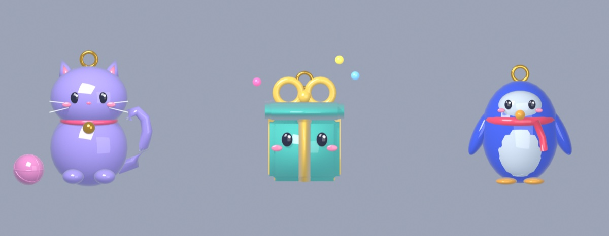
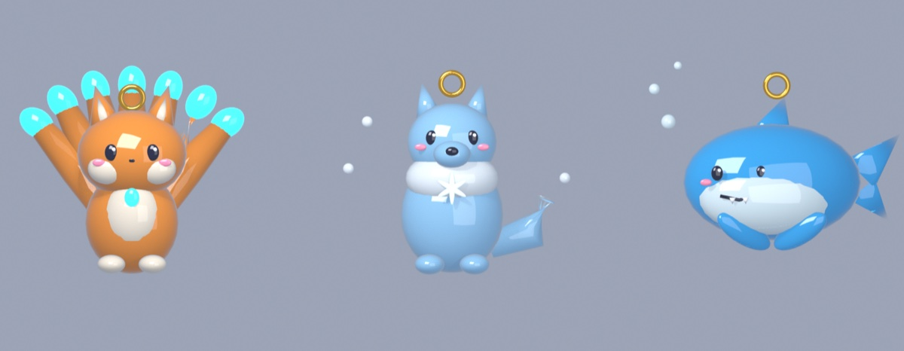

# Daily and Playtime Rewards v2: research, numbers and two Daily glassies

October 21, 2026 · **status: Phase 1 proposal. Waiting for the creator's answers (§6) before any building.**
Builds on decision 99 (`docs/design/REWARDS_SETTINGS_PLAN.md`), decision 104 (levels and XP) and decision 86 (rarity edge about 55%).

The creator asked for:

- more in the Daily calendar, about 100 coins on most days;
- an Epic glassy on Day 2 (for D1 retention) and a Legendary "good one" on Day 7 (for D7 retention), made in Blender and working with every system;
- more coins from Playtime, with one gift paying XP instead of coins.

## 1. What the research says

| Finding | Source | What we do with it |
|---|---|---|
| D1 is about first impressions and onboarding; D7 is about whether the game has become a habit. | [playio: DAU and retention 2026](https://blog.playio.co/dau-retention-analysis-mobile-games-2026) | Day 2 is the D1 hook: the Epic sits in the next cell from the very first claim. Day 7 is the habit payoff: the Legendary. |
| The usual pattern is a 7-day calendar with small prizes early and a rare item on the last day. Value climbs over the streak. Higher-value items sit at the retention checkpoints (day 7, 14, 28); Raid: Shadow Legends gives a rare champion on day 7. | [rolearn: the 7-day cliff](https://rolearn.dev/insights/player-retention-7day-cliff), [MAF: daily login rewards](https://maf.ad/en/blog/daily-login-rewards-engagement-retention/), [AppAgent](https://appagent.com/blog/build-daily-habit-loops-to-make-mobile-players-login/) | Coins on most days, a special item on Day 7. |
| Put the strong rewards early in the cycle, "especially between the 2nd to 5th day". Show the whole schedule in the UI. After a reset, give a good reward soon so players feel reassured. | [Game Developer: The Science & Craft of Designing Daily Rewards](https://www.gamedeveloper.com/business/the-science-craft-of-designing-daily-rewards----and-why-ftp-games-need-them) | Epic on Day 2 and the free Kiln pull moved to Day 5. All 7 cells stay visible. |
| The same article warns about login rewards in games for children. | same | We keep the kind rules from decision 99: a missed day **keeps your place** (no "you lost your streak"), no paid streak savers, no extra pop-ups. |
| Roblox's official Engagement Rewards package: small consumables on day 1, more valuable ones later, and a **durable item after 7 straight days**. Time rewards at 10, 30 and 60 minutes. Its timer is per session; ours adds up over the day. | [Roblox Creator Docs: Engagement Rewards](https://create.roblox.com/docs/resources/feature-packages/engagement-rewards) | A durable item (a glassy) on Day 7 is the official pattern. Playtime keeps 10 / 20 / 30 / 45 / 60 min. |
| Creator Rewards pays for users who spend **at least 10 minutes** in an experience in a day. | [Roblox Creator Docs: Creator Rewards](https://create.roblox.com/docs/creator-rewards) | The first Playtime gift stays at 10 minutes and gets bigger, a strong reason to reach that first 10 minutes. |
| Roblox benchmarks: median D1 about 10-11% and D7 about 1.2-1.8% for 13+ minute games (top 10%: D1 15-19%, D7 3-6%). Use streaks, timers and daily rewards to bring players back at least twice a day. Stagger timers across minutes, hours and days. | [GameAnalytics 2025 Roblox Benchmark Report](https://www.gameanalytics.com/reports/2025-roblox-report), [GameAnalytics Roblox metrics 2023](https://gamedevreports.substack.com/p/gameanalytics-key-roblox-and-games) | Daily (day cycle) plus Playtime (minute ladder) already cover two timer scales. These numbers give us a D1/D7 baseline to check after launch. |
| Pet Simulator 99 Free Gifts: 12 gifts. Every 5 min up to 20 min, every 10 min up to 60, then 1:15, 1:30, 2 h and 3 h. | [Pet Simulator wiki: Free Rewards](https://pet-simulator.fandom.com/wiki/Free_Rewards_(Pet_Simulator_99)) | A top kids' game front-loads small gifts. Our first gift (10 min) gets the biggest jump. |
| A DevForum A/B test found daily rewards alone did **not** raise playtime. Advice from that thread: keep the rewards from becoming "the meta" or main income; tie them to gameplay (items, not just currency); start with a 5-7 day streak; let players keep a streak after a missed day. | [DevForum: Do daily rewards actually keep players?](https://devforum.roblox.com/t/do-daily-rewards-actually-keep-players-retention/3556728) | Glassies you **play with** beat plain coins. Coins stay a bonus (§3 shows the share). |
| 95% of the Korean mobile games studied use daily login rewards. They work through loss aversion. | [Playing to Pay (arXiv 2504.10714)](https://arxiv.org/pdf/2504.10714) | Loss aversion is exactly what we soften for kids: keep-your-place, no reset. |
| Exclusive, non-shop items make a reason to come back. Scarcity raises perceived value. | [MAF](https://maf.ad/en/blog/daily-login-rewards-engagement-retention/), [recited.io](https://recited.io/kb/game-monetization-strategies/player-engagement-and-retention/daily-rewards-and-login-bonuses/) | Recommend the two glassies stay **Daily-only** (§6 Q1). |
| After day 7: many games repeat the 7-day cycle. Puzzle & Dragons adds rewards for total login days. | [Game Developer](https://www.gamedeveloper.com/business/the-science-craft-of-designing-daily-rewards----and-why-ftp-games-need-them) | We repeat the cycle. From week 2, Day 2 and Day 7 give duplicate copies (stars) until maxed, then coins and a pull (§6 Q2). |

**Honest caveat.** Many web numbers about login rewards ("+30-50% D7") come with no data behind them, so I did not use them. The proven parts are the *pattern*: a visible ramp, a durable item on Day 7, strong rewards in days 2-5, and forgiveness for missed days. The real test is our own D1/D7 after launch, in the Creator Dashboard retention charts.

## 2. Proposed numbers

### Daily calendar (one claim per UTC day, a missed day keeps your place)

| Day | 1 | 2 | 3 | 4 | 5 | 6 | 7 |
|---|---|---|---|---|---|---|---|
| Today | 50 | 75 | 100 | 125 | 150 | 200 | 250 + free Kiln pull |
| **Proposal, week 1** | **100** | **Epic glassy + 100** | **100** | **150** | **100 + free Kiln pull** | **150** | **Legendary glassy + 300** |

Coins over the week: 1,000 (today 950), plus the same one free Kiln pull, plus two glassies.

### Playtime gifts (time adds up over the UTC day)

| Minutes | 10 | 20 | 30 | 45 | 60 |
|---|---|---|---|---|---|
| Today | 30 | 50 | 75 | 100 | rotating free pull (Kiln / Finisher / Flyer) |
| **Proposal** | **75** | **100** | **125** | **200 XP** | **150 + rotating free pull** |

Coins: 450 + the pull (today 255 + the pull), +76%. **XP at 45 minutes, so every coin gift in a normal session grows.** The median Roblox session is about 26 minutes (GameAnalytics 2025), so the 10/20/30 gifts are the ones most kids reach. 200 XP is about two matches' worth: a day of 40-minute play earns about 600 XP, and Lv 1→2 takes 100, Lv 9→10 takes 660. It goes through the existing `LevelRules` total-XP grant (decision 104).

### Pacing (EconomySim's player: 50% wins, 40% bot matches; sim code in the session scratchpad, numbers below)

| Plays a day | Plan | Kiln pulls day 1 / 7 / 30 | Free coins a day (daily + playtime) | First Rare | First Epic | First Legendary | Legendary within 30 days |
|---|---|---|---|---|---|---|---|
| 20 min | Today | 2 / 12 / 49 | 200 | 51 min | 2.2 h | 9.1 h | 54% |
| 20 min | **Proposal** | 2 / 13 / 55 | 255 | 51 min | **20 min (day 2 login)** | **2.0 h (day 7 login)** | **100%** |
| 40 min | Today | 3 / 21 / 89 | 325 | 57 min | 2.8 h | 8.9 h | 75% |
| 40 min | **Proposal** | 4 / 25 / 105 | 480 | 46 min | **40 min (day 2 login)** | **4.0 h (day 7 login)** | **100%** |

(The free welcome opens and first-win prize from onboarding come on top of this for both plans.)

What changes:

- Every returning player owns an Epic on their 2nd login and a Legendary on their 7th. Today the median player waits 2.8 h for an Epic and 8.9 h for a Legendary, and a quarter never get a Legendary in 30 days.
- Kiln pulls by day 30: +18% (89 → 105) at 40 min a day. The collection fills a bit faster, but Kiln odds and the Kiln Legendary chase don't change, because the Daily glassies are outside the Kiln (if Q1 = Daily-only).
- Free rewards rise from about 37% to about 46% of a 40-minute player's coins. Matches are still the main income, but this is close to the "don't let rewards become the meta" line. If it feels too generous, trim Playtime to 60/80/100.
- `balance_sim` is unchanged: this proposal changes no fight numbers. The two new glassies go through `balance_sim` and the real-swing `release_matrix` in Phase 2.

## 3. Day 2 glassy (Epic): three options

*Quick Blender blockouts, left to right: A Whiskers, B Gift Box, C Pebble. These are concept sketches; the final models follow ART_BIBLE (faceted glossy glass, shard sets, shared icon camera).*

Epic tier (decision 90): its own signature colour, secondary motion and light, and a **two-stage anticipation** on the model. Every kit follows the cast contract (decision 85): trigger → Ready → tap CAST or auto. Numbers are first-pass on the ROSTER_V2 budget (EV 0.055-0.065) and get tuned on the real swing to 45-55%.

### A. Whiskers `whiskers` · Sharp · lilac #B9A7FF · **recommended**
*A chubby glass kitty with a gold bell collar and a curly tail. Plays with a glass yarn ball.*
- **Why a kid wants it:** a cat, a classic kids' favourite, and Epics are "sweet creatures" on our shelf (ROSTER_V2 §1.3). The bell jingles on every clash.
- **Passive: Nine Lives** (`second_wind`): survives one shattering hit with a little HP. Every kid knows "cats have nine lives".
- **Kit: Yarn Toss.** 2 turnarounds → **Ready** → stage 1: the kitty crouches and wiggles its bottom; stage 2: it bats a yarn ball that rolls out and back. The first hit tangles the foe (slowed for a moment).
  `Trigger="turnaround", Every=2, Shape="projectile", Path="return", Pulses=2, Range=6.5, Radius=0.28, Damage=0.4, Slow=0.75, StatusSeconds=1.2, Immunity=2.5, Windup=0.45, Duration=1.0, LandChance=0.65` · EV ≈ 0.052 + a short slow. Built entirely from existing shapes (Fishbowl's return projectile plus the generic ranged Slow).
- **Why tap:** the direction locks at release. Tap when the foe is in front.
- **Counter:** Crystal Tumbler's mirror catches the yarn; slow immunity after a tangle; heavy hitters burst it before Nine Lives matters.
- **Shards:** 16, and the bell drops whole with a "ting".

### B. Gift Box `gift_box` · Heavy · mint #5FE3D0 with a gold ribbon
*A glass present with a smiling face. Every Ready is a surprise.*
- **Why:** it *is* the Daily Reward, and kids love surprises. Weaker as a "creature I love", stronger on theme.
- **Passive: Wrapped Up** (`sturdy`): takes a little less damage.
- **Kit: Surprise!** Take 2 clashes → **Ready** → the lid pops and one of three surprises comes out, in a random order each round: a confetti volley (3 pips), a spring punch (the next clash hits harder), or a ribbon shield (a 40% guard). Reuses Potion Flask's `Cycle`.
- **Risk:** random outcomes are less readable at a glance, and a kid can't plan around them. That fits the luck pillar but is harder to tune.

### C. Pebble `pebble` · Heavy · cobalt #4A6CFF with a red scarf
*A round glass penguin.*
- **Why:** penguins are cute and slippery-funny.
- **Passive: Puffy Feathers** (`sturdy`).
- **Kit: Belly Slide.** 3 turnarounds → **Ready** → flops onto its belly and toboggans faster; the next clash knocks harder and chills the foe (slow). Built from `boost` + `slow_contact`.
- **Risk:** overlaps Frostglobe (cold + slow) and Rocket Pop (boost).

## 4. Day 7 glassy (Legendary): three options

*Left to right: D Foxfire, E Frostfang, F Finn.*

Legendary tier (decision 90, Hero): a bespoke VFX mesh set, bloom, a ground ring, a 0.04 s hold on a landed hit, and its own sound layer. Rarity buys a flashier, more complex kit, not raw power (decision 86).

### D. Foxfire `foxfire` · Sharp · amber #FF9A3C with cyan flame tips · **recommended**
*A glass fox with **seven tails**, one for each day you came back. Each tail tip holds a cyan foxfire flame.*
- **Why a kid wants it:** a fox with seven magic tails is a mythic-looking creature that sits below our Mythic dragon and phoenix. The seven tails tell the story of the calendar: **you earned this by coming back seven times.** Foxes and fire spirits come from old folk tales (no copyrighted character), and seven tails keeps it clearly our own.
- **Passive: Fox Luck** (`lucky`): a higher chance to land a critical hit.
- **Kit: Seven Flames.** Every clash lights more of its tails (the charge meter **is** the tails: 7 tails over 3 clashes) → **Ready** → all seven flames flare, then three foxfire wisps fan out at the foe. **Legendary twist:** wisps that miss curl back into the tails and give back a third of the charge, so the next Ready comes sooner.
  `Trigger="contact", Every=3, Shape="volley", Pulses=3, Arc=0.55, Range=7, Radius=0.16, Damage=0.55, Windup=0.4, Duration=0.6, LandChance=0.65, RefundOnMiss=0.33 (new field)` · EV ≈ 0.06.
- **Why tap:** volleys aim with lead. Tap as the foe swings toward you so the fan crosses its path.
- **Counter:** ranged-only foes that rarely clash charge it slowly; Light Bulb drains its tails; the mirror catches one wisp.
- **Type:** Sharp helps the launch gap (Sharp is 10 of 36).
- **Build cost:** one small new field (`RefundOnMiss`, which sets the signature progress the way Light Bulb's drain already does), seven tail bones or meshes for the charge display, and a Hero VFX set.

### E. Frostfang `frostfang` · Sharp · ice blue #9FD8FF
*A fluffy-ruffed glass wolf with a snowflake crest.*
- **Why:** wolves are a Roblox favourite, and "Frostfang" sounds powerful.
- **Passive: Pack Spirit** (`momentum`).
- **Kit: Moon Howl.** Timer → **Ready** → howls a frost ring (`pulse` + Slow). Legendary twist: a ghost-glass wolf leaps out of the ring for a second, smaller hit 0.6 s later.
- **Risk:** close to Glass Lollipop's planned pulse + slow (W1) and Frostglobe's cold theme.

### F. Finn `finn` · Heavy · ocean blue #3FB7FF
*A round, smiling glass shark (two tiny teeth, never scary).*
- **Why:** sharks are huge with kids.
- **Passive: Shark Tooth** (`sharp_edge`).
- **Kit: Fin Frenzy.** 2 turnarounds → **Ready** → dives at the foe (aimed boost), and the clash leaves bite cracks that keep chipping (mark/bleed).
- **Risk:** the aimed dash copies Glass Unicorn, and the sea theme is Tidewhale's W4 drop.

## 5. Recommendation

**Whiskers (Day 2) + Foxfire (Day 7).** Both are cute creatures with a one-line hook a kid can repeat ("nine lives", "seven tails, one for every day"). Both kits come almost entirely from shapes already built and tested, which matters for decision 88 (full power, full effects, or it waits). Together they bring 2 Sharps.

Other Phase 2 details I'd do unless told otherwise:

- **Calendar UI:** the Day 2 and Day 7 cells show the glassy's picture (item icons, decision 113) with an Epic or Legendary glow. Right after the first-ever claim (onboarding's Daily step), the Day 2 cell pulses ("come back tomorrow"), with pictures only and no text (decision 100).
- **"Day 7" means the 7th claim**, not the 7th calendar day, because a missed day keeps your place.
- **Players already in their cycle** get Whiskers at their next Day 2 claim; nobody loses out.
- **Bots** may field the two glassies now and then, so players see them in action ("I want that one"). Hollowlight stays out of bot hands, so tell me if these should too.

## 6. Questions for the creator

1. **Daily-only or Kiln too?** Recommended: **Daily-only exclusives**. They're the reason to come back, and Kiln odds stay untouched. (If they go in the Kiln too, every other Epic and Legendary gets a bit rarer.)
2. **From week 2 on, what do Day 2 and Day 7 give?** Recommended: **a duplicate copy (+1 star, like a Kiln duplicate) until 5 stars**, so weeks 2-6 keep growing the same glassy. After that: Day 2 → 200 coins, Day 7 → a free Kiln pull + 300 coins. (Stars are capped at about +3% HP, decision 86.)
3. **The old Day 7 free Kiln pull:** recommended **move it to Day 5** (research: strong rewards in days 2-5). Or drop it, or keep it on Day 7 next to the Legendary.
4. **XP gift:** recommended **45 minutes → 200 XP**, so every coin gift a normal session reaches grows. Or 30 minutes → 150 XP.
5. **Pick the glassies:** Day 2 = A Whiskers / B Gift Box / C Pebble; Day 7 = D Foxfire / E Frostfang / F Finn (or a mix, or a new idea). Any name changes?
6. **Numbers OK?** Daily 100 / Epic+100 / 100 / 150 / 100+pull / 150 / Legendary+300; Playtime 75 / 100 / 125 / 200 XP / 150 + pull.
