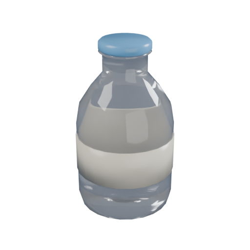
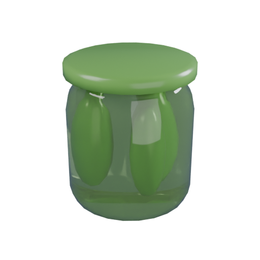
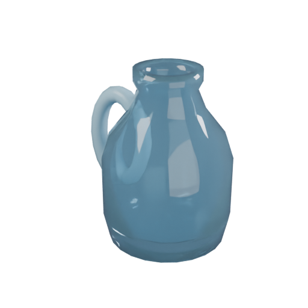

# Asset wave 1 — 2026-10-14

Eight original flat-shaded sky props and nine glossy glassies exported. Open Blender work was preserved; the active scene returned to Sky_Islands_Preview. Starter source files were untouched.

| Glassy | Body triangles | Closed shards | Surface crack segments |
|---|---:|---:|---:|
| Milk Bottle | 432 | 16 | 144 |
| Pickle Jar | 336 | 16 | 144 |
| Glass Cup | 432 | 16 | 144 |
| Ketchup Bottle | 384 | 16 | 144 |
| Water Jug | 768 | 16 | 144 |
| Lemonade Bottle | 384 | 16 | 144 |
| Mason Jar | 768 | 16 | 144 |
| Hot Sauce | 384 | 16 | 144 |
| Crystal Tumbler | 384 | 16 | 144 |

All bodies/shards: zero boundary or non-manifold edges, positive volume, common hang-point origin. Shard volume sums differ from bodies by under 0.0002%. The initial hollow-cup fracture filled its interior; a triangle-fill cutter fixed it before final export. Existing starter fracture defaults remain unchanged.

Each glassy includes separate details, source .blend, body/shard/detail FBX, cracks.json and a transparent 512×512 icon using the shared camera/lights. Icons were visually inspected. Crack paths are wired into ShatterController through CrackPathsExtra without changing starter paths.

Sky triangles: single crystal 32, small cluster 96, big cluster 192, Kiln crystal 108, featured arch 148, clouds 320 / 320 / 400. Materials remain separately recolorable, matte world props. Kiln hero is 18 studs tall; arch about 26.9 × 3.6 × 26.6.

17 FBX import bundles round-tripped through Blender: **183 meshes**, maximum bounds error **0.00000191 studs**. Details in `assets/blender/import_wave1/validation.json`. Native Studio import/assembly validation remains pending. Lune/Studio: **65 passed, 0 failed**.

Import instructions and the safe finalizer: [Wave 1 README](../../assets/blender/import_wave1/README.md), `tools/studio/install_wave1_glassies.luau`. The finalizer has not run against native imports yet; it skips existing glassies, requires every named mesh and retains raw sources. No new asset enters rolls/Kiln before complete installation.

