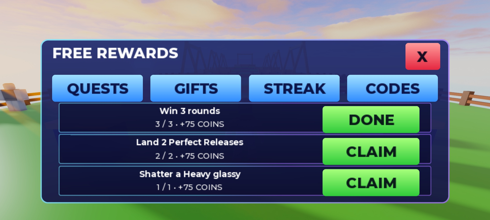
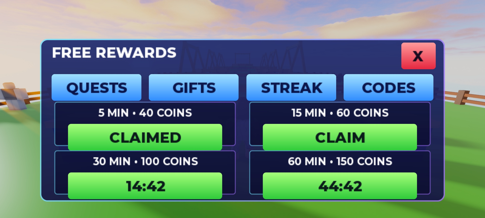

# Free retention — 2026-10-14

Implemented three daily quests from GAME_DESIGN 11 (win 3 rounds, 2 Perfect Releases, shatter a Heavy), configured 5/15/30/60-minute gifts, first win of the day, check-in streak tracking, one Studio test code and Trophies/Wins/Shatters boards. RewardsScreen is the 14th editable StarterGui template, with Quests/Gifts/Streak/Codes tabs. Daily/Codes kiosks have distance-checked prompts. Existing decor was preserved.

Server tracks elapsed time and observed fights; clients send only claim identifiers or code text. Claims and redemption flags change atomically before adding coins. Daily resets use UTC. First-win bonus requires an observed round win; synthetic pre-fight forfeits cannot earn the additional 100 coins. Existing MatchLogic forfeit rewards remain a separate eligibility follow-up for Claude.

**71 tests pass in Lune and Studio.** Added rollover/streak, observed-stat eligibility, early/repeated claims, time threshold, code persistence/production gating and malformed-input cases.

Live Studio mock integration: observed-stat/time fixtures unlocked a quest and gift; valid remote claims added 75 and 40 once. `STUDIOCLASH` added 75 once (the existing quest amount), and is **Studio-only**. Combined with first-win fixture 100, the saved balance was 290; reload retained it. Repeated quest/gift/code requests, NaN/out-of-range gift ids and table code input left 290 unchanged. No gameplay Output errors. Studio API access is available now, but mocks remain isolated and ordered leaderboard writes are disabled in that mode. Native imported-glassy and published datastore/board checks remain pending.

Leaderboard boards display local session data in Studio mocks; published servers coalesce writes to ordered stores and read top ten. Wins/shatters publish monotonically; trophy ranks refresh eventually. Production store access is not claimed as tested.

No paid systems or free Marbles are enabled. Group join reward remains pending the owner's group ID and a permitted reward configuration. Check-in streak currently tracks attendance only. No arbitrary coin streak reward was added.

Phone audit: zero Position/Size offsets; Close, quest and gift buttons have 44 px minimum height. Studio reset to default viewport. Final UI images remain the creator's work.

Balance/economy reports in F4_balance.txt and F4_economy.txt are unchanged: starter mirrors 22.3 / 43.6 / 19.9 s, zero timeouts; ~3.7-minute matches, 4 day-one / 96 day-30 pulls, first Rare 47 min, Epic 2.1 h, Legendary 9 h. Only retention plumbing intervals were added to Balance; fight/powers/rarities/economy values were not changed.
