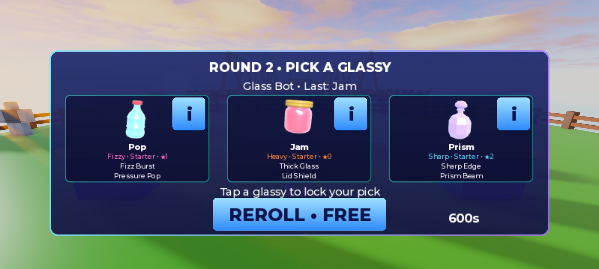

# Multiplayer, security and layout pass — 2026-10-14

The native multiplayer regression passes with **71 tests, zero runtime errors**. The final run took 181.2 seconds. Evidence: [final native result](F5_multiplayer_final.json).

## Native multiplayer

The StudioTestService harness launches two actual simulated clients against a separate server. It uses real physical pad queues and input remotes, leaving ordinary game controllers active. It verifies:

- Two isolated starter profiles; malformed inputs cannot grant coins.
- Human 1v1 matchmaking, offered picks, aim and a complete five-round PvP match.
- Seven simultaneous moving fights, both participant view owners and snapshot buffers; side B deliberately drops one third of unreliable snapshots.
- Match settlement and results, then camera/control restoration on both clients.
- Play Again, opponent disconnect during the next fight, arena/player registry release and UI restoration.
- A third native client joins while other fights are running: a fresh zero-coin profile, immediate live spectator state, normal camera and no participant HUD.

A first pass succeeded before late-spectator rendering was checked deeply. The expanded test then caught missing replicated Hook Instances ([failure](F5_multiplayer_latejoin_failure.json)). Descriptors now send hook/pad coordinates by value; clients own their local Beam anchors. A rate-limited bootstrap request also handles slow startup/character reload. Already-broken fighters hide without replaying old shatter effects. Stand fading resolves the tagged arena independently of local hooks.

## Performance sample

All seven simulations were moving before the sample began.

| Measurement | Final sample |
|---|---:|
| Server frames / FPS | 360 / 59.97 |
| Maximum server frame | 20.38 ms |
| Fight service calls | 2,520 |
| Mean / maximum service call | .0209 / .2607 ms |
| Combined simulation work per server frame | .1464 ms |
| Side A client | 59.01 FPS, max frame 99.09 ms |
| Side B client | 14.81 FPS, max frame 132.28 ms |

This is a short Studio desktop sample. Earlier native runs showed 60/15 FPS and smaller worst frames (23.90/68.30 ms). Background Studio throttling is a possible explanation for side B's steady 15 FPS, an inference rather than a device measurement. The client spikes and real low-end-phone/MicroProfiler check remain owner checks; this does not establish mobile performance. Server authority, input acceptance and interpolation survived the throttled client and deliberate packet loss.

## Cleanup and security

[Component fixture](../../tools/studio/verify_f5_client.luau): twenty repeated double-KO cycles, **123 checks**, zero retained lighting flashes or local fight roots. Fixed the second Shatter overwriting the owned flash reference. Distant fights now drain their final reliable event before going static. Heart pops retain their pad positions after the hook change.

[Real-remote flood fixture](../../tools/studio/verify_f5_remotes.luau) sends 20 requests each for profile, Kiln odds, fight bootstrap, invalid gift and invalid code, plus malformed pick/aim/pull inputs. [Result](F5_remote_flood.json): one profile response, two Kiln odds responses (including the failed-pull refresh), one claim and one code rejection, **zero coins**. Private Flags/CodesRedeemed/RecentMatches/Receipts/Marbles are absent. Added the same Open limiter to the Kiln proximity prompt.

Server review covers every client-input listener: type/finite checks, phase/player ownership, limiter before validation, server RNG/grants and atomic quote/claim consumption. Production dev hooks are unavailable. Runtime scan of 380 scripts found no numeric requires, getfenv, loadstring or unreviewed HTTP patterns outside the separately reviewed vendor. Existing pure tests cover limiter isolation, invalid numbers, duplicate settlement and reward claims.

**Open launch issue:** normal MatchLogic rewards still apply to a forfeit before a round completes. Native evidence demonstrates a 90-coin/20-trophy PvP win for the remaining player. The creator's answer on minimum completed-round eligibility is pending; economy rules were deliberately left unchanged under the standing restriction.

## Placeholder layouts

Fourteen editable StarterGui ScreenGuis have zero Position/Size/CanvasSize offsets. [Device fixture](../../tools/studio/verify_f5_layouts.luau) checks thirteen states on each of Samsung Galaxy A06, iPhone 17 Pro and iPad Pro M5 13-inch: lobby, collection, detail, Index, Kiln, four reward tabs, queue, roll, results and reveal. **39 states pass** safe-screen bounds and 44 px tap-target checks. Scrolling content is allowed to extend inside its scroll area; Roblox's own TouchGui is excluded.

Visual review caught oversized info buttons extending past roll cards and a reroll extending below its panel. They now stay within their parent panels, and the fixture checks those bounds too. [Safe original-template migration](../../tools/studio/fix_roll_info_layout.luau) only adjusts geometry matching the initial placeholders, preserving custom edits.

The screenshot is a Studio fixture; its long timer/free-reroll display does not represent the actual timed three-starter match. Normal rolls still hide rerolls when the collection has only three choices. Final images/styling remain with the creator. MCP pointer activation/gamepad ButtonB limitations from F3 remain manual checks. Default viewport restored afterward.

## Reproduce

- Edit mode: require a fresh clone of `ServerScriptService.Server.Dev.MultiplayerLauncher` and call `.run()`. Result is saved to `ServerStorage.GlassClashQAResult`; the harness requires Studio mock profiles and ends its own native test.
- Client mode, outside a match: execute the three `verify_f5_*.luau` scripts above. They neither make paid purchases nor grant debug rewards.
- `lune run tools/run_tests` and Studio `require(game.ServerStorage.Tests.RunAll)()`: 71 passed, 0 failed.

No Fight/Powers/rarity/economy values changed. No publication or paid features. Native Wave1 art imports, production datastore/global-board verification and real-phone checks remain pending.
