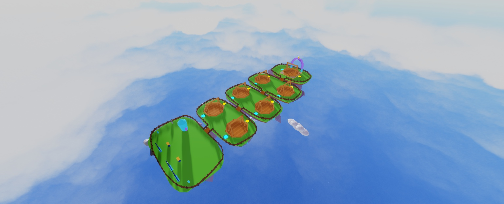
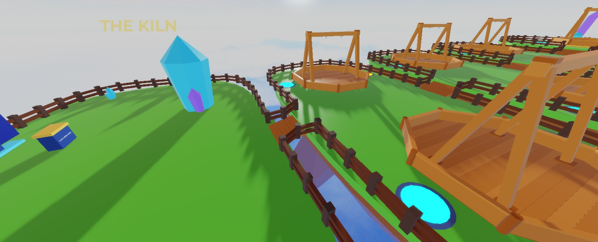
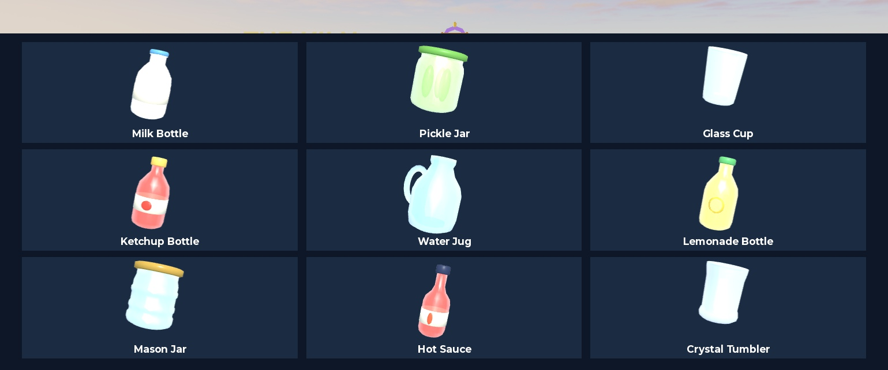

# Fitted fences and native Wave1 — 2026-10-14

All five island perimeters now use the creator's brown posts and two rails, fitted to their actual irregular grass outlines. No new Blender fence import was needed.

## Fences and access

- Posts retain the original 1×3×1 dimensions/colors; rails retain the .6×.6 section. Roughly five-stud spacing is resampled along each outline; individual rails are cut to length. The islands themselves were not resized.
- The exact 200 grass-rim vertices come from the existing island generator. Fence centres sit .9 studs inside the rim. Every post corner is supported by grass.
- Eleven-stud openings connect to the four bridges, with matching sloped handrails. Endpoint posts are shared rather than duplicated.
- 232 posts, 464 visual rails and 232 invisible safety colliders. Visual rails are non-colliding; colliders prevent walking through their gaps.
- The two original manually placed perimeter Models (**285 Parts**) and eight original low bridge rails remain in **ServerStorage.Unsorted.OriginalPerimeterFences**. A [measurement snapshot](fences/original_fences.json) also preserves the original Parts.
- [Geometry checks](fences/geometry.json): zero overhanging post corners; minimum centre inset .89999 studs; central lane clear.
- [Live walk](fences/walk.json): all 33 route visits passed, no jumps/falls/blockages; featured-pad entry 13.95 s, total route 70.53 s. A separate real-character edge test stopped at X=45.20, Y=3.01.

Build source: [fence builder](../../tools/studio/fit_island_fences.luau), [read-only verification](../../tools/studio/verify_fences.luau). The builder refuses to run when Lobby.Fences exists, protecting later manual edits. `python tools/map/export_fence_paths.py` regenerates the embedded exact rim data without opening/changing Blender.

## Imported assets

All 17 supplied Wave1 imports were staged and normalized against their measured manifests. Most arrived at 100× scale; the arch/cloud importer limit also required measured normalization. Raw models/meshes remain in ServerStorage.Wave1ImportedSources.

- Nine installed glassies: milk bottle, pickle jar, glass cup, ketchup bottle, water jug, lemonade bottle, mason jar, hot sauce and crystal tumbler. With starters, **12 are playable**.
- Native checks: Body/Details/Shards share the hang pivot; each glassy has 16 shards, anchored non-colliding templates and correct stud bounds. All nine render their own native mesh, generate surface cracks and shatter into 17–20 shards/details. [Results](fences/glassy_native.json).
- Eight normalized sky assets in ReplicatedStorage.Assets.WorldKit; 16 placed instances including the native Kiln, featured arch, crystals and clouds. Previous Kiln placeholder remains in ServerStorage.Unsorted.PreviousKiln. Kiln proximity functionality is retained.
- [Native mesh-ID/transform recovery record](../../assets/blender/import_wave1/studio_assets.json).

The temporary gallery was removed after checking all 28 body/detail meshes loaded successfully. Final ScreenGui art remains the creator's work.

Real coin Kiln verification used isolated Studio mock coins: nine eligible items, odds sum 1.000000; single pull charged 300, ten-pull charged 2,700; 11 pulls left 300 of 3,300 fixture coins. Duplicates gained stars; replaying the old quote was rejected with no extra debit/grant. Only installed Common/Uncommon content is advertised; configured Rare+ entries remain unavailable until their art exists.

Reproducible import steps: [stage exact names](../../tools/studio/stage_wave1_imports.luau), [install glassies](../../tools/studio/install_wave1_glassies.luau), [install/place sky kit](../../tools/studio/install_wave1_sky.luau). Existing installed models and placed art are protected from replacement.

## Approved reward rule

The creator accepted **no rewards before a completed round**. MatchService derives eligibility from actual FightEnded results; synthetic forfeited hearts do not count. MatchLogic returns zero currency when ineligible; profile/retention settlement records the result idempotently without match/quest stats, welcome eligibility or streak changes. Results say "MATCH ENDED / No rewards — finish a round first". Existing eligible reward amounts remain unchanged.

[Native multiplayer regression](fences/multiplayer.json): full PvP + replay/early opponent disconnect + third staggered join passed, **zero runtime errors**. The early-disconnect result has zero coins/trophies; profile currencies and match stats remain unchanged. Normal first-match settlement still works. Seven moving fights: server 59.98 FPS, .168 ms combined simulation/frame; clients 59.00/14.75 FPS with Studio spikes. Real-phone performance remains an owner check.

Lune and Studio: **74 passed, 0 failed**. Added meaningful coverage for both sides' zero rewards, idempotent denied settlement, welcome/stat exclusion and preserved streaks. Standard full-catalog simulator baseline is unchanged: starter mirrors 22.3/43.6/19.9 s, no timeouts; ~3.7 min matches, 4 day-one / 96 day-30 pulls, first Rare 47 min / Epic 2.1 h / Legendary 9 h. Those catalog projections do not describe the currently limited nine-item art pool.

## Owner actions

Save the place in Studio to retain world/UI instances. Publishing, final UI artwork, real-phone/MicroProfiler and production datastore/global-board verification remain manual. No paid features or automatic publication were added. Studio ended in Edit mode.
