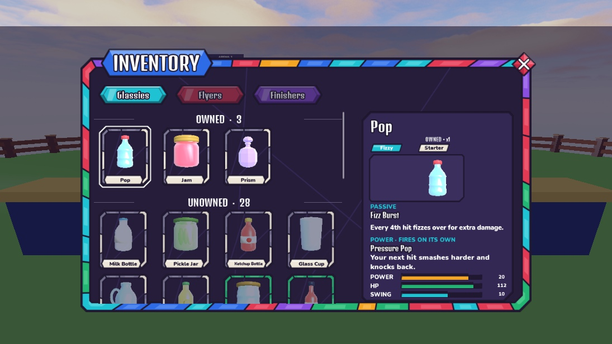
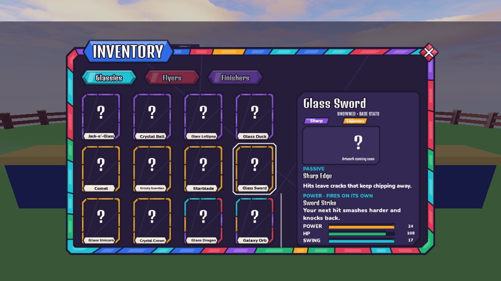

# Inventory Owned / Unowned — 2026-10-15

Creator request: show every missing glassy beneath owned glassies, with a section divider and inspectable information like the supplied references. Retained the current Inventory size, Stained Glass artwork, upright portraits, centered button anchors and removed Stars display. No device settings changed.

## Behavior

- One scroll area: Owned heading/count and owned tiles, then Unowned heading/count and every remaining catalog entry. Current new-player view: 3 owned, 28 unowned; 31 total.
- Unowned models are dimmed while names and rarity borders remain readable. All 12 installed glassies use their actual upright models. The 19 catalog entries awaiting artwork use a question mark; the info pane explicitly says artwork is coming soon, instead of showing another glassy's model.
- Selecting either section updates the existing right-hand name, ownership/type/rarity labels, portrait or placeholder, passive/power descriptions and stats. Unowned values are labeled BASE STATS. Selecting a missing glassy does not add it to the roll pool or grant ownership.
- Acquisition moves its tile into Owned, restores full portrait color and updates the selected detail in place. Empty and complete collections have explicit messages. Refresh preserves a valid selection and rebuilds each tile/handler exactly once.

## Validation

- Lune and Studio `RunAll`: **76 passed, 0 failed**.
- `tools/studio/verify_inventory_unowned.luau`, Play Client: **2,505 checks passed**. Empty, starter-only, complete and newly acquired fixtures; complete catalog with no duplicate entries, grouping/order, dimming/placeholders, button anchors, all 31 detail panels and text fit, base stats, selection continuity, acquisition migration, repeated refresh and close cleanup.
- Real Studio mock-profile grant: selected unowned Milk Bottle, granted through existing server `DataDev`, and verified automatic profile-sync migration from 3/28 to 4/27 with `OWNED • x1` details. No production data or purchasing changes.
- Desktop visual checks: both sections, scroll-to-bottom, high-rarity frames and missing-art details. No phone-ready claim; device formatting remains deferred at creator request.

## Editing and recovery

`StarterGui.CollectionScreen.Panel.Content.Grid` contains `OwnedHeader`, `Tiles`, `UnownedHeader`, `UnownedTiles` and the empty-state labels. Edit `Templates.GlassyTile` and `Templates.UnownedGlassyTile` for card artwork and dimming. Both section grids retain the authored column widths; Grid attributes control tile height, row gap, header height and section spacing relative to the visible scroll area. Only data-dependent section/canvas heights are normalized at runtime.

`InfoPane.Ownership`, `UnknownPortrait` and `ArtworkPending` are editable labels. Other info fields are reused.

Original template: `ServerStorage.UIBackups.InventoryBeforeUnowned_20261015` and `places/Inventory_BeforeUnowned_20261015.rbxm`. Final bundle: `places/UI_v05.rbxm`. One-time Edit installer: `tools/studio/build_inventory_unowned.luau`; it refuses an installed version to protect later creator edits. Studio left in Edit; publishing remains with the creator.
