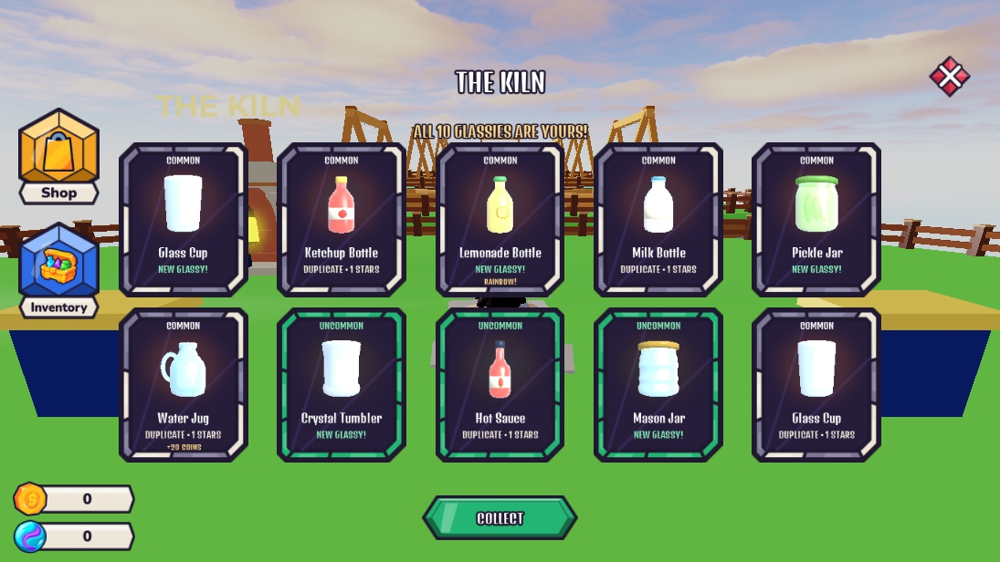
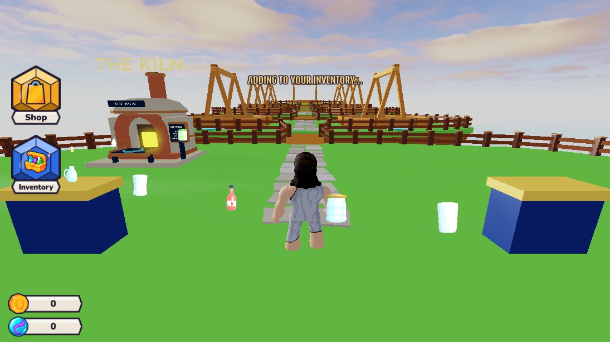

# Kiln opening — 2026-10-15

The creator approved the case-style reel and requested a transparent opening overlay, centered cards, a better firing sequence, and Collect-to-Inventory instead of Back to Shop. Everything below is UI presentation; existing server rolls, costs, odds and grants remain authoritative.

## Final behavior

- Open immediately closes the Shop and shows a pending overlay. Server rejection restores the Shop with the error.
- One or ten horizontal reels decelerate onto the exact awarded IDs. Cosmetic filler samples the currently quoted pool; it cannot award items or manufacture premium near misses. Recycled cells limit active ViewportFrames to seven for one pull or fifty for ten.
- All landings feed one front-facing UI kiln. A small chamber flame, heating glow, subtle compression, brief release pulse, sparks and existing approved sounds precede the card flight.
- Upright glassies emerge together in fixed 5:6 cards. Single-card center and artwork center are exact; ten cards form two centered rows. Rarity, duplicate stars, Rainbow and bonus-coin facts are preserved.
- No menu shell, dimmer or full-screen background. Lobby navigation remains visible; Play/its hint hide temporarily to leave Collect clear. The overlay catches input and preserves the existing movement gate.
- Collect fades the card decoration and sends the glassies on curved paths into the actual Inventory button, shrinking and pulsing the button on arrival. It then closes the overlay and restores the HUD. This is confirmation of already-granted rewards, not a second grant.
- Close and match interruption destroy the presentation/audio and restore HUD state. Skip reveals every card immediately. Marble purchasing remains inactive; no device preset changes.

## Verification

- `lune run tools/run_tests` and Studio `RunAll`: **76 passed, 0 failed**.
- `tools/studio/verify_kiln_opening.luau`, Play Client: **733 checks passed**, zero purchases. Covers 1/10 exact reel targets, reward IDs, upright models, card proportions/centers, fitted labels, one firing per batch, duplicate delivery, skip in every phase, collect-once, every flight landing at Inventory, rejected-pull recovery, and cleanup/HUD restoration after interrupted reels/fire/collection.
- Live isolated Studio mock profile: 100,000 coins → 99,700 after one pull → 97,000 after ten; server `Stats.KilnPulls` increased by 11. Native real result payloads contain 1/10 server awards; the single reward matched the UI and Collect closed it. The ten-result overlay was already closed by the time the final inspection ran; exact ten-card rendering/landing is covered by the isolated native presentation checks above.
- Final template audit: transparent panel, no Backdrop, disabled by default, version 3, all three buttons centered at (0.5, 0.5).
- Native desktop screenshots below use a nine-item-pool fixture to exercise new/duplicate/Rainbow/bonus labels without purchases. Device formatting and published/low-end performance checks remain deferred.

## Editable assets and recovery

- `StarterGui.KilnRevealScreen.Panel.Content`: Reels, KilnStage, Rewards, Status, Skip and Collect. `Templates` holds Reel, ReelCell and RewardCard prototypes. The kiln is a separate ViewportFrame model, with a saved front-facing camera pose.
- Timing: `Theme.Kiln`. Runtime: `KilnReels`, `KilnOpening`, `Screens/KilnScreen`.
- `places/UI_v05.rbxm` contains the final editable UI bundle. Original reveal: `places/Kiln_BeforeOpening_20261015.rbxm` and `ServerStorage.UIBackups.KilnOpeningBefore_20261015`. Intermediate presentations are retained as `KilnOpeningV1_20261015` and `KilnOpeningV2_20261015` in UIBackups.
- Installers are ordered, Edit-only and refuse already-installed versions: `build_kiln_opening.luau` → `refine_kiln_opening.luau` → `overlay_kiln_opening.luau`. Do not rerun over creator edits.
- Studio-only `LobbyClientDev`: `PreviewKiln`, 1 or 10 (no purchase); `KilnSkip`; `KilnCollect`; `KilnPull`, 1 or 10 (real existing Coin pull using current quote). The latter is for isolated Studio tests only.
- Original effect files and full generation prompts: [asset notes](../../assets/ui/kiln_opening/README.md).

## Reviewed implementation references

- [MikeChen1109/loot_reel](https://github.com/MikeChen1109/loot_reel), including `lib/src/loot_reel.dart`: predetermined winner injection, centered target offset, tail buffer and eased deceleration. [MIT license](https://github.com/MikeChen1109/loot_reel/blob/main/LICENSE).
- [Roblox case animation discussion](https://devforum.roblox.com/t/case-system-animation-help/2844637): author-provided native TweenService example of scrolling toward a chosen slot.

These were read as implementation references. No third-party code, library, Toolbox model or dependency was installed or executed. The shipped Luau implementation is original.
