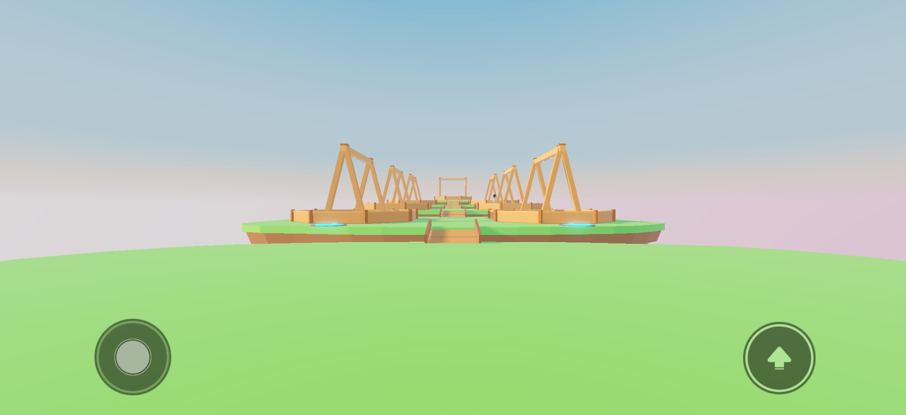
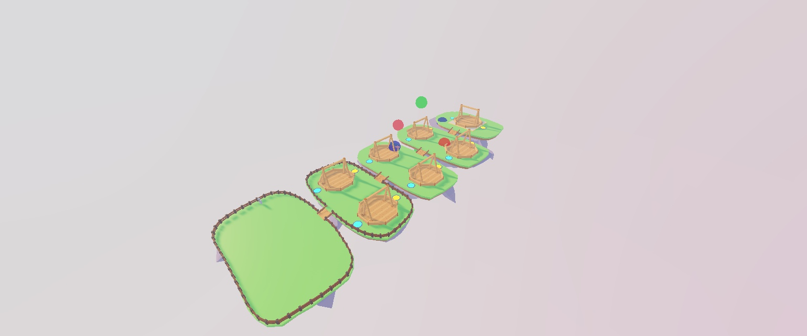
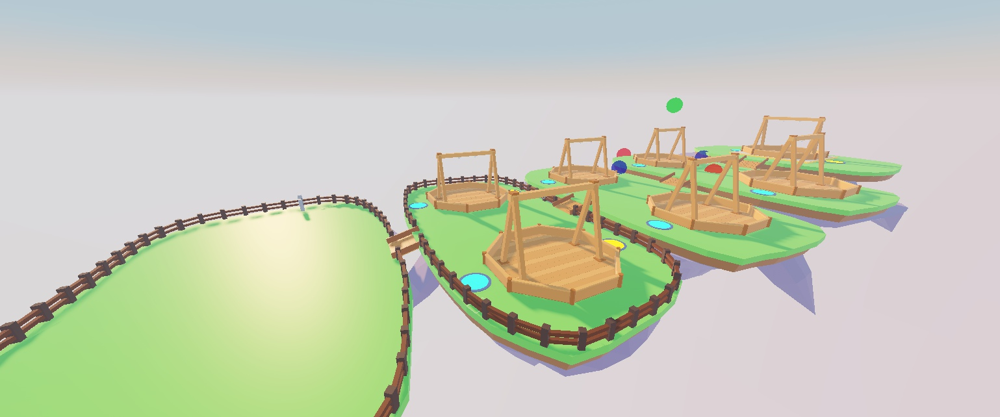

# L1 sky lobby — Part B handoff

Completed October 14, 2026. Studio is in Edit mode. **File > Publish to Roblox**
to save the world changes. User-added fences and manual edits were preserved.

## Inventory and cleanup

The complete pre-cleanup inventory lists 3,202 descendants with their disposition:
[L1_before_inventory.txt](L1_before_inventory.txt). Empty services are explicitly noted.

| Location / content | Action |
|---|---|
| `Workspace.Camera`, `Terrain`, five `Isle_*` imports | Kept; terrain voxels cleared; islands normalized and moved to `Lobby.Islands` |
| `ReplicatedStorage.Shared`, `ServerScriptService.Server`, `ServerStorage.Tests`, `StarterPlayerScripts.Client`, Rojo session lock | Kept; Rojo sync verified before code edits |
| `ReplicatedStorage.Assets` (Glassies and ClashStand) | Kept; only authorized hook spacing/attachments changed on the template |
| `ServerStorage.M1ImportedSources` | Kept as original glassy/stand art backups |
| Reusable old-map pieces | Eight clean, anchored, script-free prototypes saved to `ServerStorage.LegacyKit`: Tree, Bush, Lamp, Bench, RepairBench, Rock, Crate, FenceSegment |
| `Workspace.PlayerReference`, `Lighting.LightingPreset` | Moved to `ServerStorage.Unsorted` |
| `Workspace.Map` (GlassTown, RecyclingYard, visuals, collision, markers and old stand copies) | Deleted after prop salvage |
| Old `Workspace.ClashStand`, Baseplate, SpawnLocation | Deleted/replaced |
| `ServerStorage.MapImportedSources`, `MapBlockoutVisuals` | Deleted after prop salvage |
| Old Sky, SunRays, Atmosphere, Bloom, DepthOfField, M1Atmosphere, M1Color, M1Bloom | Replaced with sky-lobby lighting |
| StarterGui, SoundService | Already empty; no leftover HUD or audio to remove. No Sound instances were present at inventory time. |

## Result and layout adjustment

Five islands have correct source dimensions, top-centre pivots, matte colours, and
non-colliding visual meshes. The importer had enlarged them approximately 20–27×;
dimensions and offsets were restored from the Blender manifest. Original import
properties are in [L1_island_imports.json](L1_island_imports.json); mesh IDs and placed
transforms are in [studio_assets.json](../../assets/blender/map/sky/studio_assets.json).

The only planned spacing change is **four-stud nominal gaps instead of five**.
The original layout reached the featured pad in 14.17 seconds by the shorter route;
bringing Featured four studs closer reduced entry time to **13.92 seconds** at
WalkSpeed 16. Spawn stays at `(0, 0, 12)` and island heights are unchanged.

| Island | Final top centre (X, Y, Z) |
|---|---|
| Lobby | (0, 0, 0) |
| Arena1 | (0, 2, −55) |
| Arena2 | (0, 4, −105) |
| Arena3 | (0, 6, −155) |
| Featured | (0, 9, −206) |

The lobby includes 13 overlapping flat collision strips per island, four tagged
eight-stud placeholder bridges with low rails, seven tagged stands, fourteen tagged
queue pads, nine invisible lobby spots, and a SpawnLocation. Featured uses a low
gold-trim stage. All seven hook pairs finish exactly six studs apart, including
stands resized manually during handoff; the final correction moved only their hooks.
The user's stand resizing and fences were otherwise left intact.

Lighting uses the concept's golden afternoon settings and an original seamless
blue/peach gradient sky. The sun direction has a positive Z component, behind spawn.
Sky image sources and their generator are in `assets/sky/crystal_isles` and
`tools/map/build_sky_gradient.py`; asset IDs are recorded with the placed meshes.
No crystals, trees, shops, signs, or game systems were added by this task.

`FallService` runs on the server through Rojo. Below Y = −40 it returns a living
character to the nearest island's safe point, clears velocity, and preserves health.
It uses one connection, has idempotent Start / explicit Destroy, and holds no
per-player or per-character references between checks. Its three settings are in
`Balance.Lobby`; combat and economy values are unchanged.

## Checks

- Full character walk across the original row, every pad and back to spawn: **33
  waypoints, no failures, 68.85 seconds**. No jumping or intermediate teleporting.
- Shortened layout retest: **featured pad entry 13.92 seconds**, centre 14.07 seconds;
  first 14 waypoints passed before the user ended play and requested a quick finish.
- Final Edit check: all central-route ground samples and all fourteen pads have
  collision underneath; all seven hook gaps equal six studs. No old map remains.
- Falls from all five islands: returned to the intended safe point, same character,
  **100 health** throughout. Featured returns outside the pen.
- iPhone 17 Pro landscape: unobstructed row view, normal touch controls, **about
  60 FPS averaged over 600 desktop-emulator frames**. This is not a physical-phone
  performance measurement. Device simulation is now off.
- Lune and Studio RunAll: **51 passed, 0 failed**. Play console clean.
- Lobby: **584 descendants**, **400 MeshParts**, **149 native parts**. Fixed imported
  mesh budget: **17,846 triangles** (4,210 islands + 7 × 1,948 stands). Visible native
  geometry adds 552 box triangles plus 28 cylinders whose tessellation varies by LOD;
  roughly **20–22k visible triangles** overall. User decorations outside `Lobby`
  are excluded from these counts.
- StyLua was blocked by Windows Application Control. The small service was formatted
  manually; `git diff --check` and runtime/test checks passed.

Both simulators ran because Balance gained lobby settings. Combat/economy summaries:
mirror rounds 20.8–39.0 s, 0% timeouts, 50% side bias; pop>jam 64%, jam>prism 76%,
prism>pop 62%; Perfect vs worst 61%, special use 70%. Economy: ~3.7 min/match,
4 pulls day 1 / 96 by day 30; first Rare ~47 min, Epic 2.1 h, Legendary 9 h;
20% obtain a Mythic in 30 days.

## Screenshots

Phone spawn view (before the four-stud spacing reduction):

Final aerial, including the user's fences:

Final arena island:

`tools/studio/build_sky_lobby.luau` records the initial build. **Do not rerun it over
manual edits**: it replaces its arena/bridge/collision/spot folders. The cleanup
script likewise records the already-completed one-time migration.
