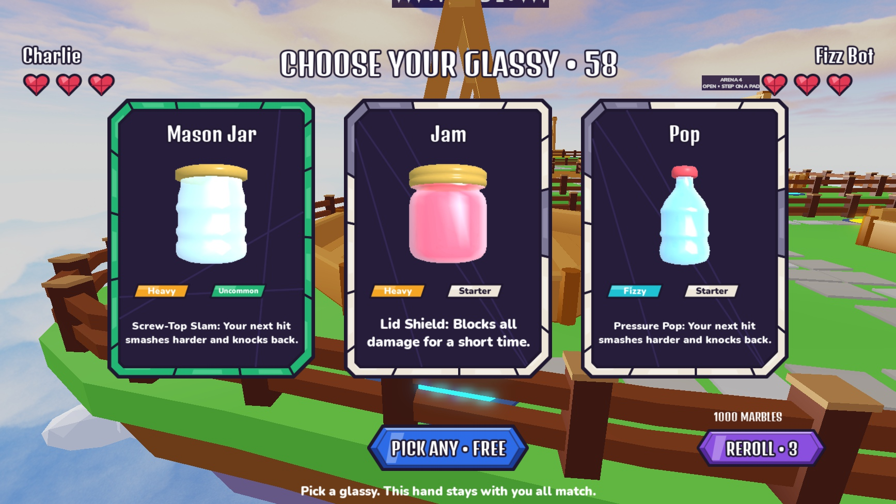
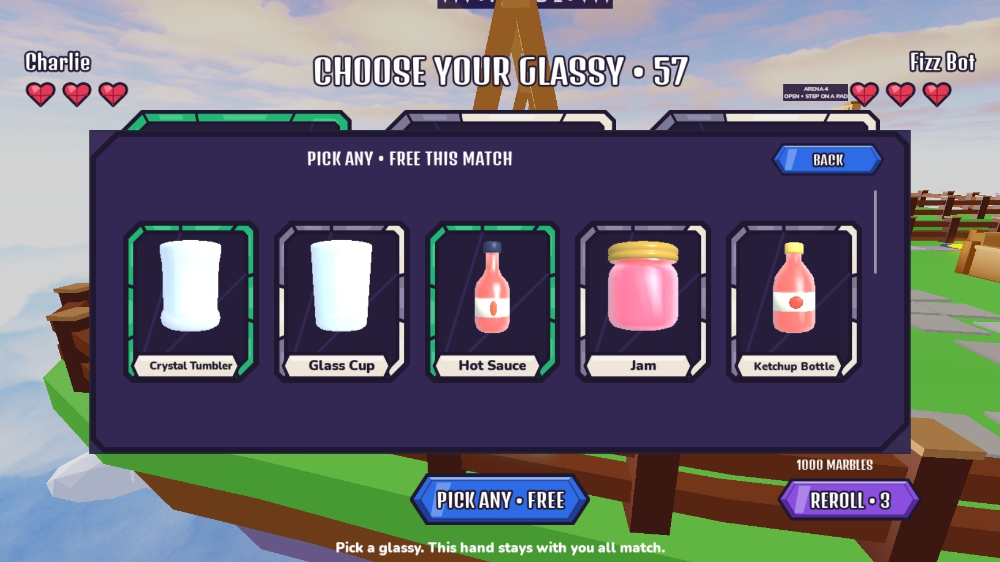

# Match selection — 2026-10-15

Creator-approved implementation of decision 55. Desktop native checks completed; device formatting remains deferred.

## Behavior

- At match start, three distinct owned glassies roll vertically one at a time. Each eligible glassy has equal probability. The same hand remains throughout the match, with no automatic reroll or repeated animation between rounds.
- Small right-side Reroll replaces the entire hand for the remaining match. Costs reset each match: **3, 3, 6, 6, then 9 Marbles**, capped at 9. A reroll may reproduce a previous hand.
- Main Pick Any opens owned inventory and selects this round's glassy without changing the hand. Costs reset each match: **free, 6, 9, then 12 Marbles**, capped at 12.
- Every paid action asks for confirmation. Reroll confirmation lists every eligible glassy and its uniform inclusion probability, min(3, owned count) / owned count. Twelve eligible glassies therefore show 25% each.
- Server checks exact match, round, selection revision and quoted price; ownership, wallet, phase and deadline; rate limits and policy. Debit and match mutation do not yield. Stale/replayed requests and duplicate confirmations cannot charge twice. Rerolls stop accepting requests within 2.2 seconds of the deadline so their presentation can finish.
- PolicyService results are cached; rerolls hide/reject for restricted players or unavailable policy. Pick Any is deterministic. No Marble packs, free earning grants, gamepasses or Marble Kiln purchases were added.

## Verification

| Check | Result |
|---|---|
| Lune RunAll | 79 passed, 0 failed |
| Studio RunAll | 79 passed, 0 failed |
| Native server selection checks | 75 passed |
| Native client presentation checks | 117 passed |
| Actual client → server Reroll/Confirm | 1000 → 997 Marbles, one reroll |
| Isolated pricing/persistence fixture | 7 rerolls + 5 Pick Any uses, 1000 → 916 saved |
| Later-round client inspection | Same hand, zero new opening animations |
| New match | Usage/revision counters reset, wallet retained |
| Close/interruption | Reels, sounds, modal connections cleaned; HUD restored |

Server fixtures also cover stale replay, forged price, unowned choice, insufficient funds, restricted random actions, late reroll and already-picked requests. UI fixtures cover exact final targets, sequential visibility, upright portraits, confirmation once, all owned choices/outcomes, text fit and centered button anchors. Final console had no game errors; Roblox internal FoundationProvider warnings were present. Studio was left in Edit, Rojo serving.

Balance simulator: Pop/Jam/Prism mirrors 24.0/36.3/19.5 seconds, 0% timeouts; side A 48%, Perfect/worst 63%, mirror comebacks 50%, 1.5 lead changes, 2.2 powers/glassy, 34% aimed misses. Economy simulator: 3.7 minutes / 4.12 rounds per match, 16.1 matches/hour; day 1/30 pulls 4/96, day 7/30 uniques 12/18; Rare 47 minutes, Epic 2.1 hours, Legendary 9 hours. It uses the full 28-item catalog versus 9 live Kiln entries and does not model new match-action spending/adoption.

## Editing and recovery

- Editable template: StarterGui.RollScreen. PickAny and Reroll are separate authored buttons; PickAnyChooser contains the owned grid and Confirm contains price/odds text plus Accept/Cancel. Runtime bindings preserve authored geometry. Buttons use AnchorPoint (0.5, 0.5).
- Installer: [build_match_selection.luau](../../tools/studio/build_match_selection.luau), version guarded to preserve later creator edits.
- Current bundle: [UI_v05.rbxm](../../places/UI_v05.rbxm). Original RollScreen: [Roll_BeforeMatchHand_20261015.rbxm](../../places/Roll_BeforeMatchHand_20261015.rbxm) and ServerStorage.UIBackups.RollBeforeMatchHand_20261015. Import into a temporary folder to inspect/recover only the intended template. The exported bundle also contains existing Inventory/Shop/Kiln UI.
- Rules/prices: src/shared/MatchLogic.luau and Config/Balance.luau. Presentation timing: Theme.Selection; client reels: UI/Components/HandRoll.luau; screen behavior: UI/Screens/MatchSelection.luau.
- Native QA helpers: tools/studio/verify_match_selection_server.luau then verify_match_selection_server_finish.luau, and verify_match_selection_ui.luau. Server fixtures require isolated Studio mock profiles and deliberately alter fixture wallet/round state.

To grant test Marbles in **Studio Play, Server Command Bar** (isolated mock profiles only):

```lua
game.ServerStorage.DataDev:Invoke("Marbles", game.Players:GetPlayers()[1], 1000)
```

## Screenshots





## Policy references

Reviewed official Roblox documentation for [paid random items](https://create.roblox.com/docs/production/monetization/paid-random-items) and [PolicyService.GetPolicyInfoForPlayerAsync](https://create.roblox.com/docs/reference/engine/classes/PolicyService/GetPolicyInfoForPlayerAsync). Rerolls conservatively follow the paid-random restriction and disclose odds before every spend. No third-party library or plugin added. Publishing remains with the creator.
