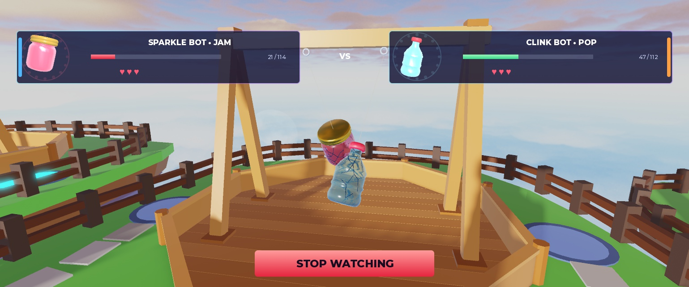
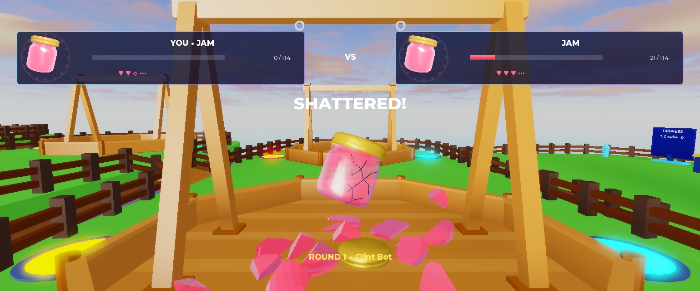
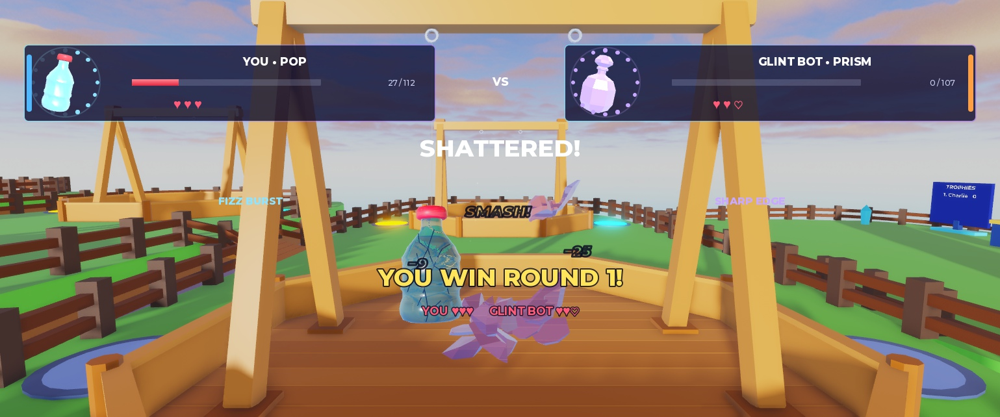
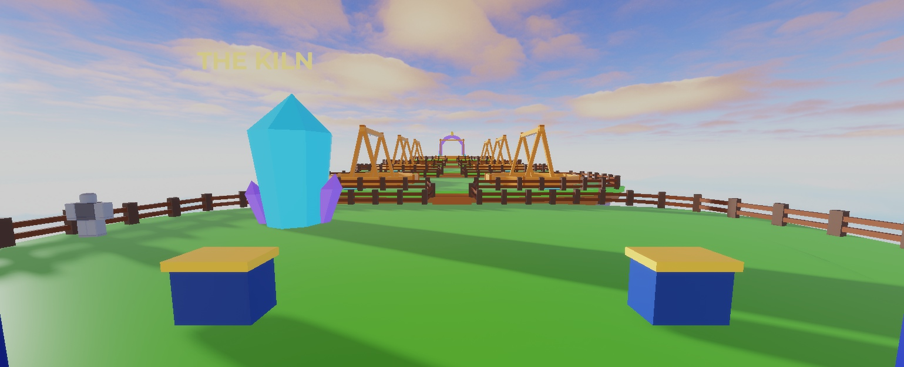
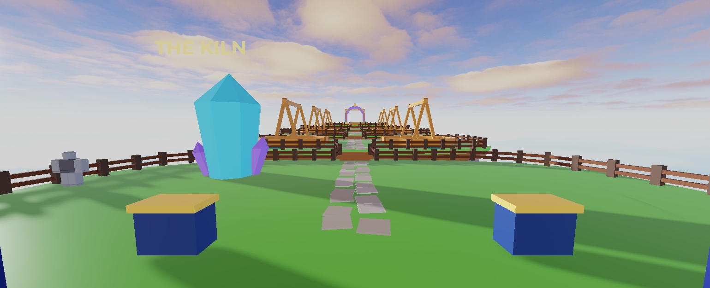
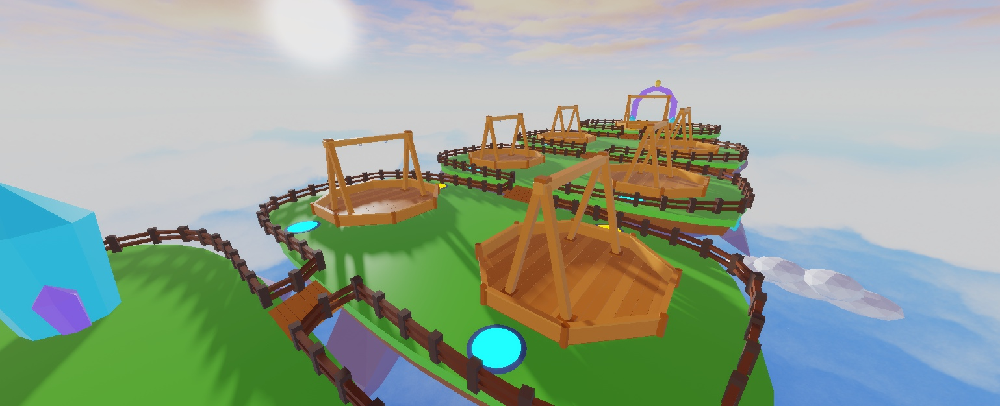
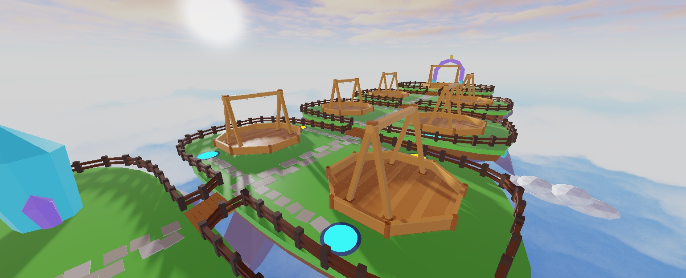
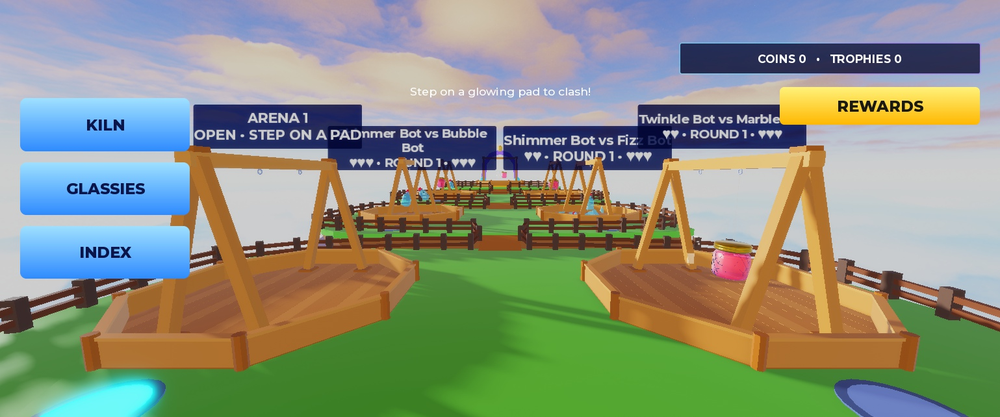
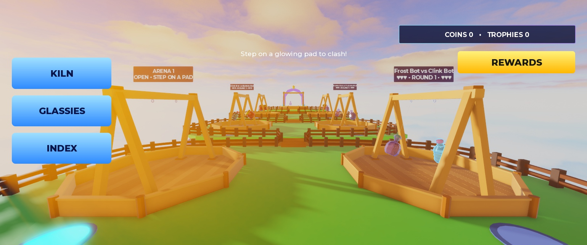

# Polish pass — 2026-10-14 (Claude)

Playtested as a player in Studio first, then fixed the highest-impact problems in small loops (inspect → implement → playtest → Output → tests → commit/push). Per the creator's direction mid-session: **no layout/visual restyle of the fight or menu UI** (final UI is being redone), **fences left alone**, and Codex's lobby-v2 Kiln/leaderboard/fence art untouched. Everything here is functional, fight-feel, world wayfinding, performance or calibration work.

**Where it lives:** code and tools are in Git (commits `634554a` … `dc50fa0`). World and StarterGui changes live **in the place — save it in Studio**. Every world/UI change has a reproducible script in `tools/studio/` and a backup.

## Bugs found and fixed

| Problem found in play | Fix |
|---|---|
| The gold **Perfect band was frozen** where the template was built, so "PERFECT!" could show with the marker outside the gold band. | The band now follows each round's sweet spot; authored vertical styling is kept. |
| Round banner appeared **before** the shatter rendered and read "ROUND 1 → Glint Bot"; the heart dropped early. | The banner waits for the rendered shatter: "YOU WIN ROUND 2!" / "FIZZ BOT WINS ROUND 2", with both players' hearts. A fallback still shows it after 1.6 s. |
| Mirror matches (Jam vs Jam) gave no way to tell which glassy was yours. | The HUD names owners ("YOU • JAM" / "FROST BOT • JAM"), side stripes match the pad colours (A blue, B orange), and an in-world **YOU ▼** marker floats over your glassy. |
| The heart label mixed in unexplained crack dots, and the shatter hard-coded "♥ ♥ ◇". | Hearts show only lives (♥ ♥ ♡) and update from game state. |
| **Survivor froze mid-air** for the 4 s round end; out-of-range fights froze in a pulled-back pose. | The survivor swings down to rest locally with a victory glint. Distant fights show a cheap stand-in swing, and the loser disappears at round end. |
| Reset left the match in limbo for ~5 s (forfeit only on respawn). | Forfeit on `Humanoid.Died`: released 0.05 s after death. Early abandonment still pays nothing; coins, trophies and match stats unchanged (decision 42 re-verified). |
| Idle arenas had **no sign**, and pads looked the same whether open or busy; distant signs stacked into one cluttered row. | Signs stay visible ("ARENA 3 • OPEN • STEP ON A PAD" / "Charlie wants a clash! Bot in 9s"), sized in studs so far ones shrink. Pad glows: bright = open, dim = someone waiting, grey = busy. |
| **Invisible 1.4-stud ledge** across the spawn → Bridge 1 route: `Isle_Lobby_Floor2` sat 1.4 studs higher (and rotated) than its 64 siblings. | Levelled. Walk test: root height flat at ~3.0 across it. Original CFrame kept as an attribute. |
| A Watch-prompt bug introduced during this session aborted the render callback 4×/s while watching was disallowed. | Caught in Output during verification and fixed before commit. Prompt updates now run after fight rendering. |
| Every bot was "Glint Bot"; Results said "RIVAL". | 12 original bot names (all end in "Bot"); Results name the rival. |
| Smaller issues | Lobby hint hides while queued. The Kiln says how many coins a pull needs. Play Again explains a just-filled arena. Kiln odds show 1–2 decimals instead of 4. "1 quest ready to claim" grammar. |

## New functionality

- **Watch any nearby fight** (decision 46): a "Watch" prompt at each stand with a fight on gives you that fight's camera and HUD, with no aim controls. It follows the arena across rounds, hides the lobby HUD, and STOP WATCHING (bottom-anchored, ≥44 px) or gamepad B exits. It is never offered while queued, in a match or on Results.
- **Countdown ticks** (rising pitch), a **release whoosh** on LET GO!, and a **heart-pop tinkle**, all reusing the four approved sounds.

## Fight clarity — before / after

| Before | After |
|---|---|
|  |  |

## World (decision 47) — before / after

Matte stepping-stone lane from spawn to the featured stage, with spurs to each queue pad (180 non-colliding stones). Calmer colour (saturation 0.40 → 0.12), low Bloom for glass glints, 1-px blur off.

| Before | After |
|---|---|
|  |  |
|  |  |
|  |  |

## Performance

7 simultaneous fights, local player participating in Arena 1, Studio desktop at 60 FPS ([perf.json](polish/perf.json)):

| Metric | Before | After |
|---|---|---|
| Fight render script, mean | 0.75–0.87 ms | 0.51–0.60 ms |
| Fight render script, max | 3.0–5.0 ms | 2.2–3.4 ms |
| Enabled Highlights | 14 | 0 (on only during a power tint) |
| Local fight instances | 634 | 382 |
| FightSnapshot payload | ~750 B table (JSON est.) | 128 B binary buffer |

Changes: binary `SnapshotCodec` with a numeric fight key (round-trip tests added), Highlights enabled only while visible, and no crack Parts for unwatched scenes. The earlier "15 FPS client" samples matched a minimized or unfocused Studio window (Studio throttles it), not game cost. **Real low-end-phone MicroProfiler remains an owner check.**

## Calibration

See [CALIBRATION_REVIEW.md](CALIBRATION_REVIEW.md). The F1 candidate's Jam/Prism Blade failures were model artifacts. The real swing: Jam mirrors 33–35 s, Prism Blade 55%. FightModel is now size- and slowdown-aware, fitted to 31 real mirrors (decision 45). No Fight/Powers/rarity/economy values changed. Rocket Pop / Momentum sitting near the fairness floor (39%) is noted for your approval.

## Verification

- **Tests:** 76 passed, 0 failed in Lune and Studio (2 new snapshot-codec tests).
- **Simulators:** under the fitted model, mirrors are pop 24.0 / jam 36.3 / prism 19.5 s with no timeouts; side bias 48%; triangle 63/67/62%; luck targets met. Economy is unchanged: ~3.7 min matches, 4 day-one / 96 day-30 pulls, Rare 47 min / Epic 2.1 h / Legendary 9 h.
- **Native multiplayer** (StudioTestService, 2 clients + staggered third) passes with zero errors after the snapshot and forfeit changes ([result](polish/multiplayer.json)). It covers PvP settlement, one third of snapshots dropped, Play Again, opponent disconnect (no-contest, zero rewards, stats unchanged) and the late spectator. Server 60 FPS with 7 fights, 0.15 ms simulation per frame.
- **Layouts:** 39 lobby/menu states on A06, iPhone 17 Pro and iPad Pro: 0 safe-screen or tap-target problems. STOP WATCHING is inside the safe area with ≥44 px on all three.
- **Played in Studio:** solo matches against bots, a 5-round match through to Results, Play Again, Leave, reset forfeit, watching across rounds, and walk tests. Output clean apart from Studio's own MCP notice.

## Place changes to save (not in Git)

| Change | Reproduce / restore |
|---|---|
| StarterGui: RoundEnd.Round moved up, RoundEnd.Hearts added, FightHud.Side1/2.SideStripe, FightHud.StopWatching (hidden) | `tools/studio/polish_ui_templates.luau`; originals in **ServerStorage.UIBackups.Polish_2026_10_14** |
| Lighting: ColorCorrection, GlassBloom, Blur disabled | `tools/studio/polish_lighting.luau`; originals in **ServerStorage.WorldBackups.Lighting_2026_10_14** |
| Workspace.Lobby.Paths (180 stones) | `tools/studio/build_lobby_paths.luau`; delete the folder to remove |
| Lobby.Collision.Isle_Lobby_Floor2 levelled | `tools/studio/fix_lobby_floor_step.luau`; original in its `OriginalCFrame_2026_10_14` attribute |

Pad glow state, arena signs, Watch prompts and the YOU marker are created by code at runtime and need no save.
