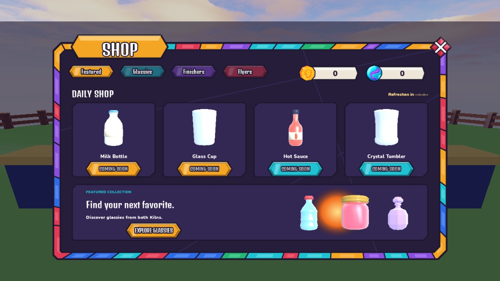
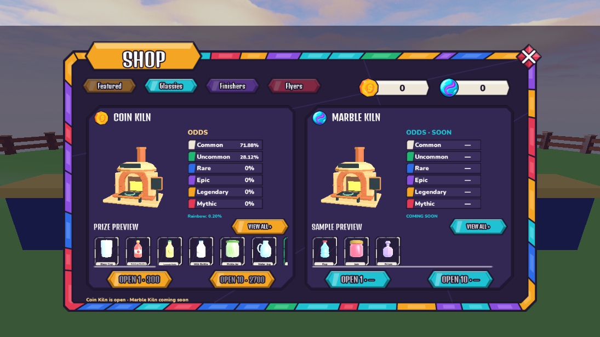

# Shop v0.6 — UI handoff

Implemented the creator-approved plan: Featured → Glassies → Finishers → Flyers, with Featured opening first. Reference screenshots informed layout; artwork remains the original Stained Glass theme and native Glass Clash models.

## Editable template map

Start at `StarterGui.KilnScreen.Panel`. The creator's shell size, currency header, Close and button anchors remain.

| Path under Panel | Purpose |
| --- | --- |
| Tabs | FeaturedTab, GlassiesTab, FinishersTab, FlyersTab |
| Content.FeaturedPage.DailyOffers.Offer1–4 | Editable sample portraits/names, inactive price controls; sample data only |
| Content.FeaturedPage.RefreshTimer | Placeholder `--:--:--`; no rotation/timer logic |
| Content.FeaturedPage.Showcase | Collection showcase and Explore Glassies navigation |
| Content.GlassiesPage.CoinKiln | Existing live Coin prices/odds, preview strip, View All and pull controls |
| Content.GlassiesPage.MarbleKiln | Inactive Marble opening controls, unset odds and sample preview |
| Content.GlassiesPage.MarbleKiln.KilnPortrait.WorldModel.MarbleKilnModel | Separate furnace copy to recolor/edit; no world placement yet |
| Content.GlassiesPage.*.OddsPane.RarityRows | Larger Common–Mythic rows and chances |
| Content.GlassiesPage.*.Pool.Templates.GlassyTile | Shared preview-tile appearance |
| Content.PoolPage | All-prizes view and Back; Coin chances come from server quote |
| Content.FinishersPage / FlyersPage | Coming-soon shells |

Keep names and `Templates` folders. Buttons anchor at `(0.5, 0.5)`. Glassies use an upright straight-on camera centered on complete body/detail bounds; idle rotations were removed throughout Inventory, Choose, details and reveals. `PortraitCamera` and `PortraitFOV` attributes restore client viewport cameras. Future edits to furnace geometry should be followed by refitting its camera (the upright migration tool fits both Kiln viewports too).

## Scope and validation

- UI navigation/preview only for new offerings. Daily rotation, prices, Marble odds/purchases, paid-random policy gating and the new animated opening await the creator's next walkthrough. No invented Marble odds or purchase remotes; Marble and daily purchase controls are inactive. Existing Coin quote/pull/reveal behavior remains.
- Lune and Studio RunAll: 76 tests pass. Desktop navigation covered four tabs, two View All pages, Back handlers and Close restoring LobbyHUD. All 99 visible Shop label checks fit; 105 template buttons have centered anchors. Separate furnace model instances and inactive Marble controls verified.
- Structural audit: five screens, 463 objects, 150 images, zero missing assets/failures/offsets/UICorners. Stretchable pane art is exempt from fixed PNG aspect constraints; pointed controls still use Fit.
- Inventory camera/pivot audit: five authored/runtime portraits upright and centered on their bounds. Device presets were not changed; phone formatting remains deferred. No new purchase was executed during this UI pass.

Backups: `ServerStorage.UIBackups.ShopBeforeFeatured_20261015`, `BeforeUprightPortraits_20261015`, and portable `places/Shop_BeforeFeatured_20261015.rbxm`. Current complete template snapshot is `places/UI_v05.rbxm`. Save the place in Studio; it was not published by this pass.
