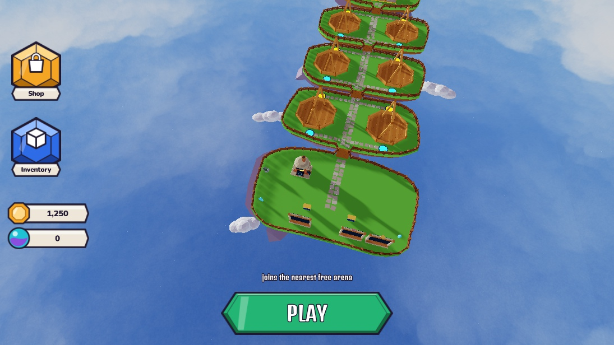
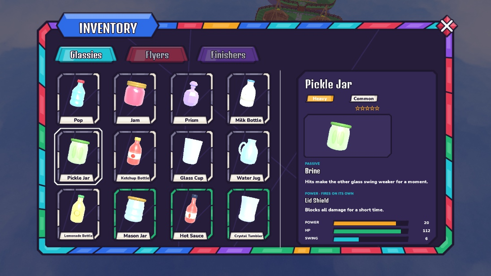
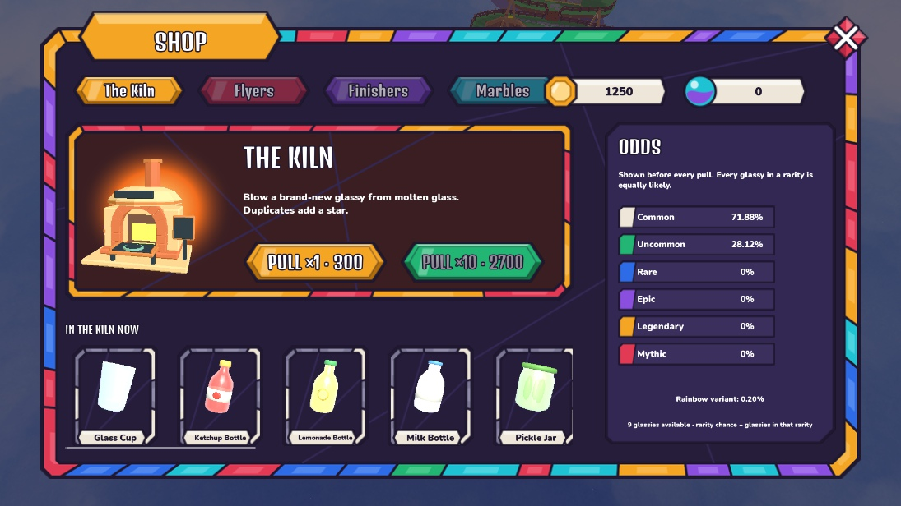
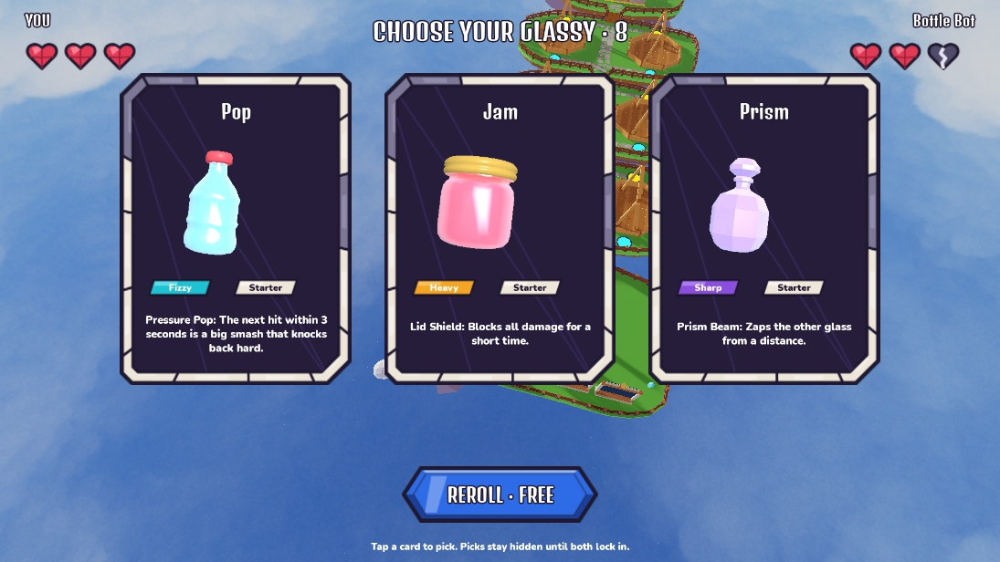
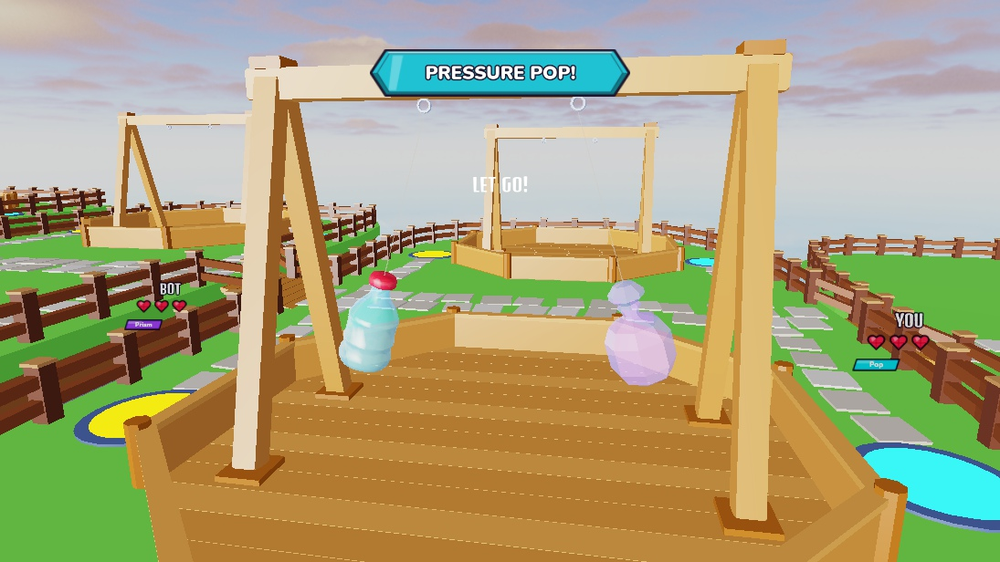
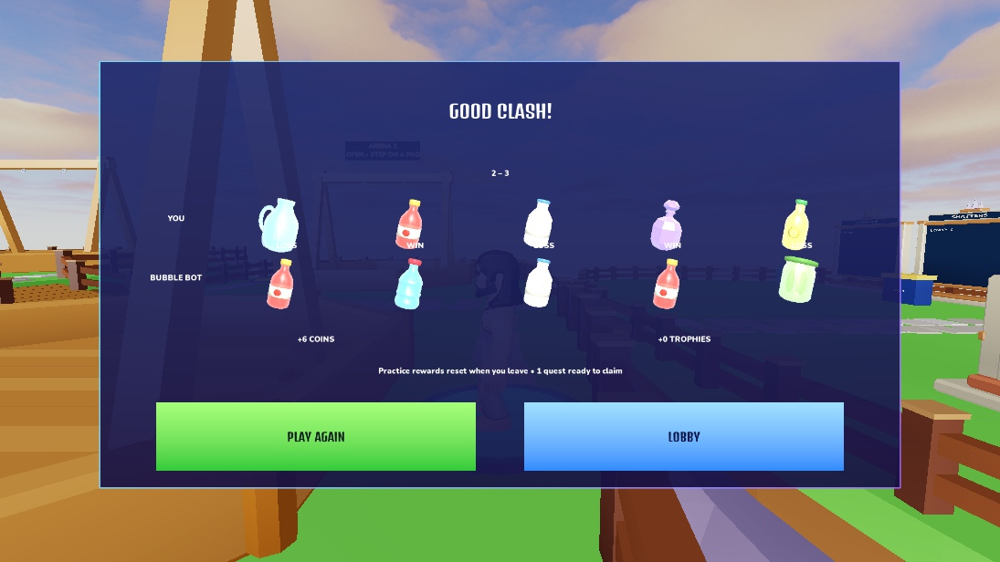

# Stained Glass UI v0.5

Implemented and visually approved October 14, 2026. Creator will restyle the templates before requesting the device pass.

## Edit these in Studio

Stop Play, expand **StarterGui**, enable one ScreenGui, edit it, then disable it again. Controllers enable the appropriate screen during play. Keep the names and Templates folders below. Layouts use Scale, safe insets, aspect constraints and 44-pixel minimum tappable controls.

| Template | Main elements / bindings |
|---|---|
| `LobbyHUD` | `Navigation.ShopButton`, `Navigation.InventoryButton`, `Currency.Coins.CoinsAmount`, `Currency.Marbles.MarblesAmount`, `PlayButton.Label`, `Hint` |
| `CollectionScreen` (Inventory) | `Panel.Title`, `Panel.Close.CloseIcon`, `Panel.Tabs`, `Panel.Content.Grid` (GlassyGrid role), `Grid.Templates.GlassyTile`, `Grid.Tiles`, `InfoPane.InfoName`, `TypeTag`, `RarityTag`, `Stars`, `InfoPortrait`, `PassiveName/Description`, `PowerName/Description`, `Power/HP/SwingTrack.FillMask.Fill`, corresponding `Amount` labels |
| `KilnScreen` (Shop) | `Panel.Title`, `Panel.Close`, `Panel.Coins`, `Panel.Marbles`, `Panel.Tabs`, `Content.Hero.KilnPortrait`, `Hero.Pull1`, `Hero.Pull10`, `Pool.Templates.GlassyTile`, `OddsPane.RarityRows.Common/Uncommon/Rare/Epic/Legendary/Mythic`, each row's `Rarity` and `Chance`, `RainbowOdds`, `PoolOdds`, `Message` |
| `RollScreen` (Choose) | `Roll.Title`, `Player1/Player2.OwnerName`, `Hearts.Heart1/2/3`, `Cards.Card1/2/3`, `Cards.Templates.GlassyCard`, each card's `Artwork`, `Name`, `Portrait`, `TypeTag`, `RarityTag`, `Power`, `SelectedOutline`, `Select`; `Reroll.Label`, `Message` |
| `FightHud` | `PowerBanner.Label`, `Templates.Popup`; existing `AimMeter`, `Lock`, `Headline`, `Instruction`, `StopWatching` remain for Aim/Countdown/spectating and hide during Fighting |
| `ReplicatedStorage.Assets.UI.FightBillboard` | `Body.OwnerName`, `Body.Hearts.Heart1/2/3`, `Body.GlassyTag.Label`; cloned above each player's side, including bots |

Other working templates retained: QueuePanel, RollInfoScreen, ResultsScreen, GlassyDetailScreen, IndexScreen, KilnRevealScreen, RoundEnd, MatchNotice, RewardsScreen, and the existing empty Work ScreenGui. Their old rounded corners were removed; their controller bindings remain.

Every glass piece has separate editable text/icons. Glassy portraits reuse `GlassyPortrait` and native models; its camera now includes body, caps and handles with padding. Milk-plaque text stays inside the light interior. `FitSingleLine` labels measure the selected FontFace against the authored text box; adjust `UITextSizeConstraint.MaxTextSize` for their preferred maximum. Model/content/selection/progress updates preserve authored UI placement.

## Artwork and clipping fix

All **82** repo PNGs uploaded through Studio MCP. IDs: `src/shared/Config/UIAssets.luau` and `assets/ui/stained_glass/roblox_ids.json`. **Missing images/placeholders: none.** Exact PNG dimensions and source slice rectangles are in `StainedAssetSpecs`.

The creator reported and then approved the clipping correction. Pointed buttons, tabs, plaques, tags and banners now use **Fit with their PNG aspect ratio**, preserving the entire silhouette. Nine-slice rendering had visibly chopped their tips. Stretchable dark/viewport panes and stat bars still use Slice; source slice rectangles remain recorded. Roblox resized the 1040×260 Play upload to 1024×256 and power banners to 1020×187; effective slice coordinates account for decoded dimensions where slicing applies.

Inventory shows three complete preview rows. Its scroll canvas grows with collection size. Shop's horizontal strip contains all nine currently available glassies. Odds come from the server quote, not mockup values: **71.88% Common, 28.12% Uncommon, 0% other rarities** for the installed pool; each tile can show its individual chance. Paid/future tabs remain disabled; no paid features added.

## Verification

- Lune: **76 passed, 0 failed**. Studio RunAll: **76 passed, 0 failed**.
- Five-screen structural audit: **411 GUI objects, 144 image instances, zero failures or missing assets**. No layout offsets/UICorners; image aspect constraints and tappable minimums present.
- Fresh startup: exactly one LobbyHUD; opening Inventory/Shop and entering a match hides it correctly.
- Inventory: select another glassy, inline details/stats/model update; close/reopen works. Fresh-runtime text-fit audit found zero unfitted labels.
- Shop: open/close, live odds, both coin pull bindings/enabled states, all nine pool tiles and per-glassy chance selection retained. Existing reveal/receipt-free coin logic retained.
- PLAY: malformed 20-request flood cannot queue; valid flood starts only one nearest-free-arena queue. Remote validates arguments, rate-limits and uses the existing authoritative queue/readiness checks.
- Native bot match completed Choose → Aim → Fight → round ends → Results (2–3 result, ordinary mock rewards). Free reroll, heart state and billboard cleanup exercised. Additional fresh-runtime Choose/Fight captures verified final text/model fitting.
- **No multi-device formatting pass performed.** Current desktop/HD1080 view only; creator edit and approval come first. No Roblox publication performed.

## Backups

- Original 15 ScreenGuis: **ServerStorage.UIBackup_v04**.
- Portable snapshots: **places/UIBackup_v04.rbxm** and **places/UI_v05.rbxm**. The v0.5 snapshot contains `StarterGuiTemplates` and `FightBillboard`; move the former's contents into StarterGui and the billboard into ReplicatedStorage.Assets.UI when restoring into a separate place.
- Reproducible migration: `tools/studio/restyle_ui_v05.luau` refuses to overwrite v0.5 edits. Audit/export tools live alongside it.
- Save the open place in Studio to preserve the editable instances alongside the world. Git contains the snapshots, source and assets.

## Screenshots

Editable previews plus native gameplay evidence; currency/ownership previews use Studio-only fixtures.

