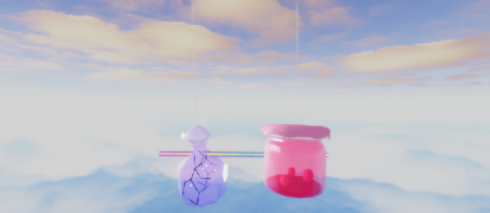
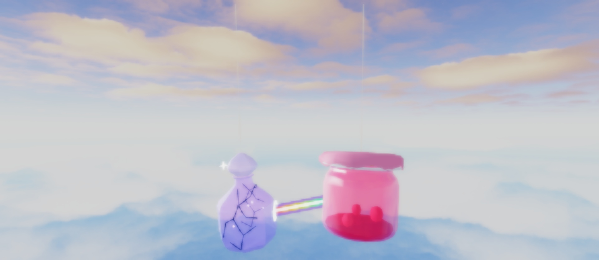
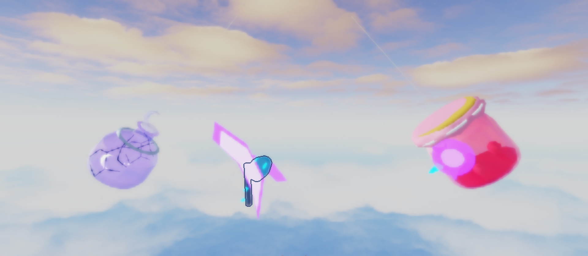
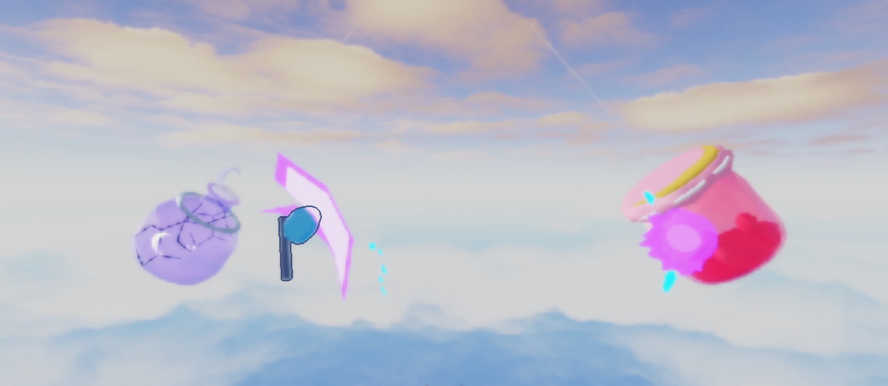
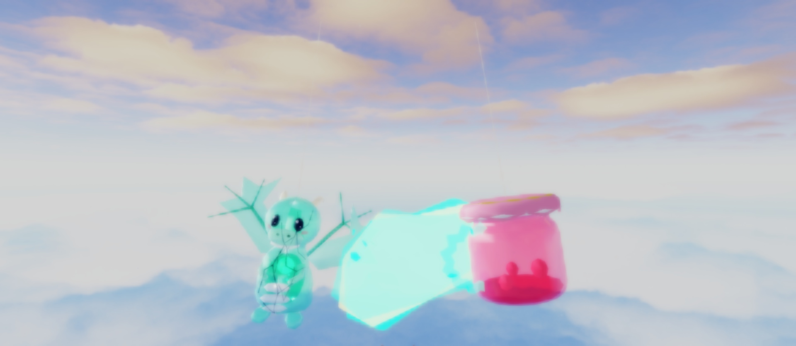
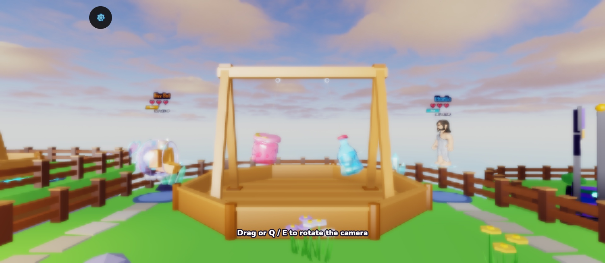

# Power direction and seamlessness audit

Creator note (2026-10-20): the powers look great, but some (Prism's ray, the Unicorn's rainbow dash) "shoot in
different directions and it just does not look seamless". This audit covers every directional power in the
24-glassy release roster plus the launch kits, finds the root causes and fixes them in presentation only (server
timing, hits and damage are unchanged).

## Measured on the real swing

`lune run tools/power_direction_audit` runs real `Pendulum` rounds (12 per kit, mixed foes) and logs each cast:

| Kit | Shape | Windup → release turn | Release → foe | Caster drift during the effect |
|---|---|---|---|---|
| prism | ray | 59.5° avg (max 152°) | 9.1° | 6.6 studs (max 10.0) |
| arc_coil | ray | 31.9° (max 117°) | 8.7° | 4.7 (max 8.6) |
| crescent_axe | sweep | 107.6° (max 178°) | 5.8° | 5.1 (max 9.8) |
| glass_top | sweep | 110.9° (max 179°) | 8.4° | 5.8 (max 8.5) |
| water_jug | cone | 36.3° (max 94°) | 8.9° | 6.3 (max 8.3) |
| frostglobe | cone | 51.1° (max 138°) | 13.0° | 6.0 (max 8.4) |
| glass_dragon | breath | 71.9° (max 165°) | 6.7° | 6.2 (max 10.0) |
| lemonade_bottle | volley | 57.1° (max 148°) | 9.6° | 7.1 (max 10.3) |
| cookie_jar | volley | 40.8° (max 116°) | 9.7° | 7.4 (max 9.8) |
| piggy_bank | volley | 38.7° (max 135°) | 10.2° | 5.8 (max 8.9) |
| prism_blade | projectile (return) | 59.3° (max 154°) | 13.7° | 6.3 (max 9.8) |
| fishbowl | projectile (return) | 18.5° (max 90°) | 4.3° | 7.3 (max 11.7) |
| glass_phoenix | projectile | 38.5° (max 157°) | 10.3° | 6.6 (max 9.8) |
| comet | echo shot | 56.9° (max 136°) | 23.1° | 7.8 (max 9.9) |
| glass_unicorn | boost (dash) | n/a | n/a | 4.0 (max 7.2) |

What the numbers say:

1. **The release is well aimed** (6–14° off the foe on average): the server re-aims every 0.05 s.
2. **The windup is not.** Between CastStart and CastRelease both glassies swing, so the direction captured at
   CastStart is 30–110° off by the time the power fires. Anything aimed with it (Prism's lens, Crescent Axe's raised
   weapon) points one way and then the power leaves another way. This is the "shoots in different directions" look.
3. **Origins detach.** Over an effect's life the caster moves about 6 studs (up to ~12). Effects pinned at the
   release point (ray start, cone base, axe crescent, breath, flashes) were left hanging in the air while the glassy
   swung away, and impacts pinned at the contact point were left behind by the struck glassy.
4. **Return shots return to nowhere.** Prism Blade and Fishbowl flew back to the empty spot they were thrown from.
5. **The Unicorn's dash trail drew the whole 2 s boost**: the dash starts at a turnaround, so the rainbow trail traced
   the reversal and the swing back, a scribble in every direction.

## Fixes (presentation only)

- **Live cast points** (`PowerFX/Dispatch.luau`): every released cast gets `ctx.Here()` (the release point carried
  along by the caster's swing) and `ctx.Aim()` (the release direction, or the line to the struck glassy once it
  landed). Attached effects use them; world-fixed shots keep the server's fixed path.
- **Hits ride with the glass they struck**: during a Hit / Payoff, flashes, rings, spokes, lights and beam ends placed
  at the contact point follow the struck glassy (`FX:Follow`, `FX:Followed`). Flung chips and sparkles stay in the
  world, as debris should.
- **Rays and bolts** (Prism, Arc Coil): start at the live caster, end on the live struck glassy (`ctx.EndAt`).
- **Prism's lens** tracks the foe live through the windup, then holds the ray's line once fired; the ray now
  leaves from the lens itself.
- **Cones and breath** (Water Jug, Frostglobe, Glass Dragon): sheets, particles and chips grow from the caster as
  drawn, toward the struck glass once a pulse lands.
- **Crescent Axe**: the raised axe faces the foe live while winding; the swing and its crescent happen round the axe
  as drawn.
- **Boomerangs** (Prism Blade, Fishbowl): the return leg is caught by the glassy where it is now.
- **Glass Unicorn**: the rainbow streak draws only while the unicorn charges at the foe; the boost glow stays.
- Pulse rings (Chime), launch flashes and lights (Comet, Phoenix, Lemonade, Prism Blade, Dragon, Frostglobe) follow
  the caster. Galaxy Orb's gravity well stays fixed in the world on purpose.

Studio A/B: `workspace:SetAttribute("PowerFXPinned", true)` restores the old pinned points (used for the captures).

## Captures

Same frame of the staged preview (`src/client/Dev/PowerVFXPreview.luau`, `Swing = 0.4, Lean = -0.35`, clock frozen),
before = `PowerFXPinned`, after = live.

| | Before | After |
|---|---|---|
| **Prism** ray, just after release |  The ray starts in empty air behind and above Prism (where it was at release) and runs through the jam. |  The ray leaves from the glowing lens and ends on the jam's glass. |
| **Crescent Axe** mid-sweep |  The axe and crescent hang in the middle of the arena, far from the glassy. |  The axe sweeps beside Crescent Axe; the hit ring sits on the jam it struck. |
| **Glass Dragon** breath |  The breath has come loose from the mouth. |  The breath grows from the dragon toward the jam it hit (it still travels outward, by design). |

**Glass Unicorn** (a trail can't be caught in a frozen frame, so it was sampled every 0.1 s over the 2 s boost):

| Preview time | 1.8–2.3 s | 2.4–3.1 s | 3.2–3.7 s |
|---|---|---|---|
| Unicorn moving | toward the foe | away (backswing) | toward the foe |
| Before: rainbow streak | on | **on** (the scribble) | on |
| After: rainbow streak | on | off | on |

**Prism Blade / Fishbowl** boomerangs: the preview's staged swing is too small to show the return drift in a still,
so this one rests on the measurements above (the thrower moves 6–7 studs during a 1 s throw) and the code path.

## Verification

- Studio Play, every directional kit plus Pop, Pickle Jar, Galaxy Orb, Jam and Glass Duck staged hit and miss through
  the real CombatEffects / PowerFX pipeline: no PowerFX warnings or errors.
- A live bot match (Pop vs Jam, real server events, contact payoffs and guard): no PowerFX warnings or errors.
  
- Lune tests pass; no Balance, Powers or server code changed (simulators not needed).

## Not changed (on purpose)

- Server aiming and land chances: aimed powers can still miss by design (GAME_DESIGN 3.5). A miss now leaves the
  glassy as drawn along the server's direction, so it reads as a near miss instead of a beam from nowhere.
- World-fixed shots (projectiles, volleys) keep the server's straight path; only their launch point and a returning
  shot's catch follow the glassy.
- Galaxy Orb's well, zones (Bubble Wand, Honey Bear, Crystal Ball) and Comet's planted star stay fixed in the world.
