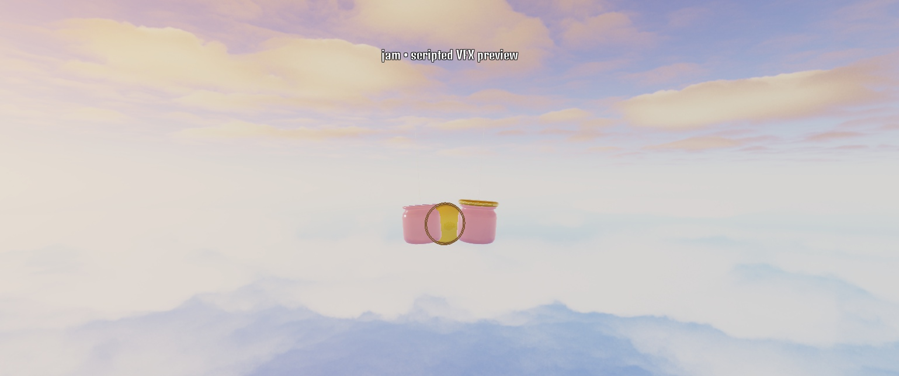
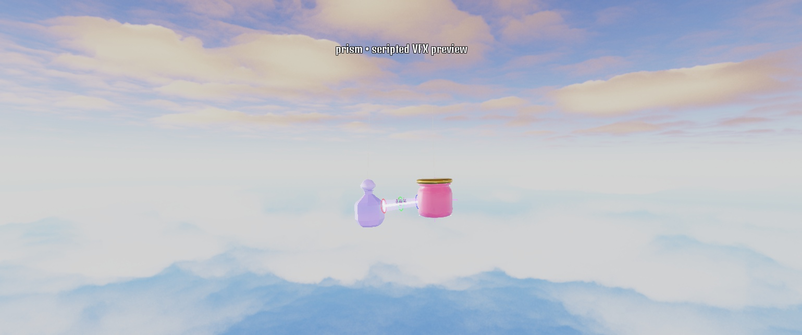
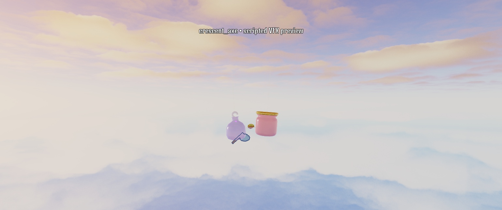
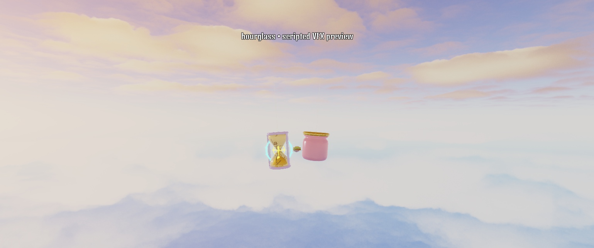

# Power readability and Hourglass repair

October 16, 2026. Implemented in source and synced through connected Rojo. Exactly 24 release glassies; native/Blender source assets preserved. Studio left in Edit, unpublished. Decision 65 records the creator's request.

## Installed changes

- **Pop:** the original cap launches and spins, an expanding cyan pressure ring/dome accompanies the clash, and the body visibly recoils. Server rebound increases from 1.2 to 1.35; damage stays unchanged.
- **Jam:** its actual lid and rim rise between the glassies. The original cap hides while the shield is active and returns after consumption/expiry. Gold block spokes and recoil punctuate a confirmed block. Existing one-hit 40% mitigation remains.
- **Prism:** the real lens aims at the locked firing direction and glows. An untextured white beam core, colored halo and three refraction rings remain visible for 0.55 seconds. This is a visual afterglow; the authoritative narrow ray and instant hit test stay unchanged.
- **Crescent Axe:** shows its separate blue axe during anticipation, then sweeps with a head trail and slash. Fixed a malformed CFrame basis that misplaced/oriented the weapon. The actual head center now follows the server arc. Sweep duration is 0.5 seconds and head radius 0.7 studs, matching the scaled prop; damage stays unchanged.
- **All glassies:** shared confirmed impacts have a white core, expanding rings, eight outward streaks and glass chips. Distant presentation uses fewer streaks/rings and omits chips. Confirmed signature hits/blocks get a short 0.045-second pause and modest camera shake; misses get neither.
- **Hourglass — Second Turn:** replaces the stored-sand projectile. At or below 65% HP, three turnarounds start a 0.85-second whole-glassy spin with a mint clock ring/twelve ticks. Completion restores 7% maximum HP. At most two starts per round, at least eight seconds between starts, no start/completion in overtime, no overhealing or revival. Maximum restored HP is 14% per round. The swing simulation, incoming damage and hang point remain active during the cosmetic spin.

These numerical choices are provisional. Bounded healing and tests establish limits, not full matchup fairness.

## Verification

- Lune and native Studio: **102 tests, zero failures**, including exact Hourglass healing, cooldown, round cap, no offensive projectile, no premature heal, HP clamp, death and overtime cases.
- Native Client: **31 focused hero checks**, **264 all-24 presentation checks**, **179 all-24 shatter/avatar/finisher checks** pass. Axe head positions sampled throughout the arc agree within 0.001 studs. Lid restoration/outline cleanup and original Pop cap restoration pass.
- Actual deterministic pendulum: **48 rounds, 619 body hits, 29.91-second mean, zero timeouts**, maximum string-radius error 0.00000143 studs. See [raw report](readability_swings.json). These are regression samples, not equal-stat fairness approval.
- One watched native Hourglass/Prism round, seed 29018: completed at **47.11 seconds**, Hourglass started/released exactly two heals (18.57/27.01 seconds), Prism released five rays. Hourglass won at 1 HP; one seed cannot establish strength. A 30-frame spectator sample measured 0.44 ms mean / 1.93 ms maximum controller render work, about 60 FPS on this desktop; this is not a phone/performance soak.
- Required stand-in [balance report](readability_balance.txt), 200 rounds per matchup: starter mirror means 28.9/28.5/19.6 seconds, zero mirror timeouts; side A 49%, Perfect versus worst 58%, 39% comebacks, 1.2 lead changes, 3.1 powers/glassy, 34% aimed misses. Hourglass field rate 40%; skewed field rates remain diagnostic. [Economy](readability_economy.txt): 5.7 minutes/match, 10.5 matches/hour; 3/81 day-one/day-30 pulls; 11/18 uniques day seven/day 30; Rare 57 minutes, Epic 2.8 hours, Legendary 11.3 hours, 19% Mythic by day 30. Prices, odds and rewards unchanged.
- Studio console has unrelated Roblox CorePackages warnings and an existing asset-type warning for 203785492. The temporary MCP event observer initially used the wrong packet signature and produced AssistantCommand errors; corrected/disconnected. These are not gameplay script failures. Preview cleanup verified; Rojo remains connected.

## Native visual fixtures

The screenshots below use the normal 33-stud distance/52-degree FOV, current short desktop viewport, original models and native presentation. Poses/contact are scripted offworld art fixtures, not live hit evidence. `tools/studio/preview_readability_v3.luau` supports normal-speed looping or a frozen phase and restores camera/GUI state. No device settings changed.

| Pop pressure/cap | Jam raised lid |
|---|---|
|  |  |
| Prism lens/ray | Axe anticipation |
|  |  |
| Hourglass spinning clock | |
|  | |

## Creator review

Try these five at normal speed, including orbiting the camera. Review whether anticipation/payoff is recognizable without reading the power meter, whether the beam and axe remain clear over the arena, and whether the heal feels worth waiting for. Full equal-stat tuning, a longer performance/real-phone pass and publishing remain open. Current implemented powers and separate future ideas are in [the brainstorm list](../../design/POWER_BRAINSTORM_24.md).
