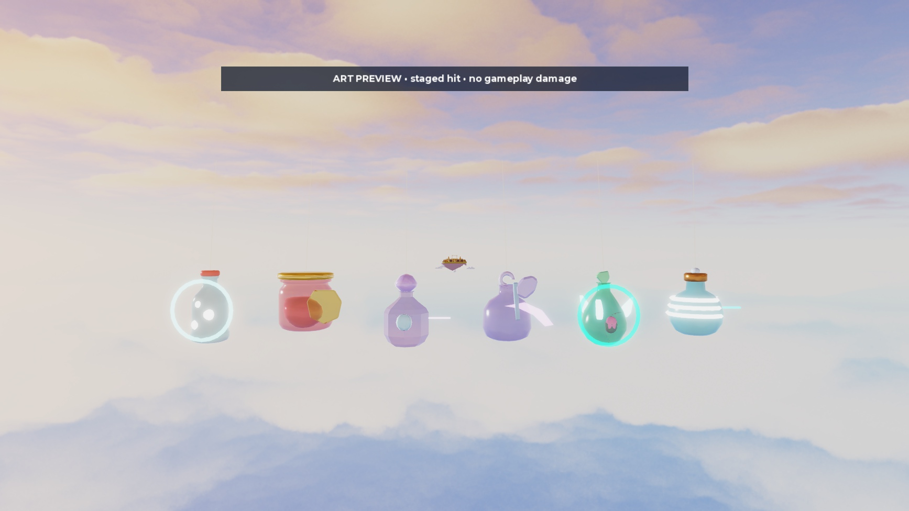
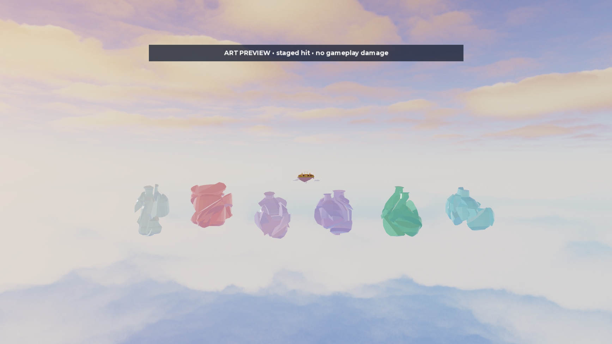
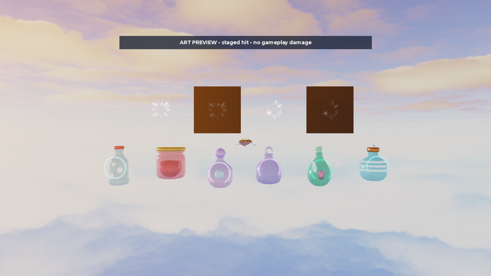

# Native VFX and replacement audio prototypes

2026-10-15. **This records the earlier staged art checkpoint.** Rojo initially needed the creator's Connect action, so independent art/audio work continued without desktop input. The creator subsequently connected it and source work proceeded. See the [current first-six checkpoint](FIRST_SIX_CHECKPOINT.md) for implemented rules, refreshed playback, 88 tests and remaining creator review. The staged demonstrations below are still distinct from live combat proof.

## Saved work

- `ServerStorage.CombatReleaseStaged.VFX.Combat`: ten reusable native meshes, six disabled/bounded burst emitters, four disabled beam templates, 14 replacement sound cues, 24 unique kit folders and a separate two-piece axe with its authored animation pivot.
- `assets/vfx/combat_release/native_library.json`: exact texture/audio IDs, cue starts/fades/volumes/pitches, presentation timings, mesh references and trigger briefs. Presentation values do not award damage or activate abilities.
- `tools/studio/build_combat_effect_library.luau`: reproducible library builder. It refuses to overwrite an existing library.
- `tools/studio/preview_combat_release.luau`: client-only developer preview factory, with deterministic `At(time, result)` and bounded `Play(seconds)`/`Destroy()`. Clone the staged Glassies and Combat library into the temporary `ReplicatedStorage.CombatReleaseArtPreview` folder before running it. No permanent LocalScript or player control is installed.
- `places/CombatRelease_VFX_Audio_v2.rbxm`: 38,331-byte editable native library snapshot. SHA256 `ce1c10e3e84d839d7759c447f01c1f5f254f99685bfefc5dc3c562e10f8078a2`. Restore the **Combat** folder beneath `ServerStorage.CombatReleaseStaged.VFX`.

The existing 12 live glassy models, source scripts, active power rules, inventories, acquisition pools, UI templates, lobby and finisher remain unchanged. The original 527-part imports, previous canonical library snapshot and original Blender sources remain recoverable. The snapshot above supplements the earlier staged asset snapshot.

## Client preview evidence

Left to right: Pop, Jam, Prism, Crescent Axe, Briar Flask, Arc Coil. Current sky/lighting, 1.75 display scale, fixed camera at `(0,26,2033)` looking toward `(0,26,2000)`, FOV 52. Preview labels explicitly identify staged outcomes. Lobby GUIs are temporarily hidden only while this developer preview runs.

The first preview exposed rings/guard meshes occluded inside transparent bodies. The revised preview moves those accents forward and enlarges contact rings; the gold guard uses Glass rather than an opaque Neon flare. The axe uses separate effect-only pieces. Charge bubbles, coil segments and thorns show staged readiness. Miss rays use a fixed release direction and emit no contact glints. These are art demonstrations, **not server attack geometry, HP, block-mitigation, turnaround or multiplayer tests**. Captures are still images; no clip is claimed.

Two native Grid4x4/OneShot flipbooks were emitted over sky and dark cards, starting at frame zero. Enlarged 4-second laboratory playback made progression visible: initial compact form → expanded dust/ring → expiry. The middle capture followed the start by approximately 0.93 seconds; the expired capture was after 31.67 seconds. `ZOffset=1` in this laboratory prevents the backing card occluding the particle.

There are no opaque atlas rectangles in these captures. Contrast remains modest, especially on the cards; live readability, phone fill-rate, normal-speed timing and reduced-detail behavior remain pending. Essential cues use native meshes rather than depending on these particles.

## Replacement sound bank

The 14 cues load successfully both in Edit and on the Client, with actual TimeLength values in `audio_client_loads.json`. Thirteen are free ProSoundEffects library assets; the short cartoon pop is DailySoundsFX's explicitly original synthesized free sound. Creator Store provenance links are stored on every native Sound and in the JSON. No paid pack, plugin, external library or downloaded script was added. The creator's new sound request supersedes the earlier prototype-only audio scope.

The bank separates light hits, heavy bottle impact, lid block/click, electrical snap, air cut, pressure air, water slap, bubble pop, cap rattle, charge and two shatter layers. `audio_waveforms.json` records amplitude/onset measurements for 13 accessible source files. The DailySoundsFX file endpoint requires authorization, so it was not downloaded; native loading succeeds. No credentials or access workaround was used. Temporary audit files stay outside the repository; licensed audio copies are not redistributed in Git.

Measured corrections:

- Rejected the first heavy candidate (`9119919969`): peak 0.0547 and first strong transient at 0.396 s. Selected `9113557731`: peak 0.598 and onset 0.003 s. This avoids a weak delayed contact.
- Heavy shatter starts at 0.506 s and scatter at 0.288 s, removing their measured leading silence. Cap rattle starts at 0.168 s. Light variant B starts at 0.328 s to select one clear transient.
- Each cue has a bounded duration and short volume fade; full shatter retains the longest tail. Charge is quieter than impact, and ordinary hits do not use a full glass-break layer.

These are measured timing/mix prototypes, **not a subjective listening approval**. Following reconnection, `Config/Audio`/`AudioCues` were updated to use the new bank in contact/shatter playback. Listening in actual fights and on the creator's device remains pending.

## Checks actually run

- 612 native library contract checks pass (`vfx_native_checks.json`): 24 unique kits, valid internal references, anchored/cosmetic meshes, bounded idle emitters, correct flipbook settings, disabled beams, no scripts/lights, all audio loaded and valid cue/fade bounds.
- RBXM deserialize restores 24 kit folders, 14 sounds and all 48 internal mesh references without dangling links.
- First-six preview: 300 steps for each staged hit/miss/block branch. Hits/blocks emit 24 contact glints across six examples; misses emit zero. Shared shatter emits 12 dust particles/36 flecks across the six examples.
- Ten further staged cycles (3,000 steps): 272 descendants before and after; no instance growth with audio disabled.
- Actual 10-second RenderStepped replay reaches timed cleanup: root/caption removed, connection disconnected, all 16 saved screen GUI enabled states restored.
- Lune: 79 passed, 0 failed. Native RunAll returned true in Server during Play and again in Edit. These remain baseline gameplay tests, not new kit tests. Balance/Glassies/Powers were not edited, so simulators were not required.
- Studio left in Edit, FOV 70 restored; temporary replicated preview library and workspace preview removed. Blender remains the original unsaved Scene with Cube selected. No publication or device changes.

## Continue

Rojo is now connected. The [first-six checkpoint](FIRST_SIX_CHECKPOINT.md) has the current implementation and inexpensive creator test. Complete that review before expanding the remaining 18 kits and activating signatures globally. The earlier staged screenshots do not establish that final release validation.
