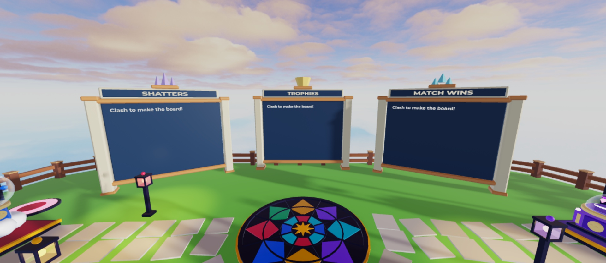
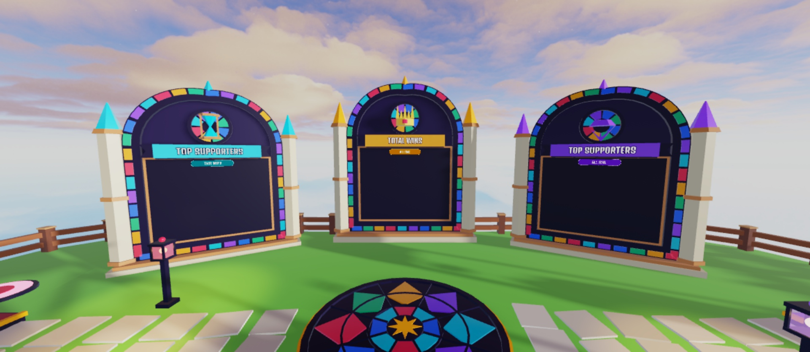
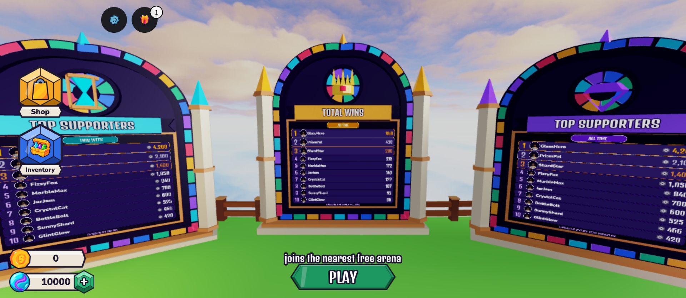
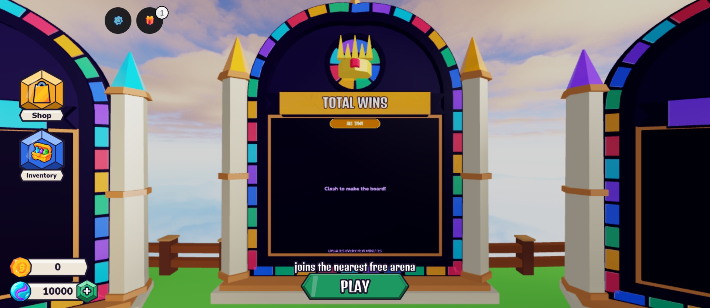

# Leaderboards v3: report (2026-10-20)

Creator request: new boards that fit the vibe, nicer board UI, and new stats: Left = Robux spent (weekly),
Middle = total wins, Right = Robux spent (all time). Decision 101 (Proposed).

| Before | After |
|---|---|
|  |  |

Rows (Studio preview data, `LeaderboardDev:Invoke("Preview", true)`) and the empty state:

## What was checked (Studio Play, mock profiles)
- Boards installed at the old spots, facing the plaza; old boards moved to `ServerStorage.LeaderboardsV2Backup`.
- Fake purchases (`LeaderboardDev:Invoke("Spend", player, 499)` then `80`): profile Spend = 579 total / 579 this week;
  both supporter boards show the player with 579 and a Robux icon; the weekly footer reads "RESETS IN 5D 0H".
- Total Wins with 0 wins shows "Clash to make the board!".
- Ten preview rows: headshots, names, values, gold/silver/bronze top three.
- Lune: 8 new tests (week key and reset, spend and weekly reset, game pass once, receipt Robux, profile repair, row
  cleanup/ranking, number format, board config).

## Not checked / needs the creator
- Live ordered stores and real purchases (needs a published game with products on sale; no Robux products are live).
- Phone readability in person (captures are desktop-size).
- The place must be **saved** (new boards are in the place, not in Rojo).
- In Studio captures the SurfaceGuis can take ~3 s to appear and the lobby's menu blur/depth of field hides them; that
  is capture timing, not a board problem.
