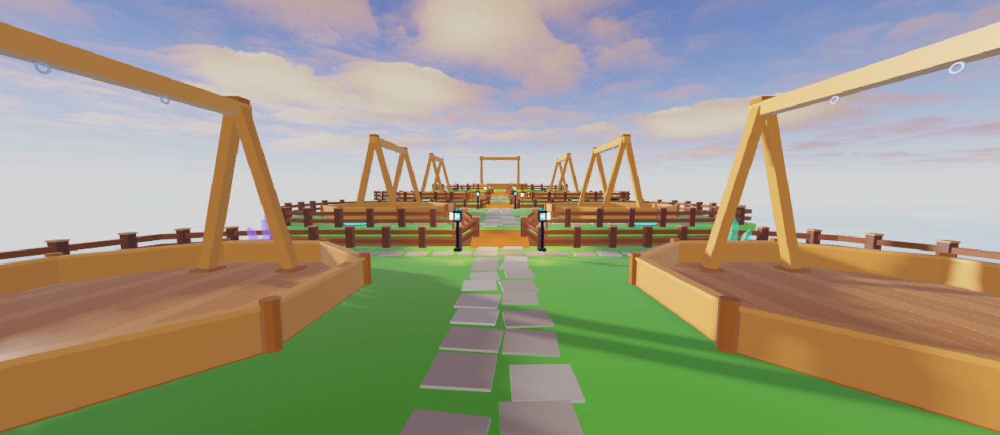
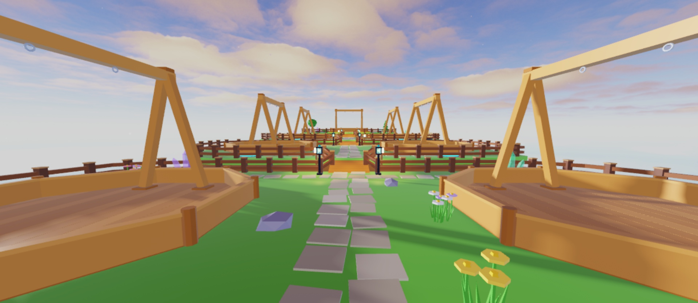
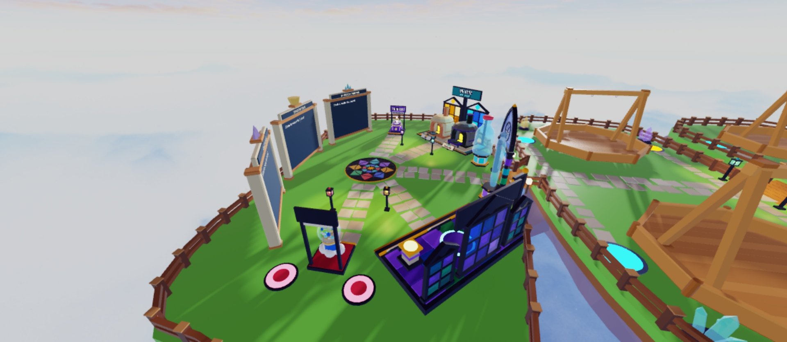
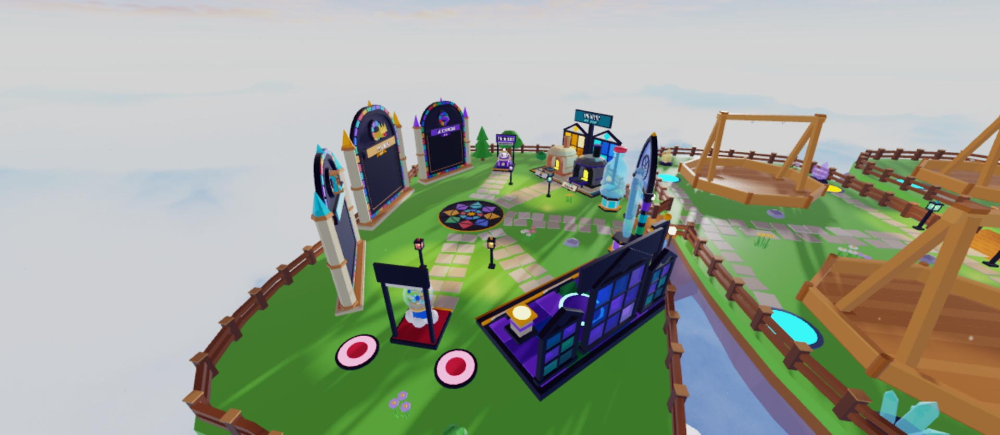
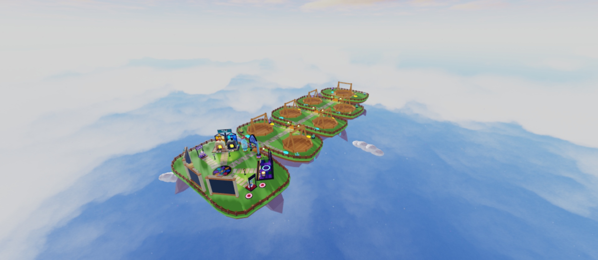
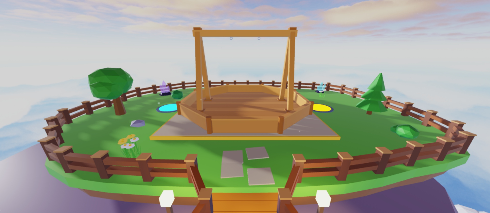

# Map polish (2026-10-20)

Creator request: make the lobby look nicer and less boring, "keep it simple". Restrained pass, all of it removable.

## What reads as plain (before)

- **Arena islands:** flat grass with only the stepping-stone path and the pens, nothing small to look at between the
  pens and the fences. This was the most boring stretch.
- **Spawn island:** already busy (Kilns, shop fronts, rosette, boards), so it got only a few touches at the edges.
- **Sky:** a pretty sunset, but only five clouds around the islands.
- **Island undersides** (purple rock and crystals) and the lighting preset already look good, so I left them alone.

| Before | After |
|---|---|
|  |  |
|  |  |
|  |  |

## What changed

- **Decor kit** (Blender, `assets/blender/map/decor_kit/`): round tree, pine, bush, rock and flower tuft. Faceted and
  flat-shaded, 20–260 tris each, one mesh per colour, coloured in Studio (SmoothPlastic, matte so glass stands out).
- **Placement** (`tools/studio/place_lobby_decor.luau`, seeded and re-runnable). Props go only on island floor and are
  kept clear of pens, pads, paths, bridges, fences, lanterns and everything else, including CanQuery=false parts.
  - **Arena islands:** a few rocks and flower clusters only. Pens, pads and paths fill these islands, so no tree fits
    without crowding the fights.
  - **Featured island:** a tree and a pine at its sides, plus bushes, rocks and flowers. The view of the featured arena
    from the bridge stays open.
  - **Spawn island:** two trees at the outer edges, plus a couple of bushes and flower clusters. The leaderboard strip
    along the back edge (z > 10) is left free for the new boards.
- **Clouds:** 7 more clones of the existing SkyArt clouds around and under the islands, for a fuller sky.
- **Glints:** one soft sparkle emitter per island (2.5 particles/s, 4–6 s life, pale cyan to pink). A gentle hint of
  life, subtle enough not to compete with the glassies.

## Cost and safety

- About 99 decor MeshParts, 7 clouds and 5 emitters, against roughly 2,000 parts in the place. Only trees cast shadows.
- Everything is Anchored, with CanCollide/CanTouch/CanQuery off, so gameplay, pads and movement are unaffected.
- Everything lives in `Workspace.Lobby.Decor`; delete that folder to undo. Kit templates are in
  `ServerStorage.MapDecorKit`. Nothing existing was moved or replaced, so no backup was needed.

## For the creator

- **Save the place** (the decor is in Edit mode, not yet saved).
- Optional ideas held back to stay simple: a subtle Atmosphere haze, path-edge stones, more trees on wider future islands.
