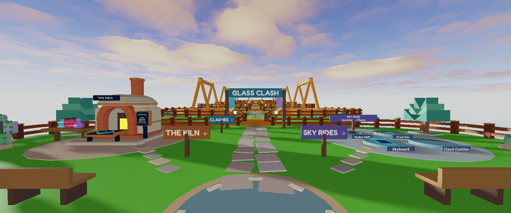
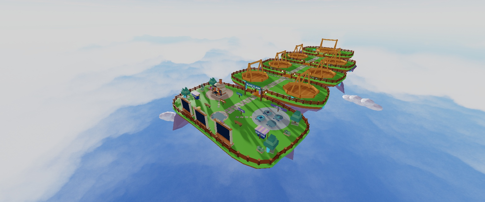
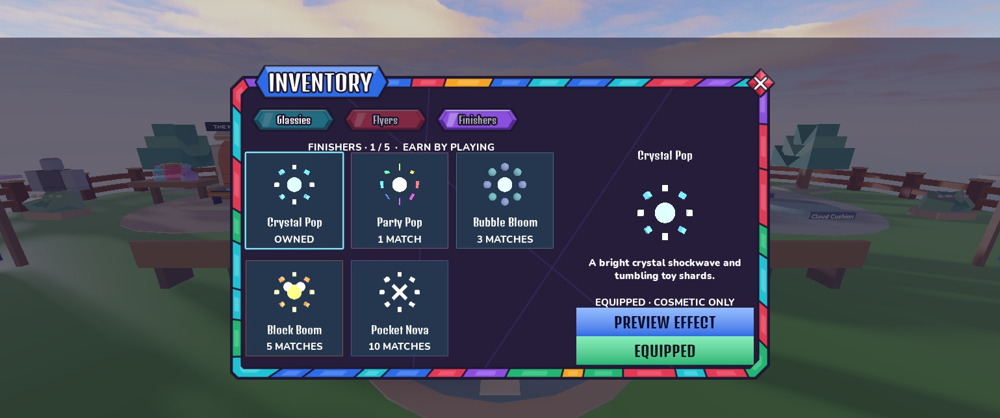
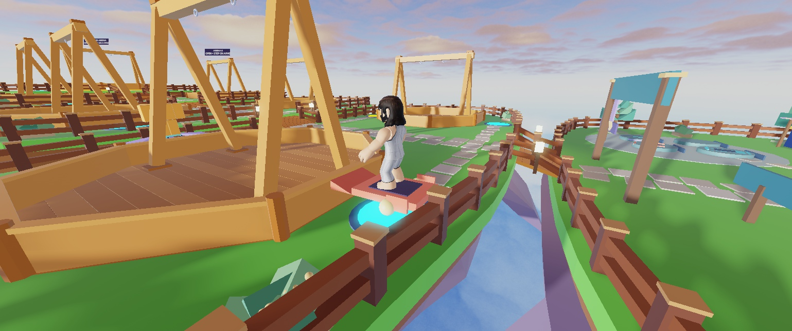
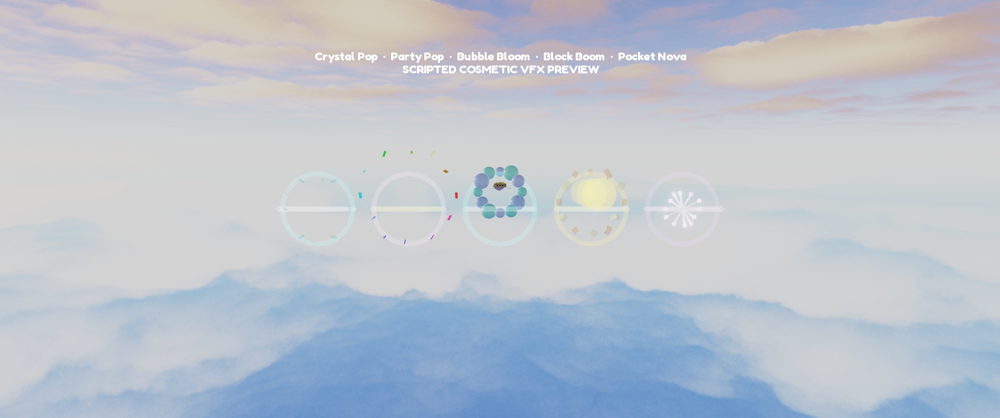

# Overnight lobby, rides and finishers

October 16, 2026. Implemented through Rojo and Studio MCP. Originals preserved; Studio Edit/unpublished. No desktop/device changes or paid feature activation. [Continuation handoff](../../HANDOFF_OVERNIGHT_COSMETICS.md), decision 66.

## Lobby

Crystal Isles keeps its five islands/seven arenas. Added a Kiln workshop court/workbench/display, opposite ride showcase, arrival medallion, branch paths, welcome gate/pennants, benches, gardens/trees, kiosk canopies and bridge lanterns. Balanced the three boards and relocated Daily/Codes/Kiln models with their associated spots. **1,315 original functional parts** across islands, collision, arenas, fences, bridges and paths retain transforms/sizes/collision flags. New dressing has 340 descendants.

Reduced excessive sunset rays (0.483 → 0.035) and sun angular size (21 → 6), retaining the warm sky/clock/color correction/bloom. Hid redundant Kiln labels with originals backed up.

| Arrival | Aerial |
|---|---|
|  |  |

[Previous capture](lobby_before.jpg) uses a wider aerial camera; this is context rather than a pixel-aligned comparison.

## Equipment

**Inventory → Flyers / Finishers** and both Shop tabs now have real native 3D previews, ownership/progress text and Equip. All unlocks are free, deterministic and based on eligible completed matches (wins or losses). Equipment is frozen per match; changes apply next match. Bots show varied cosmetics without consuming combat RNG.

| Ride | Matches | Look |
|---|---:|---|
| Skyboard | Free | Carved deck and lift fins |
| Cloud Cushion | 1 | Cloud puffs and rainbow wake |
| Rocket Skiff | 5 | Twin engines/fins, flickering exhaust |
| Prism Ray | 10 | Friendly eyes and flapping triangular wings |

Server-staged riders hover above existing pads, with client bob/bank and feet tracking the deck pivot. Exit restores character position/anchor/AutoRotate. No combat advantage.

| Finisher | Matches | Look |
|---|---:|---|
| Crystal Pop | Free | Crystal shockwave/toy shards |
| Party Pop | 1 | Colorful confetti held before fading |
| Bubble Bloom | 3 | Bubbles grow/float before popping |
| Block Boom | 5 | Chunky blocks, orange fireballs, golden shockwave |
| Pocket Nova | 10 | Star gems contract then burst with trails |

Finishers use at most 18 extra anchored parts (fewer at distance), expire within 1.4 seconds and use existing sound accents. No damaging Explosion, avatar hiding/killing or heart/reward changes. Existing glassy flight and reset/zoom/return camera remain.

| Inventory | Actual staged Rocket rider |
|---|---|
|  |  |



The effect strip is an offworld scripted fixture, not live combat evidence. The rider is an actual staged match with UI hidden and an inspection camera. Studio captures can include the camera pivot marker. Creator review remains for normal-camera feel, lobby composition, proposed milestone pacing and real-phone performance.

## Checks

Follow-up: fixed clipping in the animated finisher preview (icon camera was too close). Camera now fits the effect envelope against both axes, refits on visible resize and restores close static framing on selection. A focused five-effect native fixture passes framing/replay/close checks: original normalized maximum extent 2.420, fitted 0.766. Closing clears active previews and listeners. This is not device-layout approval; native art/snapshots and combat rules are unchanged.

- **106 Lune/native logic tests**, **301 native cosmetic checks**, **179 all-24 finish/avatar/ghost/camera checks** pass. Coverage includes additive profile migration preserving legacy cosmetics, deep snapshots, eligible/idempotent milestone rewards, invalid/unowned equip, deck/feet alignment, real model portraits, nova contract-then-burst, confetti hold, bubble growth and cleanup.
- Native rate audit rejects unowned Pocket Nova/immediate spam and accepts an owned starter. Studio mock save/reload retains Rocket Skiff/Pocket Nova with zero currency. Production persistence remains creator verification.
- One player-versus-bot round completed with Prism Ray/Block Boom selected. Player won a round; mid-match equipment remained frozen. Exit restored visible avatar at 100 humanoid health, original spawn/unanchored state/Custom camera, zero fight/stage roots. Separate early-abandon staging left zero matches/Coins.
- Required [balance stand-in](../overnight_balance.txt), 120 rounds/matchup: mirrors 29.0/27.9/19.9 seconds, zero mirror timeouts; side A 49%, Perfect versus worst 56%, 41% comebacks, 1.3 lead changes, 3.1 powers/glassy, 34% aimed misses. Field rates are diagnostic, not fairness approval; combat tuning unchanged. [Economy](../overnight_economy.txt): 5.7 minutes/match, 10.5 matches/hour; 3/81 day-one/day-30 pulls; 11/18 day-seven/day-30 uniques; Rare 57 minutes, Epic 2.8 hours, Legendary 11.3 hours, 19% Mythic by day 30. Prices/odds/rewards unchanged.
- No gameplay script errors observed. Existing Roblox CorePackages/asset-type warning 203785492 remains. Fixed an Edit template wait by loading remotes only on equip; corrected a geometry audit that assumed SafetyCollider names were unique. No repeated broad multiplayer/device pass.

Two bounded hourly follow-ups are scheduled for focused polish; stop if no actionable gap remains.

## Recovery and Studio testing

- `places/Overnight_Cosmetics_v1.rbxm`: **509685 bytes**, SHA256 `11d2bebc995bb0115481f372f99be12bf88ca421ac568040c0081a6a4bb5bf74`. Native deserialize round-trip: **3394 descendants**. Contains Lobby, Lighting children/property attributes, Assets.Rideables/RoundFinishers and two StarterGuiTemplates. Restore each to its named service/location after backing up current equivalents. Source scripts remain under Rojo.
- `places/Overnight_Before_v1.rbxm`: **468135 bytes**, SHA256 `3e7affca742c8534596869df86d603307a184e865681e2bc4e61cabce716e0c8`. Native originals also remain in ServerStorage.LobbyBeforeNight_20261016 and UIBackups.BeforeRoundCosmetics_20261016. Restore only named original lobby children; additional prototype/LightingBeforeNight folders in that backup are recovery assets, not world objects.
- Reproducible builders/refinements/export/verifier are in tools/studio; builders guard against overwriting existing assets.

Studio **Server Command Bar**, isolated mock profile only:

```lua
local p = game.Players:GetPlayers()[1]
game.ServerStorage.CosmeticDev:Invoke("PreviewAll", p)
-- Use the real Inventory tabs, or equip directly:
game.ServerStorage.CosmeticDev:Invoke("Equip", p, "Rideables", "rocket_skiff")
task.wait(0.55)
game.ServerStorage.CosmeticDev:Invoke("Equip", p, "Finishers", "brick_boom")
```

The helper grants only these cosmetics in Studio mock mode, without fabricated stats/currency or production inventory grants.
