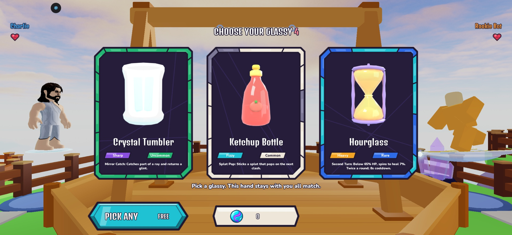
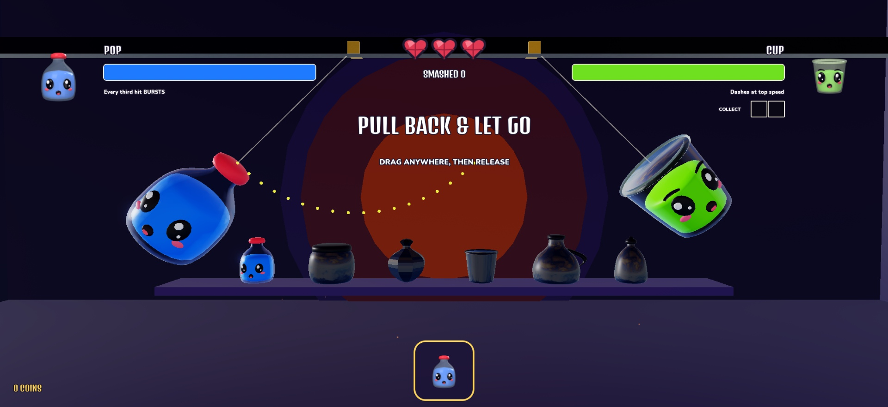
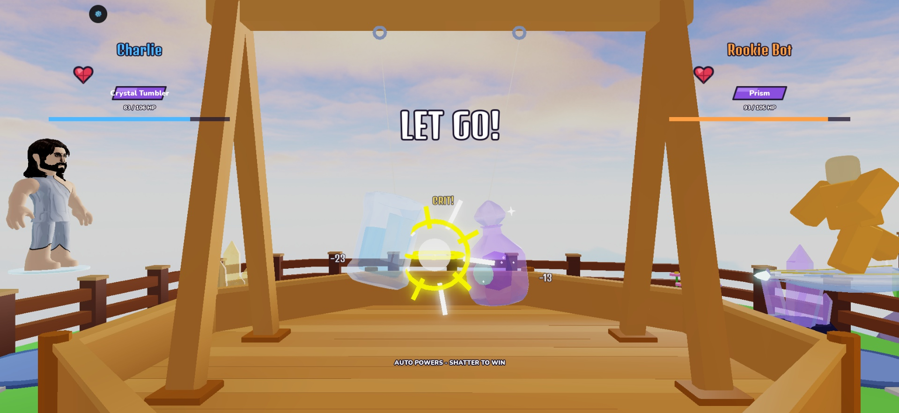
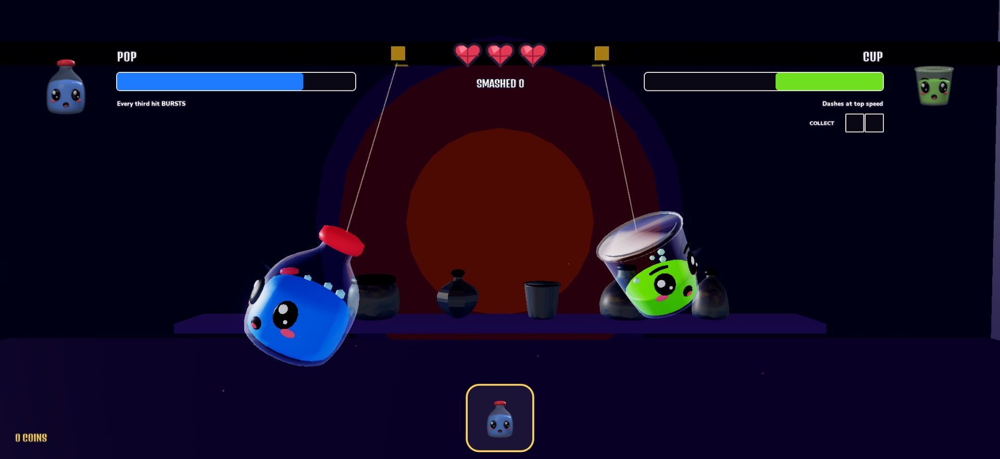
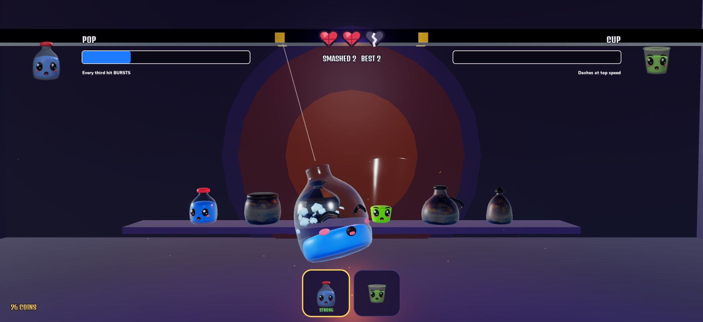
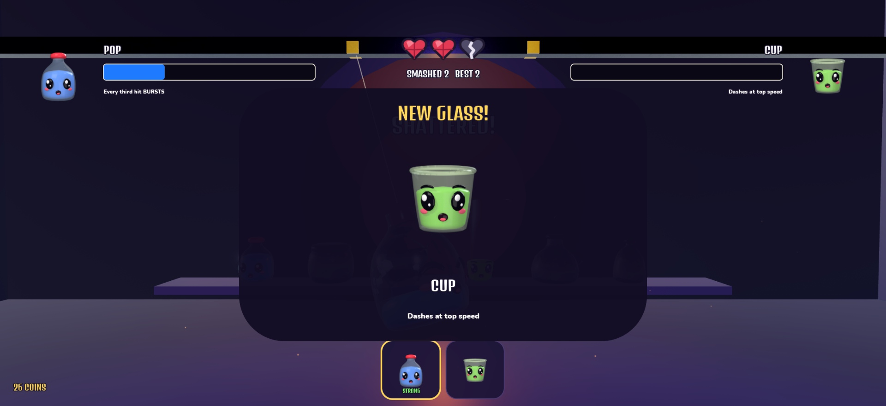
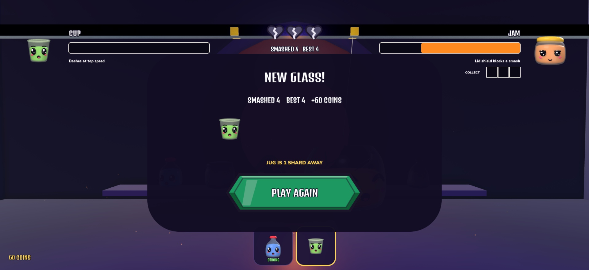
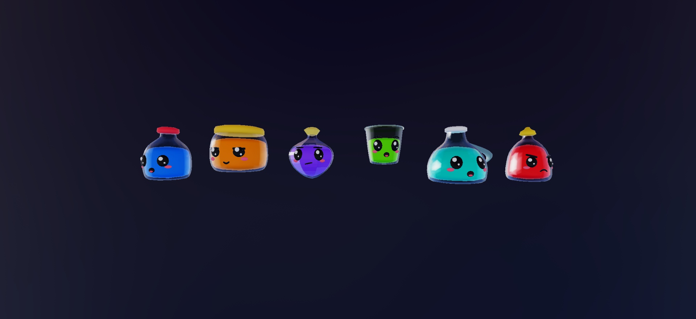

# Relaunch slice: test report (2026-11-02)

Studio only, nothing saved, not published. Place 129420351303019, branch `claude/relaunch-gauntlet`.

## Before and after

| Before (live) | After (slice) |
|---|---|
|  |  |
|  |  |

| Liquid shows HP | Unlock | End of run | v5 roster in Studio |
|---|---|---|---|
|  |  |  |  |

## Verified

- Lune and Studio Play server: **302 passed, 0 failed** (295 before, plus 7 Gauntlet tests).
- Two full runs in Studio, driven by tooling. Run 1: 82 s, 7 duels, 4 wins, 1 unlock, first shatter 15.2 s after starting. Run 2: 68 s, 7 duels, 4 wins, 1 unlock, first shatter 5.8 s. Most of the difference in first shatter is how quickly the launch was sent. These are two samples, not averages.
- Space launch, switching mid-run (Cup entered the next duel without interrupting the fight), hearts, shard pips, unlock reveal and run-over summary. A real mouse click on PLAY AGAIN reset hearts to 3 and kept the unlock.
- Models: six bundles uploaded and Approved, 1.6k to 3.6k visible tris each, 14 shards, four face states with working vertex colours.
- Console clean after the Jam lid fix, apart from the old `203785492` warning.
- `Balance`, `Glassies` and `Powers` untouched, so no simulator rerun is required. Live services do not require the slice. `FightScene` and `ShatterController` gained optional fields that are inert unless a v5 library is passed.

## Not verified

- No unfamiliar player has played it and no real phone has run it. Layout was only seen on desktop; phone emulator checks are still to do.
- **Crack rows are in the repo but stubbed in Studio** (`BuddyCracks` returns `{}` there) because of the paste size, so v5 cracks have not been seen in game. The next Rojo connect syncs them.
- Studio source for the new modules matches the repo in behaviour, not byte for byte (StyLua ran only on the repo copy). A few repo-side tweaks to whitespace remain. Rojo connect aligns them.
- Refusing a switch to an unowned glassy is in the server code, but the test didn't isolate it.
- The stage sometimes captured darker in the first moments of a duel and lighter later. Cause not found; it may be a capture artifact or the combat colour grade. Check by eye.
- Damage numbers read faint against the kiln glow.
- Blink, Hurt and Happy faces swap by code, but screenshots only caught some of them. Check by eye.
- Difficulty, shard pacing and counter strength are first guesses.

## Run it

Press Play in Studio, then run the first line in the **Server** command bar and the second in the **Client** command bar:

```lua
require(game.ServerScriptService.Server.Dev.Gauntlet).start()
```

```lua
require(game.Players.LocalPlayer.PlayerScripts.Client.Dev.Gauntlet).start()
```

Drag and release, or press Space. Timing reports: `game.ServerStorage.GauntletReport:Invoke()` on the server. Reinstall the models with `tools/studio/install_buddies_v5.luau` if the place reopens without them.
