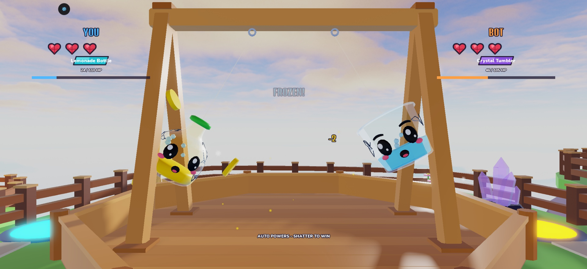
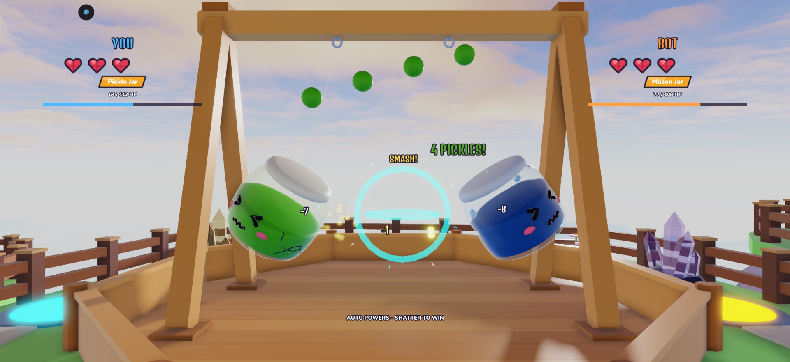

# Concept abilities in the real arena: test report (2026-11-02)

Studio only, not published. Place 129420351303019, branch `claude/relaunch-gauntlet`. Plan: [design/RELAUNCH_PLAN.md](../../design/RELAUNCH_PLAN.md).

The earlier Gauntlet slice was rejected and removed. Its screenshots here (`after_*.jpg`) are history, kept only for comparison.

## Screens

| Rising Tide fills the pen | Split Light |
|---|---|
|  |  |

| Reaction faces and a jam blob | Real match from the lobby, mixed with an older model |
|---|---|
|  |  |

| Zest Ring and Ice Field | Pickle Drop and Firefly Swarm |
|---|---|
|  |  |

## Verified

- Lune and Studio Play server: **QA_TESTS_PLACEHOLDER**. Each of the 12 abilities has a real-swing test, and round length has a range check.
- Round length on the real swing (`equal:bot0.5`, 4,680 rounds): **mean 32.2 s**. Before this work, `tools/pacing_report` measured 21.6 s.
- Balance on the real swing, 234 rounds per glassy: **43.6% to 56.8%, 34 of 40 inside 45-55%**. At this sample size a few points either way is noise.
- Real first session in Studio: welcome spins, reveal, assisted first match against Rookie Bot. No new console errors, only the old `203785492` warning.
- QA_MULTI_PLACEHOLDER
- Economy: match about 3.9 min. With rewards up about 25%, 141 Kiln pulls by day 30 (was 145) and 5 on day 1.
- No new remotes: abilities are server-driven and clients only draw them.

## Not verified

Full list for the creator: [MORNING](../../logs/MORNING.md).

- Nobody but the creator has judged feel, and sound choices were not heard.
- No phone or emulator check.
- Some abilities were only exercised by tests, not seen on screen.
- Balance is equal-stat bots; real players and rarity may shift it.

## Run it

Press Play in Studio and play normally. To watch a chosen matchup, run this in the Server command bar:

```lua
require(game.ServerScriptService.Server.Services.FightService):BotVsBot("pop", "water_jug", 1, true)
```

Ids: `pop`, `jam`, `prism`, `glass_cup`, `water_jug`, `ketchup_bottle`, `milk_bottle`, `pickle_jar`, `lemonade_bottle`, `mason_jar`, `crystal_tumbler`, `hot_sauce`.
