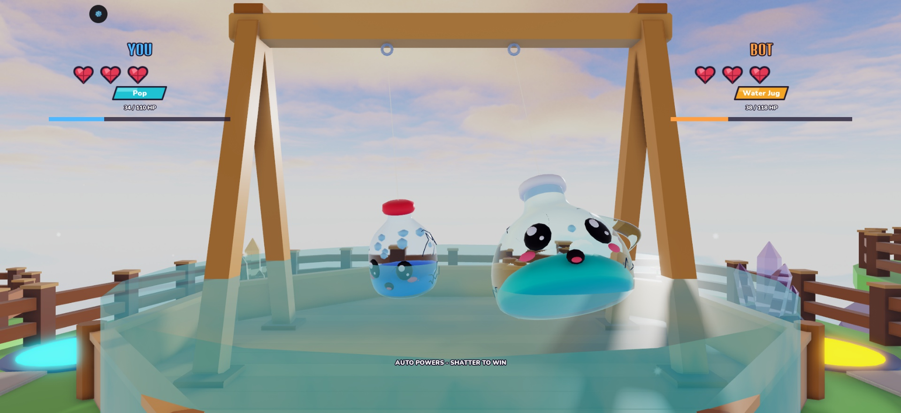
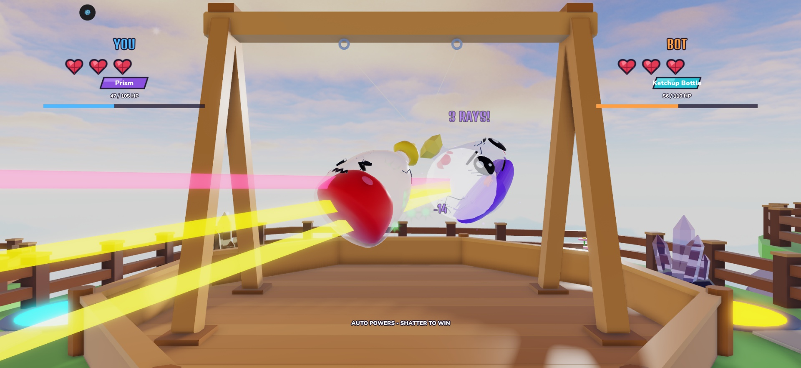
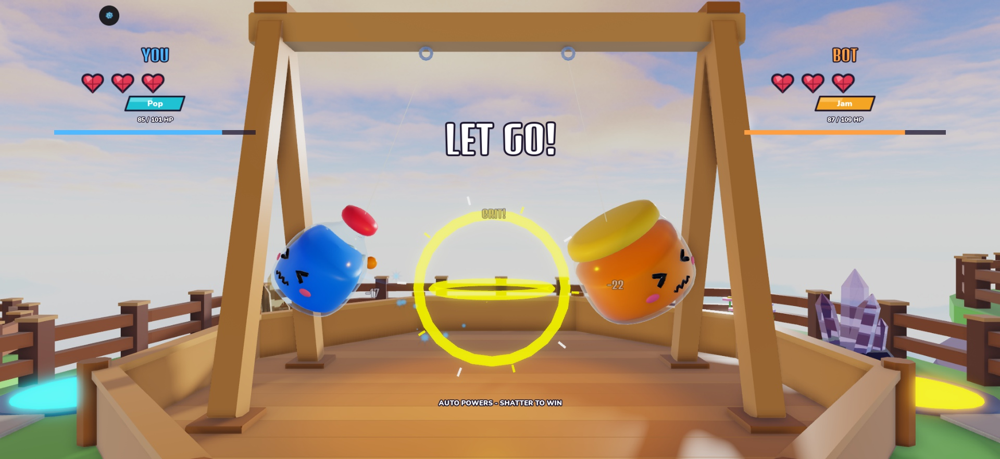
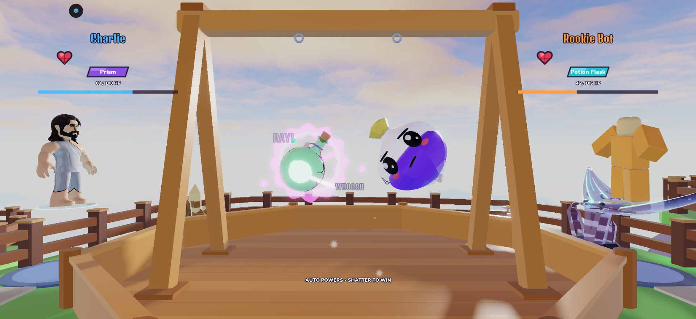

# Concept abilities in the real arena: test report (2026-11-02)

Studio only, not published. Place 129420351303019, branch `claude/relaunch-gauntlet`. Plan: [design/RELAUNCH_PLAN.md](../../design/RELAUNCH_PLAN.md).

The earlier Gauntlet slice was rejected and removed. Its screenshots here (`after_*.jpg`) are history, kept only for comparison.

## Screens

| Rising Tide fills the pen | Split Light |
|---|---|
|  |  |

| Reaction faces and a jam blob | Real match from the lobby, mixed with an older model |
|---|---|
|  |  |

## Verified

- Lune and Studio Play server: **302 passed, 0 failed**. Seven new tests run each ability on the real swing and check that round length stays in range.
- Round length on the real swing (`equal:bot0.5`, 3,120 rounds): **mean 33.6 s, 2.2% timeouts**. Before this pass, `tools/pacing_report` measured 21.6 s.
- Balance on the real swing, 156 rounds per glassy: **41.0% to 57.7%, 29 of 40 inside 45-55%**. A separate run gave the six reworked glassies 312 rounds each: 48.4% to 56.7%. In the 40-glassy run, Cup, Jam, Pop and Prism landed in band, and Ketchup and Jug outside it. At these sample sizes a few points either way is noise.
- Pop vs Jug, Prism vs Ketchup and Pop vs Jam in the real arena through the watched bot fight, plus one real first match from the lobby. Water, rays, reaction faces, blobs, liquid-level HP and new cracks were all seen. No new console errors; only the old `203785492` warning.
- Models: six swapped into `Assets.Glassies`, with the old six backed up in `ServerStorage.GlassiesBeforeV5`. Item icons and the reel sprite sheet updated.
- Simulators ran. EconomySim shows 145 pulls by day 30 and 2.9 min matches, but it still assumes the old fight length, so its coin pacing is optimistic. Matches are about 33 s per round now, so expect fewer coins per hour.

## Not verified

- **Nobody but the creator has judged the feel, and I can't judge fun from a tool.** Numbers and effects are first passes.
- Cap Blast, Sticky Trap's full glue, Spin Cycle's top speed, the wave and the Squeeze were exercised by tests and matches, but I only got screenshots of some of them. Check them by eye.
- No phone or emulator check.
- Bystanders who start watching mid-round miss earlier water or blobs until the next change.
- Ability numbers were tuned hard downward to reach fairness, so hits read small (for example a 5 to 6 damage wave). The big moments are carried by visuals and knockback; damage may need raising alongside lower HP if they feel weak.
- `BalanceSim` (the stand-in model) can't run concept abilities, so its fairness test now skips those six and uses a wide guard. `tools/release_matrix` is the fair check.
- Power x HP test widened to 1950-2500 because HP is now the balance lever.
- Other 34 glassies keep cast kits and old models, so the roster looks mixed until later waves.
- Studio source for new modules matches the repo in behaviour, not byte for byte. Some are in a more compact format, because they were pasted through MCP. Rojo was not used.

## Run it

Press Play in Studio and play normally. To watch a chosen matchup, run this in the Server command bar:

```lua
require(game.ServerScriptService.Server.Services.FightService):BotVsBot("pop", "water_jug", 1, true)
```

Ids: `pop`, `jam`, `prism`, `glass_cup`, `water_jug`, `ketchup_bottle`.
