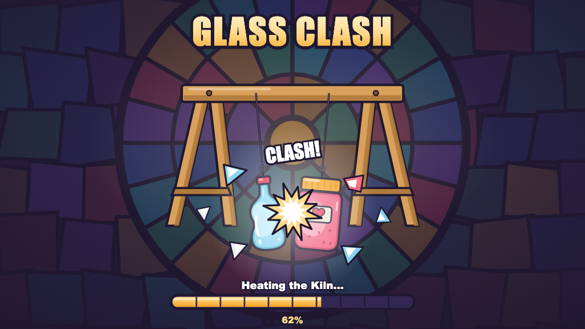
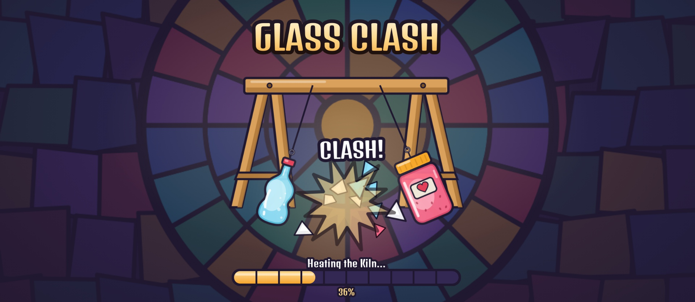
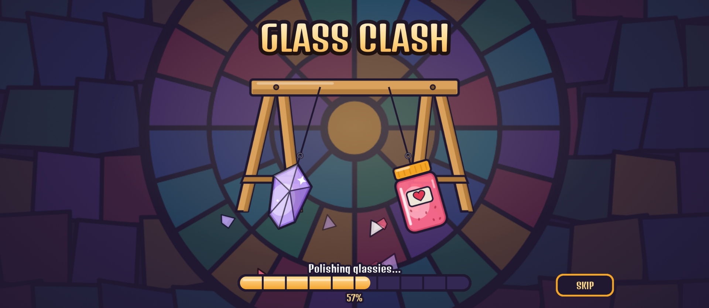
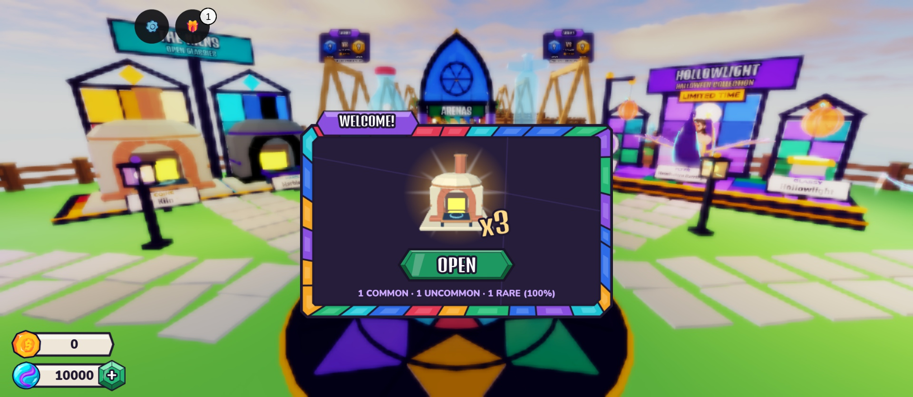

# Loading screen

The first thing a player sees (ReplicatedFirst, replacing Roblox's default screen). It shows the game in miniature
while the art preloads, then dips into the lobby.

## What it shows

- A dim stained-glass rose window, "GLASS CLASH" in gold, the arena swing.
- Two vector glassies on strings (Pop, Jam, Prism, a green flask take turns). A small damped-pendulum simulation
  pulls them back and smashes them together: gold burst, glow, "CLASH!" on strong hits, shards in both colours, a
  little shake. Every third strong hit one glassy shatters and the next one drops onto its string.
- Tapping anywhere swings them again.
- A segmented amber glass bar with the real percent, and a rotating line ("Heating the Kiln...").

Flat images only (no ViewportFrames). Art: `tools/ui/loading_art.py` → `assets/ui/loading/{svg,png}`, uploads in
`assets/ui/loading/roblox_assets.json`, image ids in `src/first/LoadingScreen/Art.luau` (ReplicatedStorage isn't there
yet when it starts, so the ids live next to the script, not in UIAssets).

## What it loads

`src/first/LoadingScreen/Preload.luau`, as `ContentProvider:PreloadAsync` jobs on four workers (an Instance preloads
everything under it):

1. every UI image id in `Shared.Config.UIAssets` (batches of 24)
2. every StarterGui screen template
3. every model and effect under `ReplicatedStorage.Assets` (glassies, flyers, finishers, crates, Kilns, crate
   machines, VFX, world kit, seasonal), except the review-only `CombatReleasePreview`
4. whatever lobby has streamed in around the spawn (StreamingEnabled is on)

## When it closes

- When everything has loaded, but never before `MIN_SECONDS` (3.2 s, one full clash).
- **SKIP** appears after `SKIP_AFTER` (10 s) if loading is still going.
- It closes by itself after `MAX_SECONDS` (30 s); preloading carries on in the background.

Roblox's guidance is to keep loading screens light; the skip and the cap are what keep "load everything" from
trapping anyone on a slow phone.

When it is gone it sets the local Player attribute `ClientLoaded = true`. `OnboardingController` waits for it
(45 s cap) before the welcome card.

## Studio check (2026-10-20)

| | |
|---|---|
|  | A strong hit: CLASH!, the gold burst, shards in both colours |
|  | After a shatter (Prism dropped onto Pop's string); SKIP after 10 s on the first, uncached run |
|  | The dip into the lobby; the welcome card follows |

Timing in Studio: about 15 s on the first run (downloads), about 9 s once cached.

## Files

| File | What |
|---|---|
| `src/first/LoadingScreen/init.client.luau` | The screen, flow and timing |
| `src/first/LoadingScreen/Clash.luau` | The swing show |
| `src/first/LoadingScreen/Preload.luau` | What is preloaded and how |
| `src/first/LoadingScreen/Art.luau` | Image ids, glassy sizes, colours, the rotating lines |
| `default.project.json` | `ReplicatedFirst.LoadingScreen` → `src/first/LoadingScreen` |
