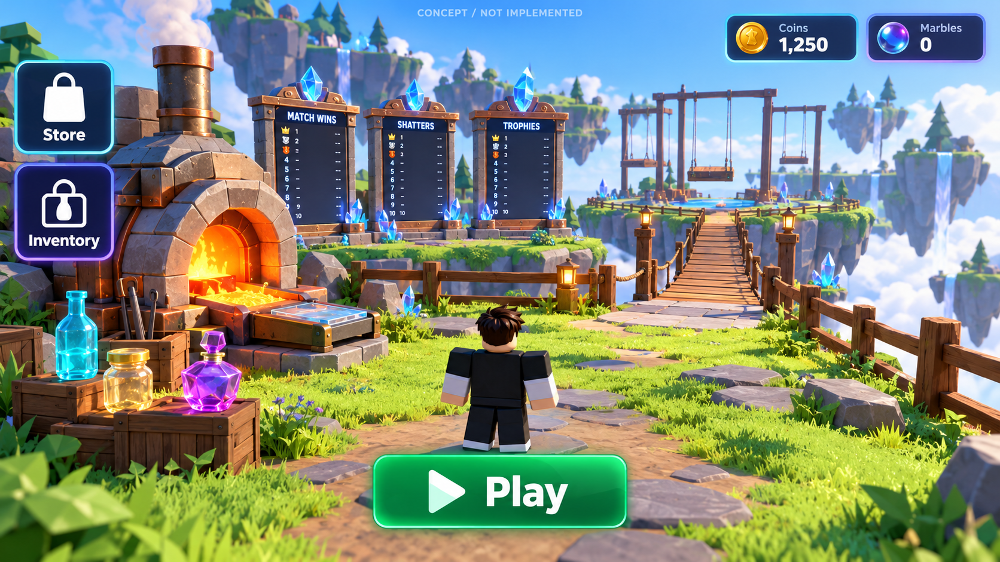
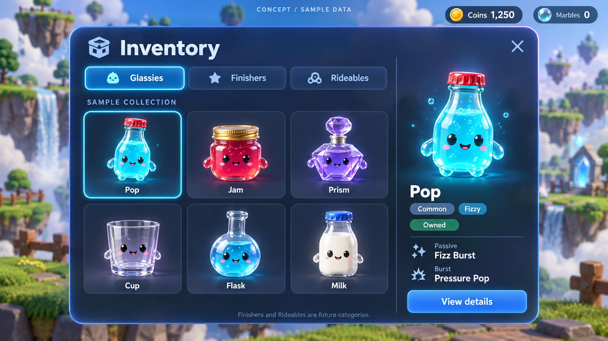
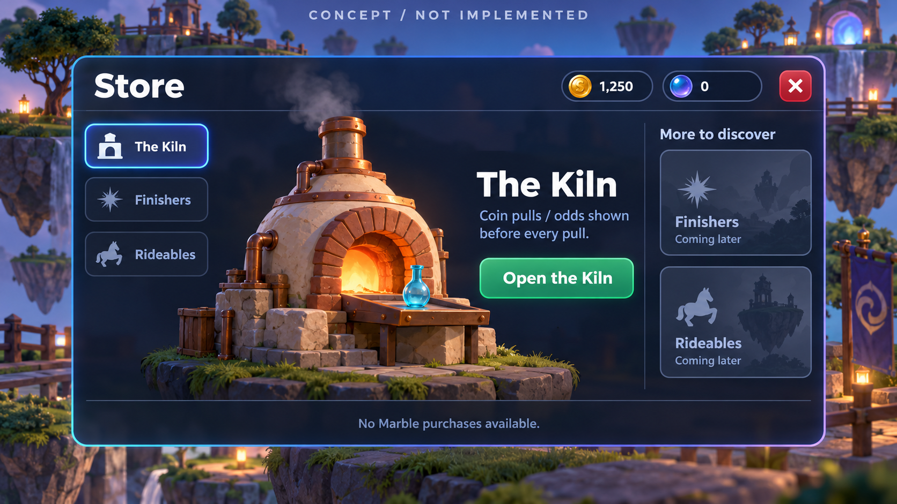

# Glass Clash — generated interface concepts

Generated 2026-10-14 with the built-in imagegen tool. All three final PNGs and the exact tool prompts are saved here. These are **concept images**, not implemented or tested Roblox screens. Current functionality remains whatever is present in the shared source and live StarterGui; this session did not edit either.

| Image | Exact prompt | Intent |
|---|---|---|
| [Lobby HUD](hud.png) | [Prompt](hud.prompt.txt) | Exactly two square main buttons, Store / Inventory; Coins / Marbles; bottom-center Play; sparse navigation and open touch corners. |
| [Inventory](inventory.png) | [Prompt](inventory.prompt.txt) | Glassies / Finishers / Rideables tabs, 3×2 sample grid, fixed right-hand preview and details. |
| [Store](store.png) | [Prompt](store.prompt.txt) | The Kiln as the current interaction, coming-later cosmetic categories, no invented offers or Marble purchase controls. |

The saved Ball v Ball screenshots were inspected for navigation hierarchy, generous item previews and grid/sidebar organization. No reference-game artwork, icons, names or models were extracted. The generated backgrounds are illustrative; the actual import-ready models are in [lobby_v2](../../../../assets/blender/map/lobby_v2/README.md).

## What carries into functional UI

- Preserve editable StarterGui templates, existing named bindings, shared Theme/components, CoreUISafeInsets and authored geometry. Arrange with Scale; use aspect/size constraints and minimum 44 px phone targets. Do not use a flattened image as the interactive screen.
- Lobby HUD: two square Store/Inventory buttons, separate Coins/Marbles readouts, Play at bottom center. Other features belong inside panels. A displayed Marble balance does not activate paid systems, free grants or new prices. Closed menus expose thumbstick/jump space; match phases suppress the lobby HUD.
- Inventory: approximately 65% grid / 30% details with remaining space for gutters. Use clear selected borders, category tabs and a readable close target. Keep Glassies functional through existing collection data; show Finishers/Rideables as unavailable/future until their data and actions exist. Surface useful descriptions from Config rather than transcribing generated text or sample numeric data.
- Store: Open the Kiln routes to the existing odds-first panel; it must never directly debit coins. Show the real installed pool and server quote before each actual pull. Keep all paid/Marble features disabled under current scope. Coming-later cards have no dead purchase controls.
- Reflow the grid/sidebar for portrait phones without shrinking targets below 44 px; the landscape concepts are not a responsive-layout test. Verify actual text fitting and gamepad selection in Studio after a clear handover from Claude.

## Concept limitations

Inventory names, ownership, amounts and the expressive faces/limbs are illustrative sample data/art. The approved native starter geometry remains authoritative; this work does not redesign glassies or add those facial features. Sample balances grant nothing. The Store image uses currency icons without spelling out both names beside them; functional UI should retain accessible Coins and Marbles labels. The more detailed generated furnace/background should guide mood, not imply that every detail is present in the low-poly exported model.

Finishers/Rideables inventory, equipping and purchases are future features. No final UI assets have been uploaded, no Roblox image IDs assigned, and no controllers/templates changed. The creator can replace these concepts with final styling while retaining the requested structure.
