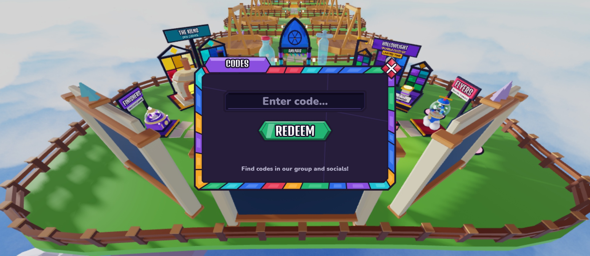
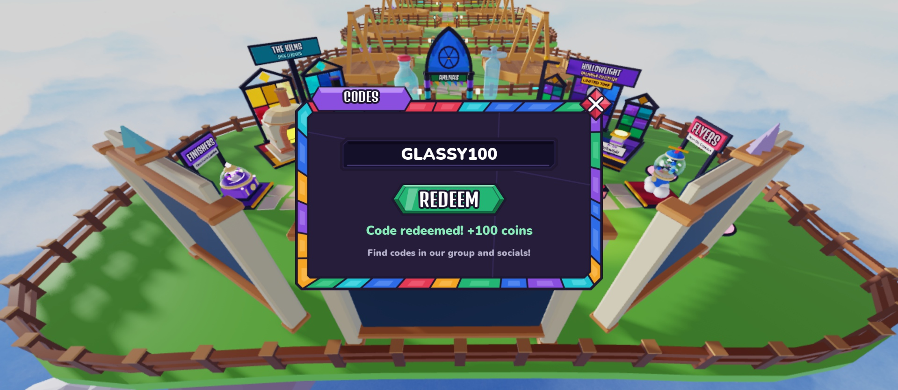
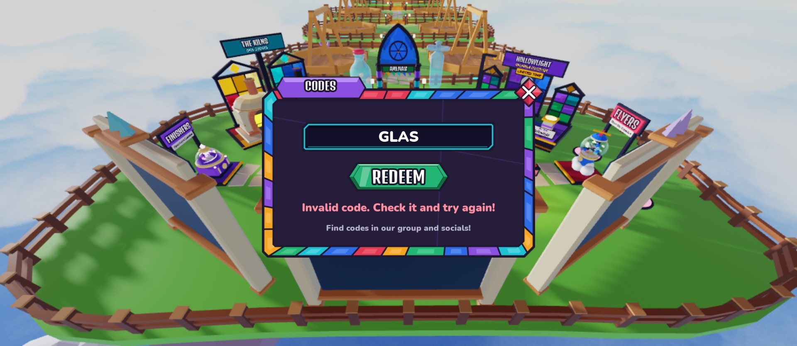

# CodesScreen (top bar → Rewards gift → Codes)

Design only (Oct 19): no controller, no remotes. A deliberately **small** Stained Glass window, about 30% of the screen
width (min 400×249, max 640×398 px), aspect 900:560. The REDEEM button sits **under** the code field (stacked, not side by side). Rebuild with `tools/studio/build_codes_screen.luau`
(Studio Edit, lock held; copies the old screen to `ServerStorage.UIBackup_Topbar`, then replaces `StarterGui.CodesScreen`).

| Default | Success | Invalid + focused |
|---|---|---|
|  |  |  |

## Element map

`CodesScreen` (ScreenGui, `Enabled = false`, `TopbarScreen = true`) → `Panel` (aspect 900:560, Scale only)

| Name | Class | What it will do |
|---|---|---|
| `Panel.WindowArtwork` | ImageLabel | mosaic window (`window_codes`), Fit |
| `Panel.TitleBanner` / `Panel.Title` | ImageLabel / TextLabel | amethyst `panel/title_amethyst` banner, "CODES" (Denk One, cloned from the Inventory window) |
| `Panel.Close` | TextButton | close diamond cloned from the other windows; TopbarController closes the screen on it |
| `Panel.Content` | Frame | the dark inner pane; everything below lives here |
| `Content.InputField` | Frame (aspect 6.5) | holds the field art |
| `InputField.Artwork` | ImageLabel | dark inset glass field (`field_inset`) |
| `InputField.FocusOutline` | ImageLabel | aqua ring (`field_focus`), hidden; show it on `CodeInput.Focused`, hide on `FocusLost` |
| `InputField.CodeInput` | **TextBox** | the code. `PlaceholderText = "Enter code…"`, `ClearTextOnFocus = false`, one line, centred, Nunito Heavy white, `TextScaled` with a max of 34. Attribute `TextFit = false` so TextFit never touches it. Read `.Text` on `FocusLost` or on redeem |
| `Content.RedeemButton` | TextButton | (under the field) green gem "REDEEM" (`button/gem_emerald`). Has the usual `Artwork`, `Label` (Denk One), `InteractionScale` parts |
| `Content.Status` | TextLabel | one-line message slot. **Empty and `Visible = false`** by default |
| `Content.Hint` | TextLabel | "Find codes in our group and socials!" (generic, no links) |

## States

- **Default:** field empty (placeholder shown), no status, hint visible.
- **Typing:** the text is centred and white; it shrinks only if longer than the field (about 20 characters).
- **Focused:** show `FocusOutline`.
- **Success:** `Status.Text` e.g. "Code redeemed! +100 coins", `TextColor3 #86EDB8` (emerald light), `Visible = true`.
- **Error:** e.g. "Invalid code. Check it and try again!", `TextColor3 #FF8EA0` (ruby light), `Visible = true`. Other messages the
  controller may want: "Already redeemed", "Code expired", "Slow down!".
- **Busy (suggested):** `Label.Text = "…"`, and tint `RedeemButton.Artwork.ImageColor3` to grey (e.g. 150,150,150) while the
  server answers; restore afterwards.

## Assets

Generator `tools/ui/codes_art.mjs` (`node tools/ui/codes_art.mjs` with resvg; this session had no Node, so the same module
was run in a browser and rasterised with a canvas; the output is equivalent). Sources in `assets/ui/screens/codes/svg`, 2× PNGs
in `png`, uploads in `roblox_assets.json`. Decals were resolved to image ids with `InsertService:LoadAsset` and added to
`UIAssets` under `screens/codes/*`.

| Key | Decal | Image id |
|---|---|---|
| `screens/codes/window_codes` (900×560, 2×) | 90013473722478 | 130439492899536 |
| `screens/codes/field_inset` (520×80, 2×) | 84567967482821 | 98997316553457 |
| `screens/codes/field_focus` | 133279075090658 | 99561576715408 |

Reused: `panel/title_amethyst`, `button/gem_emerald`, `button/close_diamond` + `icon/close_x` (through the cloned Close).

## Notes / not done

- All positions and sizes are Scale; the Panel has a `UISizeConstraint` so it stays readable on small screens. The phone and
  tablet scaling pass is still to do; at the 400 px minimum the field is about 284×44 px and the REDEEM gem about 151×43 px.
- The window and field use Fit with their own aspect ratios (no 9-slice), so they need no `StainedAssetSpecs` entry.
- The creator saves the place in Studio.
