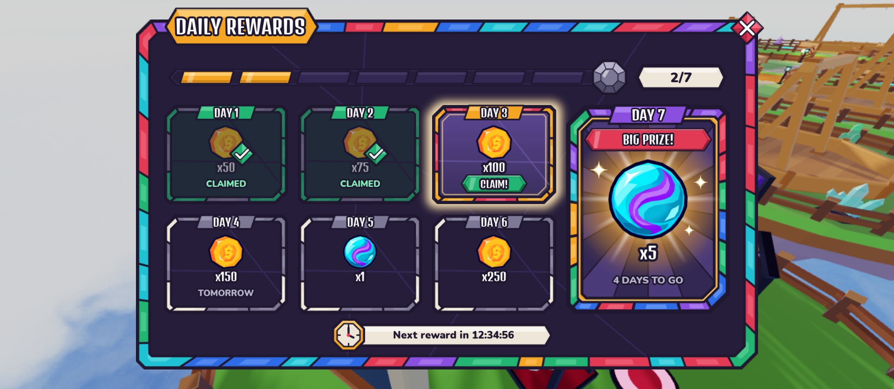
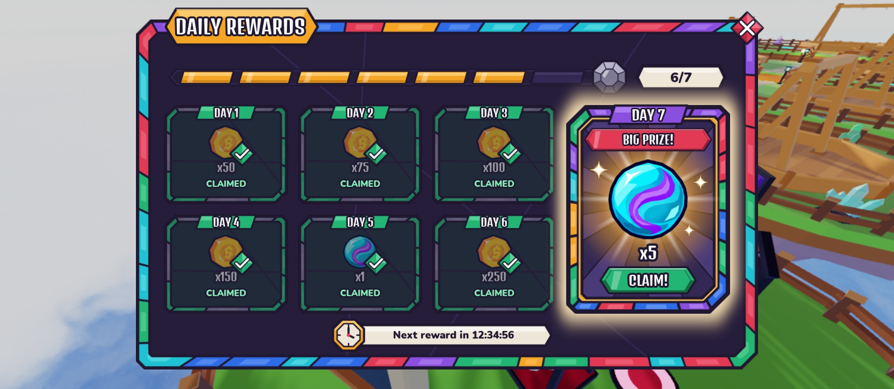

# DailyRewardsScreen (top bar → Rewards gift → Daily Rewards)

Design only (Oct 19): no controller, no remotes. A regular-size Stained Glass window, the same footprint as the Inventory
window (Panel `0.86 × 0.9` of the screen, aspect 1.773, Scale only). Seven days on one screen in a 4 × 2 grid: Days 1–6 are
six equal cells in columns 1–3, and Day 7 is one large cell spanning both rows of column 4. A segmented progress bar sits
under the title.

Rebuild with `tools/studio/build_daily_rewards_screen.luau` (Studio Edit, lock held). It copies the old screen to
`ServerStorage.UIBackup_Topbar.DailyRewardsScreen`, then replaces `StarterGui.DailyRewardsScreen`. Set `SCENARIO = "Day7"`
at the top to preview the weekly prize's claim state; the saved design uses `"MidWeek"`.

| Mid-week (saved build): Days 1–2 claimed, Day 3 today, 2/7 | Day 7 today: Days 1–6 claimed, 6/7 |
|---|---|
|  |  |

## Element map

`DailyRewardsScreen` (ScreenGui, `Enabled = false`, `TopbarScreen = true`, DisplayOrder 20, CoreUISafeInsets) → `Panel`

| Name | Class | What it will do |
|---|---|---|
| `Panel.WindowArtwork`, `TitleBanner`, `Title` | ImageLabel / TextLabel | Inventory window art, **amber** `panel/title_amber` banner, "DAILY REWARDS" (cloned from `CollectionScreen.Panel`) |
| `Panel.Close` | TextButton | close diamond; TopbarController closes the screen on it |
| `Progress` | Frame | attribute `Claimed` (0–7): the number of days claimed this week |
| `Progress.Track` | ImageLabel | leaded track (`progress_track`) |
| `Progress.Segments.Seg1`–`Seg7` | ImageLabel | one per day, attribute `State` (the day's state). Image: `seg_lit` once that day is **claimed**, otherwise `seg_off` (including today, until it is claimed) |
| `Progress.Gem` | ImageLabel | Day 7 gem at the end of the track: `gem_off` (slate) until Day 7 is **claimed**, then `gem_lit` (gold). Attribute `Lit` |
| `Progress.CountPlaque` / `Progress.Count` | ImageLabel / TextLabel | milk plaque reading "x/7", x = days claimed (Nunito, lead). `TextFit = false` |
| `Days.Day1`–`Day6` | Frame | attributes `Day` (n) and `State` (`Claimed` / `Today` / `Locked`) |
| `Days.Day7` | Frame | same children as the others, plus the Day 7 extras below |
| `DayN.Glow` | ImageLabel | amber halo behind the cell (1.26× its size). Visible only for `Today`. Pulse it later |
| `DayN.Art` | ImageLabel | the cell's glass: `cell_claimed` / `cell_today` / `cell_locked`. Day 7 always uses `cell_day7` and dims with `ImageColor3 = (150,150,165)` when claimed |
| `DayN.LabelTag` / `DayN.Label` | ImageLabel / TextLabel | "DAY n" on a tag riding the top lead line. Tag: `tag/tag_emerald` claimed, `tag_amber` today, `tag_slate` locked; Day 7 is always `tag_amethyst` |
| `DayN.Icon` | ImageLabel | reward icon (placeholders `icon/coin`, `icon/marble`). `ImageTransparency 0.45` when claimed |
| `DayN.Amount` | TextLabel | "x100" (Denk One, white + lead stroke). `TextTransparency` and stroke `0.45` when claimed |
| `DayN.ClaimedMark` | ImageLabel | emerald check diamond (`check_badge`) over the icon's corner. Visible only for `Claimed` |
| `DayN.ClaimButton` | ImageButton | green gem (`button/gem_emerald`) with `Caption` "CLAIM!", sitting fully inside the cell's inner pane (never over the lead border). Visible only for `Today`. Wire its `Activated` to the claim remote |
| `DayN.Status` | TextLabel | small line under the amount: "CLAIMED" (emerald light) for claimed days, "TOMORROW" on the next day, "n DAYS TO GO" on a locked Day 7 (slate light). Hidden when empty and on `Today` |
| `Day7.Badge` / `Day7.BadgeText` | ImageLabel / TextLabel | ruby `banner/power_ruby` ribbon, "BIG PRIZE!" |
| `Day7.IconGlow` | ImageLabel | gold burst behind the big icon (`glow_burst`). `ImageTransparency 0.7` when claimed. Slow-rotate it later |
| `Day7.Sparkles.Sparkle1`–`3` | ImageLabel | four-point sparkles (`sparkle`). Hidden when claimed. Twinkle later |
| `Timer` | Frame | "next reward" row |
| `Timer.Plaque` / `Timer.ClockIcon` / `Timer.Text` | ImageLabel / ImageLabel / TextLabel | milk plaque, amber clock gem, "Next reward in 12:34:56" (Nunito, lead). Also fits "Come back tomorrow!" |

## States (per day cell)

| | Claimed | Today (claimable) | Locked (upcoming) |
|---|---|---|---|
| `Art` | `cell_claimed` (spent emerald border, darker green-tinted pane) | `cell_today` (amber/ruby border, lit violet pane, inner gold line) | `cell_locked` (slate and milk border, plain smoke pane) |
| `Glow` | hidden | **visible** | hidden |
| `LabelTag` | emerald | amber | slate |
| `Icon` / `Amount` | 45% faded | full | full |
| `ClaimedMark` | **visible** | hidden | hidden |
| `ClaimButton` | hidden | **visible** | hidden |
| `Status` | "CLAIMED" | hidden | "TOMORROW" / "n DAYS TO GO" / empty |
| `Progress.SegN` | `seg_lit` | `seg_off` (lights on claim) | `seg_off` |

Day 7 keeps its own frame, tag and badge in every state; claimed dims its `Art`, fades `IconGlow` and hides the sparkles.

**Progress rule (approved by the creator): the bar counts claimed days only.** A segment lights when its day is
claimed, and `Count` shows the number of days claimed. Today's segment stays unlit until the player presses CLAIM (a good
moment for the fill animation), and `Progress.Gem` lights only when Day 7 itself is claimed. Mid-week sample: Days 1–2
claimed, Day 3 ready → 2 segments lit, "2/7". `seg_today` (brighter gold) is kept in the asset set for a claim flash but
is not a resting state.

## Layout (Scale, fractions of the parent)

- `Progress`: pos (0.05, 0.118), size (0.9, 0.095). Track 0–0.79, gem centred at 0.79, count plaque centred at 0.918.
- Inside a small cell (fractions of the cell): tag centred at y 0.075 (it rides the top lead line), icon 0.375, amount
  0.625, CLAIM gem / status 0.795. The gem spans y 0.70–0.89 and x 0.23–0.77, inside the pane (0.07–0.93) and clear of
  today's gold inner line (0.90). On Day 7 the gem spans y 0.77–0.91 and x 0.20–0.80, inside its pane (0.075–0.925).
- `Days`: pos (0.045, 0.245), size (0.91, 0.595). Columns 1–3 are 0.2192 wide with 0.01758 gaps; Day 7 fills the rest
  (0.2895). Rows are 0.475 tall with a 0.05 gap. A small cell is 1.24 : 1, Day 7 is 0.778 : 1; the art is drawn at those
  aspects (Stretch is safe).
- `Timer`: centred at (0.5, 0.902), size (0.34, 0.066).

## Assets

Generator: `python3 tools/ui/daily_rewards_art.py`. It ports the kit's window mosaic and renders with headless Chrome,
because this Mac has no Node/resvg. Sources are in `assets/ui/screens/daily_rewards/svg`, and the 2× PNGs (capped at 1024 px)
are in `png`. Uploads are recorded in `roblox_assets.json` (group 11116787, all Approved). The Decals were resolved to image
ids with `InsertService:LoadAsset` and added to `UIAssets` under `screens/daily_rewards/*`.

| Key (`screens/daily_rewards/…`) | SVG size | Decal | Image id |
|---|---|---|---|
| `cell_locked` | 300×242 | 112787130497723 | 112424900545322 |
| `cell_claimed` | 300×242 | 123596332261851 | 123062189542207 |
| `cell_today` | 300×242 | 93323905340653 | 89477285281517 |
| `cell_day7` | 300×386 | 72193649497002 | 120953856890626 |
| `glow_today` | 360×290 | 87150558302843 | 71166976377615 |
| `glow_burst` | 300×300 | 76536494088778 | 77624391348245 |
| `check_badge` | 80×80 | 98754341133551 | 89983929075705 |
| `progress_track` | 1145×50 | 91498645560289 | 103459116303156 |
| `seg_off` / `seg_lit` / `seg_today` | 172×44 | 92429415079956 / 90438674965093 / 129105907744603 | 83486640438740 / 108615290612409 / 134509086525244 |
| `gem_off` / `gem_lit` | 120×120 | 110601954075765 / 85041706487960 | 101814573321454 / 85620972073701 |
| `sparkle` | 64×64 | 73585919241434 | 117952041961855 |
| `timer_plaque` | 460×50 | 138231779694813 | 136293032496465 |
| `icon_clock` | 96×96 | 95290108454766 | 95614830605707 |

Reused from the kit: `panel/window_inventory`, `panel/title_amber`, `button/close_diamond` + `icon/close_x` (through the cloned
Close), `button/gem_emerald`, `banner/power_ruby`, `hud/label_plaque`, `tag/tag_{emerald,amber,slate,amethyst}`, `icon/coin`
and `icon/marble`.

## Notes / not done

- The rewards shown (x50 coins … x5 marbles) are placeholders; the real reward table is decided later.
- Animation ideas for later: pulse `Glow` and bob the `ClaimButton` on today; rotate `Day7.IconGlow`; twinkle the sparkles;
  on claim, fill the segment left to right, then pop in `ClaimedMark`.
- The phone and tablet scaling pass is still to do. At 1920×1080 a small cell is about 330×265 px, and the CLAIM gem about
  178×51 px.
- The creator saves the place in Studio.
