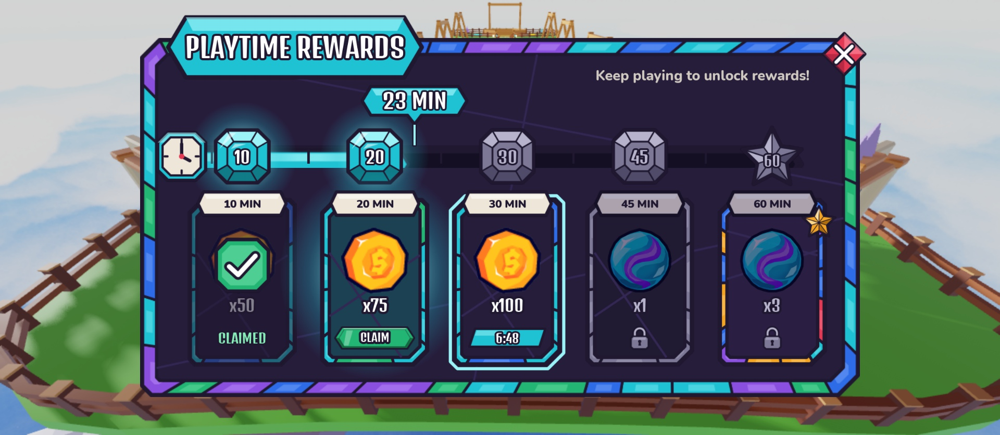

# PlaytimeRewardsScreen (top bar → Rewards gift → Playtime Rewards)

Design only (Oct 19): no controller, no remotes. A **wide** Stained Glass window (aspect 2.0, 0.72 of the screen width,
about 1380×690 px at 1920×1080) with one row of **five** reward cells at **10, 20, 30, 45 and 60** minutes of play (the
creator's stages), under a progress bar whose milestone gems sit exactly over each cell's centre. One page, no scrolling. It is Daily Rewards' sister: same window,
banner and close diamond, but a different shape (a long row instead of a calendar) and an **aqua** accent (Daily is
amber). Rebuild with `tools/studio/build_playtime_rewards_screen.luau` (Studio Edit, lock held; copies the old screen to
`ServerStorage.UIBackup_Topbar`, then replaces `StarterGui.PlaytimeRewardsScreen`).

The build shows a sample of **23 minutes played**: 10 claimed, 20 ready to claim, 30 next (6:48 left), 45 and 60
locked.

Revision (creator, Oct 19): 5 stages instead of 6 and a narrower window; the CLAIM gem and the countdown pill now sit fully
inside the cell's inner pane (clear of its lead border); the top note is neutral until the rules are set. Close-ups: [cells](PlaytimeRewardsScreen_cells.jpg), [progress bar](PlaytimeRewardsScreen_bar.jpg).

## Element map

`PlaytimeRewardsScreen` (ScreenGui, `Enabled = false`, `TopbarScreen = true`, DisplayOrder 20, CoreUISafeInsets) →
`Panel` (aspect 2.0, Scale only). Every image has an `AssetPath` attribute naming its UIAssets key.

| Name | Class | What it will do |
|---|---|---|
| `Panel.WindowArtwork` | ImageLabel | wide mosaic window (`window`, 1400×700), aqua-led cool border, Fit |
| `Panel.TitleBanner` / `Panel.Title` | ImageLabel / TextLabel | aqua `panel/title_aqua` banner, "PLAYTIME REWARDS" (Denk One, cloned from the Inventory window) |
| `Panel.Close` | TextButton | close diamond cloned from Inventory; TopbarController closes the screen on it |
| `Panel.Note` | TextLabel | small right-aligned note. Neutral sample "Keep playing to unlock rewards!"; the functionality pass sets the final text |
| `Panel.Progress` | Frame (whole panel) | the bar; attribute `PlayedMinutes` (sample 23) |
| `Progress.Track` | ImageLabel, Slice `Rect(20,0,1004,46)` | lead channel from x 0.058 (0 min) to just past the 60 gem (x 0.923) |
| `Progress.Track.Fill` | ImageLabel, Slice (same rect) | aqua glass fill. **`Size.X.Scale` = fill fraction of the track** (see Wiring) |
| `Progress.Track.Leads.Came1–5` | Frame | thin lead lines halfway between milestones that split the fill into glass panes (decoration) |
| `Progress.StartCap` | ImageLabel | clock gem (`icon_clock`) at the bar's start = 0 min |
| `Progress.Markers.M10, M20, M30, M45, M60` | Frame (square) | one per milestone, centred over its cell. Attributes `Minutes`, `Reached` |
| `M*.Gem` | ImageLabel | `gem_on` (aqua) when reached, `gem_off` (slate) before; M60 uses `gem_best_on` / `gem_best_off` (star) |
| `M*.Glow` | ImageLabel | soft aqua glow behind a reached gem; `Visible = Reached` |
| `M*.Label` | TextLabel | "10", "20", "30", "45", "60" (Denk One). White when reached, slate `#B7B3CC` before |
| `Progress.Time` | ImageLabel (`time_tag`) | play-time readout tag that **rides above the fill's head** and points down at it. AnchorPoint (0.5, 1) |
| `Progress.Time.Label` | TextLabel | "23 MIN" |
| `Panel.Rewards` | Frame | the row of cells (x 0.05 to 0.97, y 0.445 to 0.915) |
| `Rewards.R10, R20, R30, R45, R60` | Frame (aspect 200:310) | one cell. Attributes `Minutes`, `State` (`Claimed` / `Ready` / `Next` / `Locked`); R60 also has `Best = true` |
| `R*.Artwork` | ImageLabel | cell frame, swapped by state (table below) |
| `R*.Glow` | ImageLabel | aqua-white glow behind the cell, **Ready only** (pulse it later) |
| `R*.Outline` | ImageLabel | aqua-light outline around the cell, **Next only** |
| `R*.TimePlaque` / `R*.TimeLabel` | ImageLabel / TextLabel | milk plaque straddling the top edge, "10 MIN" (Nunito Heavy, lead). Plaque tinted slate when locked |
| `R*.Icon` | ImageLabel | reward icon slot (placeholder `icon/coin` or `icon/marble`; rewards are decided later). Greyed when locked |
| `R*.Amount` | TextLabel | "x50" (Denk One, white; slate when locked) |
| `R*.Dim` | ImageLabel | dark glass over the whole cell (`cell_dim`, ImageTransparency 0.45), **Claimed only** |
| `R*.ClaimedMark` | ImageLabel | emerald check medallion over the icon, **Claimed only** |
| `R*.Status` | TextLabel | "CLAIMED" in emerald light in the bottom slot, **Claimed only** |
| `R*.ClaimButton` | TextButton | green gem "CLAIM" (`button/gem_emerald`) with `Artwork`, `Label` and `InteractionScale` like the kit buttons, **Ready only**. 0.74 of the cell width, so it stays inside the inner pane (the lead band is about 0.085 of the width each side) |
| `R*.CountdownTag` / `R*.Countdown` | ImageLabel / TextLabel | aqua pill with time left to unlock ("6:48"), **Next only**; 0.72 of the cell width, inside the pane |
| `R*.LockIcon` | ImageLabel | slate padlock in the bottom slot, **Locked only** |
| `R60.BestBadge` | ImageLabel | amber star gem on the top-right corner of the best (60-minute) cell, always shown |

## States

| State | `Artwork` | Shown | Icon / text |
|---|---|---|---|
| **Claimed** | `cell_open` | `Dim`, `ClaimedMark`, `Status` | normal (the dim covers them) |
| **Ready** | `cell_ready` (aqua/emerald border, lit teal pane) | `Glow`, `ClaimButton` | normal |
| **Next** (the one being timed) | `cell_open` | `Outline`, `CountdownTag`, `Countdown` | normal |
| **Locked** | `cell_locked` (slate border, darker pane) | `LockIcon` | `Icon.ImageColor3 #8C88A3`, `ImageTransparency 0.15`; `Amount` and `TimePlaque` slate |

R60 keeps `cell_best` (rainbow border) in every state and shows the same overlays on top. More than one cell can be Ready
at once (the player came back to the menu late); only the first unreached cell is Next.

Milestone gems: reached → `Gem` = `gem_on` / `gem_best_on`, `Glow.Visible = true`, `Label` white; not reached →
`gem_off` / `gem_best_off`, no glow, `Label` slate.

## Wiring notes (for later)

- **Fill and readout position.** The gems are evenly spaced over the cells but the stages are not evenly spaced in time
  (10, 10, 10, 15, 15 minutes), so time maps to x **piecewise**: 0 min is the bar start (x 0.058, under the clock), stage
  *i* is its cell centre `0.05 + 0.92 * (i - 0.5) / 5`, and at 60 the fill covers the whole track (to x 0.923, under the
  star). Copy `timeToX` from the build script (it reads the stage list). Then
  `Track.Fill.Size.X.Scale = (timeToX(t) - BAR_X0) / (BAR_X1 - BAR_X0)` and `Progress.Time.Position.X.Scale = timeToX(t)`.
- Tween the fill and the tag together; light the gem (and fire a small sparkle) as the fill passes it.
- The readout can show "23 MIN" or "23:12"; it is Denk One with TextFit, so either fits.

## Assets

Generator `tools/ui/playtime_rewards_art.py` (`python3 tools/ui/playtime_rewards_art.py`). This Mac has no Node/resvg,
so it is plain Python: it ports `windowSvg` from `tools/ui/stained_glass.mjs` (that file stays untouched) and rasterises
every SVG in one headless-Chrome pass (canvas → PNG). PNGs are 2× the SVG size, capped at 1024 px on the long side so
Roblox never resamples them. Sources in `assets/ui/screens/playtime_rewards/svg`, PNGs in `png`, uploads in
`roblox_assets.json` (from `upload_list.json`). Decals were resolved to image ids with `InsertService:LoadAsset` and added
to `UIAssets` under `screens/playtime_rewards/*`.

| Key (`screens/playtime_rewards/…`) | PNG | Decal | Image id | Use |
|---|---|---|---|---|
| `window` | 1024×512 | 95439411319486 | 117328170402465 | panel, Fit, aspect 2.0 |
| `cell_open` | 400×620 | 113954142347514 | 92846045397361 | cell frame (claimed / next), Fit |
| `cell_ready` | 400×620 | 124739632696378 | 109813909526428 | cell frame (ready) |
| `cell_locked` | 400×620 | 117425286963282 | 74505075426783 | cell frame (locked) |
| `cell_best` | 400×620 | 136504429102525 | 117752506007054 | 60-minute cell frame (rainbow) |
| `cell_dim` | 400×620 | 82048366010397 | 85314916298071 | claimed dimmer (same outline as the cell) |
| `cell_outline` | 432×652 | 133618103977731 | 105222766204706 | white outline, tinted aqua light for Next |
| `bar_track` | 1024×46 | 107766879726676 | 79949151437952 | Slice `Rect(20, 0, 1004, 46)` |
| `bar_fill` | 1024×46 | 81555105475564 | 80964919944478 | Slice `Rect(20, 0, 1004, 46)` |
| `gem_on` / `gem_off` | 200×200 | 94215792011414 / 121058919709767 | 123522265045482 / 82694150596352 | milestone gems |
| `gem_best_on` / `gem_best_off` | 220×220 | 97764530498037 / 99567109935181 | 121430822606586 / 84282126147749 | 60-minute star gem, `BestBadge` |
| `glow` | 600×600 | 135203695254889 | 92846222472557 | radial aqua-white glow (cells, gems) |
| `icon_check` | 192×192 | 125870698503076 | 91723893736830 | claimed medallion |
| `icon_lock` | 160×192 | 88071117075872 | 103789030449627 | locked padlock |
| `icon_clock` | 192×192 | 112889451006717 | 109458855076082 | bar start cap |
| `time_tag` | 440×168 | 118477836247752 | 75404031875632 | play-time readout tag (pointer at the bottom) |

Reused from the kit: `panel/title_aqua`, `hud/label_plaque`, `tag/tag_aqua`, `button/gem_emerald`, `icon/coin`,
`icon/marble`, `button/close_diamond` + `icon/close_x` (through the cloned Close).

## Notes / not done

- All positions and sizes are Scale with UIAspectRatioConstraints; the phone and tablet scaling pass is still to do. At
  1920×1080 the panel is about 1380×690 px and each cell about 210×325 px. The first (6-stage, 2.4:1) window art is
  superseded; its Decal 126260622906559 is no longer used.
- The Settings screen also uses an aqua banner; if the two should differ more, swap `TitleBanner` to another
  `panel/title_*` colour (the bar and gems can stay aqua).
- Animations (fill tween, gem light-up, glow pulse, claim pop) come with the wiring.
- The creator saves the place in Studio.
