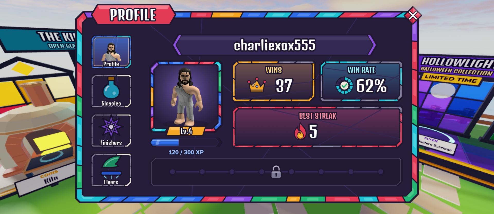
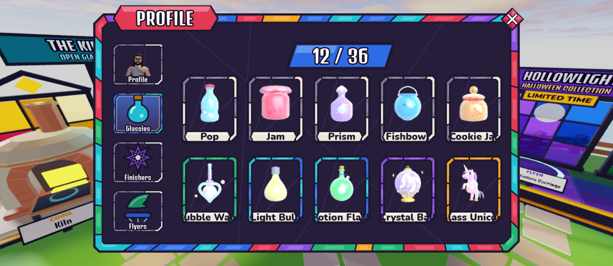
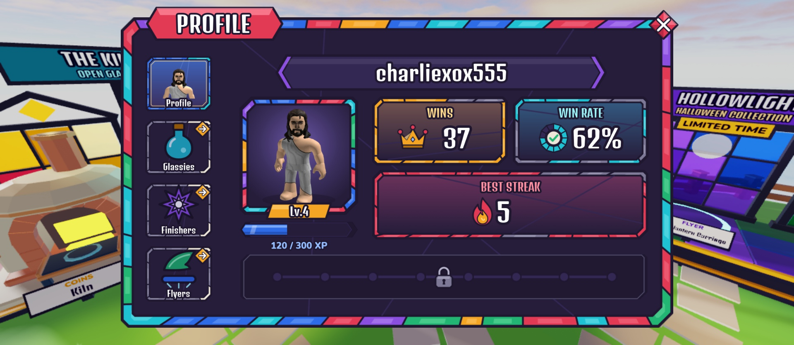

# ProfileScreen (top bar → Profile)

Design only (Oct 20): no controller, no remotes, no XP yet. Placeholder data: Lv.4, 120 / 300 XP, 37 wins, 62%, best
streak 5. It's a regular-size Stained Glass window with the same footprint as Inventory (Panel `0.86 × 0.9` of the
screen, aspect 1.773, Scale only). It has a **ruby** title banner ("PROFILE"), so it stands apart from Inventory
(sapphire), Daily (amber), Settings and Playtime (aqua) and Codes (amethyst).

The layout borrows ideas from the Ball v Ball profile (a column of big picture tabs, a name banner, an avatar with
its level, and stat tiles). The art is our own kit.

Rebuild with `tools/studio/build_profile_screen.luau` (Studio Edit, lock held). It copies the old screen to
`ServerStorage.UIBackup_Topbar.ProfileScreen` and then replaces `StarterGui.ProfileScreen`. Art comes from
`tools/ui/profile_art.py` (17 pieces, keys `screens/profile/*` in `Config/UIAssets`).

## The two tab options (creator picks one)

| A: **Grids** (recommended). The tabs show read-only grids inside the profile | B: **Jump**. The tabs open the Inventory on that tab |
|---|---|
|  |  |
| Same tiles as the Inventory (`GlassyTile` + the live `GlassyPortrait`), without Open/equip. A count tag on top shows owned / total. Works the same later for someone else's profile. | An amber arrow badge marks the three tabs as "takes you somewhere". Tapping one closes the profile and opens Inventory on Glassies / Finishers / Flyers. Nothing new to build, but it can't show another player's collection. |

Set `VARIANT = "Jump"` at the top of the build script to build option B. `PAGE = "Glassies"` shows the grid page.

## Element map

`ProfileScreen` (ScreenGui, `Enabled = false`, `TopbarScreen = true`, DisplayOrder 20, CoreUISafeInsets) → `Panel`

| Name | Class | What it will do |
|---|---|---|
| `Panel.WindowArtwork`, `TitleBanner`, `Title`, `Close` | from `CollectionScreen.Panel` | the Inventory window, ruby `panel/title_ruby`, "PROFILE", close diamond (TopbarController closes on it) |
| `Tabs.{Profile,Glassies,Finishers,Flyers}Tab` | ImageButton | big picture tabs. Attributes `Tab` and `Active`. Image `tab_active` (sapphire, lit) or `tab_idle` (slate). `Icon` is dimmed when idle (`ImageColor3` 205,200,220) |
| `ProfileTab.Icon` | ImageLabel | the viewed player's `rbxthumb://type=AvatarHeadShot` |
| `GlassiesTab.Icon` etc. | ImageLabel | `icon_glassies` / `icon_finishers` / `icon_flyers` |
| `*Tab.OpenBadge` | ImageLabel | option B only: amber arrow diamond (`badge_open`) |
| `Content.ProfilePage` | Frame | the Profile tab's page |
| `ProfilePage.NamePlate.Name` | TextLabel | the player's display name (Denk One) |
| `ProfilePage.Portrait.Avatar` | ImageLabel | 2D avatar render in the design. At runtime it may become a ViewportFrame with the player's avatar (creator's call) |
| `ProfilePage.Portrait.Level.Text` | TextLabel | "Lv.N" on an amber tag riding the portrait's bottom edge |
| `ProfilePage.Xp` | Frame | attributes `Xp`, `XpNext`. `Track` + `Fill` (its width = Xp / XpNext × 0.98; the `Fill.Art` inside keeps full length) |
| `ProfilePage.XpText` | TextLabel | "120 / 300 XP" (attribute `Format`) |
| `ProfilePage.Wins` / `WinRate` / `BestStreak` | Frame | stat tiles: `Art`, `Label`, `Icon` (crown / win dial / flame), `Value` |
| `ProfilePage.LevelRewards` | Frame | **empty for now**: a dim strip with faint stepping stones and a lock. `Track` is where level reward cells go later |
| `Content.GlassiesPage` / `FinishersPage` / `FlyersPage` | Frame | option A only. `Count.Text` ("12 / 36") and `Grid.Tiles` (UIGridLayout, 5 per row, tiles cloned at runtime) |

## Open questions (asked in the main session)

The XP numbers and level speed, whether old profiles get back-filled XP, option A or B, whether other players'
profiles open, extra stats (Trophies, Shatters, collection count), the headshot top bar icon, and whether the level
shows anywhere else.
