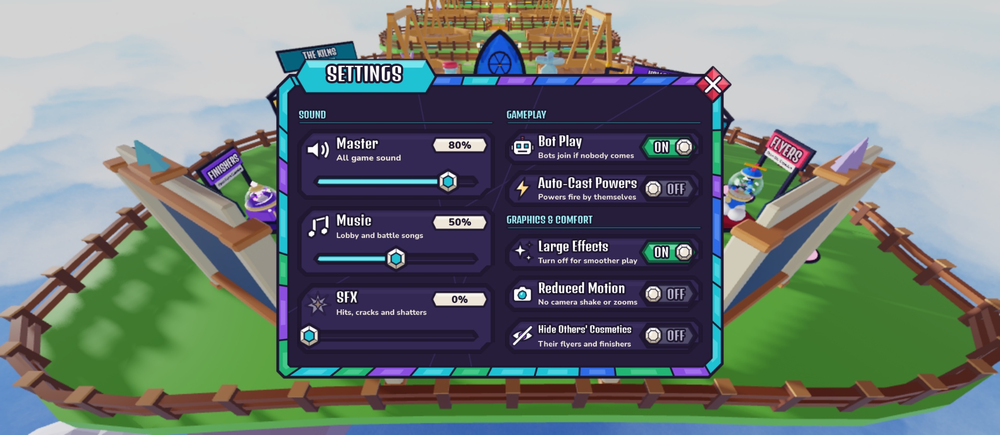
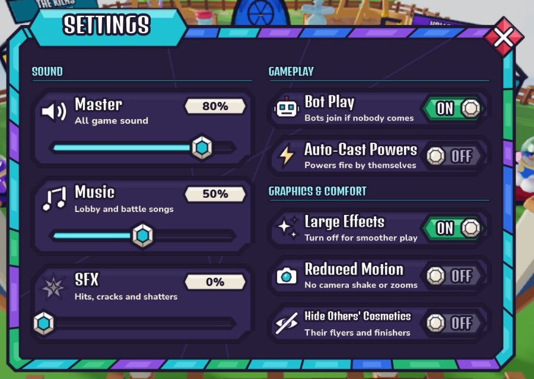
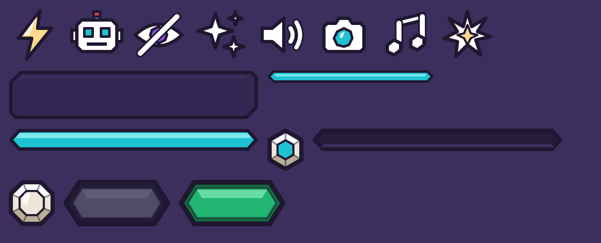

# SettingsScreen (top bar → Settings gear)

Design only (Oct 19): no controller, no remotes, no saved settings yet. A **compact** one-page Stained Glass window with no
scrolling: 0.54 of the screen width (Inventory is 0.7) at aspect 1260:860, so about the same height as Inventory but
narrower. Two columns: **Sound** on the left, **Gameplay** and **Graphics & Comfort** on the right. Accent colour **aqua**
(title banner, section headers, slider fill), kept apart from the amber reward screens and the amethyst Codes window.

Rebuild with `tools/studio/build_settings_screen.luau` (Studio Edit, lock held). It copies the old screen to
`ServerStorage.UIBackup_Topbar` (as `SettingsScreen_<UTC time>`), then replaces `StarterGui.SettingsScreen`. Title, banner and
close diamond are cloned from `CollectionScreen.Panel`, so they match Inventory's size and style.

The sample values show every state: sliders at 80%, 50% and 0% (muted), and toggles both ON (Bot Play, Large Effects) and
OFF (Auto-Cast Powers, Reduced Motion, Hide Others' Cosmetics).

## Element map

`SettingsScreen` (ScreenGui, `Enabled = false`, `TopbarScreen = true`, `CoreUISafeInsets`, DisplayOrder 20) → `Panel`
(aspect 1260:860, Scale only, no offsets anywhere).

| Name | Class | What it will do |
|---|---|---|
| `Panel.WindowArtwork` | ImageLabel | cool-jewel mosaic window (`window_settings`), Fit |
| `Panel.TitleBanner` / `Panel.Title` | ImageLabel / TextLabel | aqua `panel/title_aqua` banner, "SETTINGS" |
| `Panel.Close` | TextButton | close diamond; TopbarController already closes the screen with it |
| `Panel.Content` | Frame | inner pane; holds `Sections` and `Rows` |
| `Content.Sections.{Sound, Gameplay, Graphics}` | Frame | section headers: `Label` (Denk One, aqua light) and `Rule` (aqua came under it). Static |
| `Content.Rows.<Setting>` | Frame | one row per setting. Attributes `Setting` (= the row name) and `Kind` (`"Slider"` or `"Toggle"`) so a controller can loop over `Rows` |
| `<Row>.Plate` | ImageLabel | dark cut-glass row pane (Slice) |
| `<Row>.Icon` | ImageLabel | row icon (white glass, lead outline) |
| `<Row>.Label` / `<Row>.Helper` | TextLabel | name (Denk One) and one-line helper (Nunito ExtraBold, milk) |

### Slider rows: `Rows.Master`, `Rows.Music`, `Rows.SFX`

| Name | Class | What it will do |
|---|---|---|
| `<Row>.Value` | ImageLabel | milk plaque (`hud/label_plaque`) |
| `<Row>.Value.Text` | TextLabel | the readout, `math.round(v * 100) .. "%"` |
| `<Row>.Slider` | **TextButton** (transparent) | the hit area: tap anywhere or drag along it. Attribute `Value` (0..1) holds the current level |
| `<Row>.Slider.Track` | ImageLabel | dark groove (Slice). Fill and Knob are its children, so both use the value directly as Scale |
| `<Row>.Slider.Track.Fill` | ImageLabel | aqua fill: `Size = UDim2.fromScale(v, 1)`. Set `Visible = v > 0` (its pointed ends can't shrink to nothing) |
| `<Row>.Slider.Track.Knob` | ImageLabel | milk-and-aqua gem: `Position = UDim2.fromScale(v, 0.5)` (AnchorPoint 0.5, 0.5) |

Value from input: `v = math.clamp((input.Position.X - Track.AbsolutePosition.X) / Track.AbsoluteSize.X, 0, 1)`.
Muted look at 0%: `Icon.ImageTransparency = 0.55` (0 otherwise). Master scales all sound; Music and SFX scale their
SoundGroups under it.

### Toggle rows: `Rows.BotPlay`, `Rows.AutoCast`, `Rows.LargeEffects`, `Rows.ReducedMotion`, `Rows.HideCosmetics`

| Name | Class | What it will do |
|---|---|---|
| `<Row>.Toggle` | **TextButton** (transparent, aspect 128:56) | tap to flip. Attributes: `On` (bool, the state), `OnImage`, `OffImage`, `KnobOnX` (0.76), `KnobOffX` (0.24) |
| `<Row>.Toggle.Track` | ImageLabel | `OnImage` (lit emerald) or `OffImage` (dark slate) |
| `<Row>.Toggle.Knob` | ImageLabel | milk octagon: `Position.X = KnobOnX` or `KnobOffX` |
| `<Row>.Toggle.State` | TextLabel | `"ON"` (white, X 0.38) or `"OFF"` (slate light `#B7B3CC`, X 0.62), always on the side away from the knob |

Kid-readable on three cues at once: colour (green / grey), knob side (right / left) and the word ON / OFF. A short tween of the
knob X (`Theme.Motion.ButtonPress`-like, ~0.12 s) is enough motion.

| Row | Label | Helper | Meaning |
|---|---|---|---|
| `BotPlay` | Bot Play | Bots join if nobody comes | bots may fill your 1v1 when nobody else comes |
| `AutoCast` | Auto-Cast Powers | Powers fire by themselves | hides the CAST button; powers always fire on their own |
| `LargeEffects` | Large Effects | Turn off for smoother play | off = simpler effects for low-end devices |
| `ReducedMotion` | Reduced Motion | No camera shake or zooms | no camera shake, hit pauses or FOV punches |
| `HideCosmetics` | Hide Others' Cosmetics | Their flyers and finishers | hides other players' flyers and finisher shows |

The HUD's existing music toggle (top right) is untouched; the functional pass decides whether it stays as a shortcut to
`Music`.

## Assets

Generator: `tools/ui/settings_art.mjs` (SVG + 2× PNG into `assets/ui/screens/settings/`; renders with `@resvg/resvg-js` or
`sharp` from `NODE_PATH`). Uploaded to group 11116787 via `assets/ui/screens/settings/upload_list.json`
(record: `roblox_assets.json`). UIAssets keys: `screens/settings/<name>`; each ImageLabel's `AssetPath` attribute names its
key. These keys aren't in `StainedAssetSpecs`, so `StainedGlass.bindSlices` leaves the authored `SliceScale` alone.

| Key | PNG | Use |
|---|---|---|
| `window_settings` | 2520×1720 | window, Fit, aspect 1260:860 |
| `row_plate` | 600×120 | Slice `Rect(30, 24, 570, 96)`, SliceScale 0.6 |
| `section_rule` | 400×32 | Slice `Rect(18, 8, 382, 24)`, SliceScale 0.28 |
| `slider_track`, `slider_fill_aqua` | 600×56 | Slice `Rect(30, 12, 570, 44)`, SliceScale 0.45 |
| `slider_knob` | 88×104 | Fit, aspect 44:52 |
| `toggle_on`, `toggle_off` | 256×112 | Fit, aspect 128:56 |
| `toggle_knob` | 112×112 | Fit, aspect 1 |
| `icon_master`, `icon_music`, `icon_sfx`, `icon_bot`, `icon_autocast`, `icon_effects`, `icon_motion`, `icon_cosmetics` | 128×128 | Fit, aspect 1 |

Reused from the kit: `panel/title_aqua`, `hud/label_plaque`, `button/close_diamond`, `icon/close_x`.

## Not done yet

- Wiring (a SettingsController, saving to the profile, applying volumes/effects), by a later functional pass.
- Phone/tablet scaling pass: SliceScale values are tuned for a ~1080p-tall viewport, and text uses TextScaled with max sizes
  that TextFit (decision 97) will manage at runtime.
